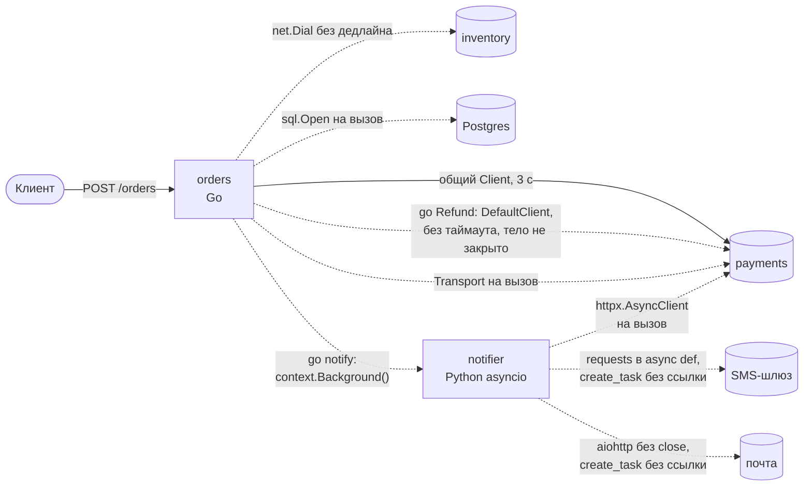
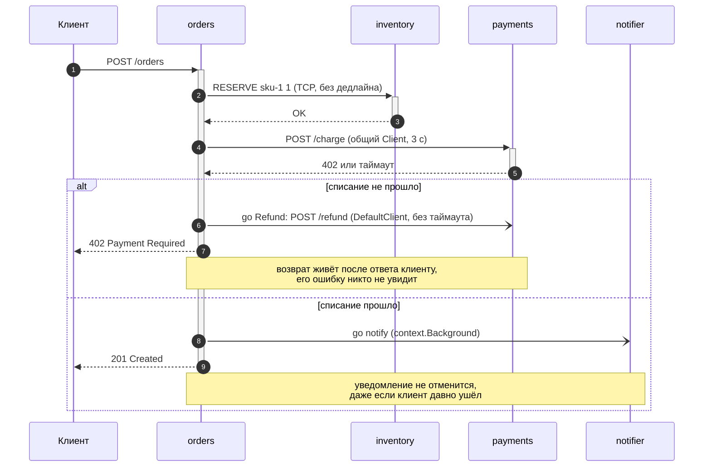
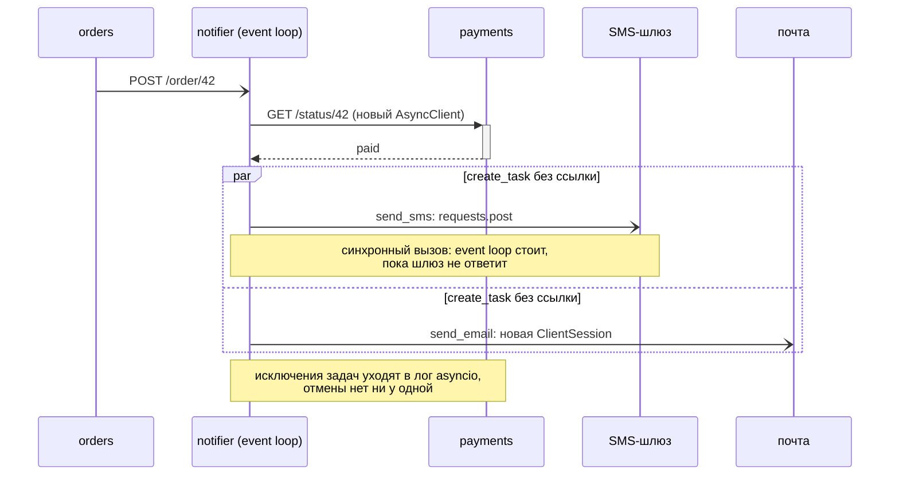
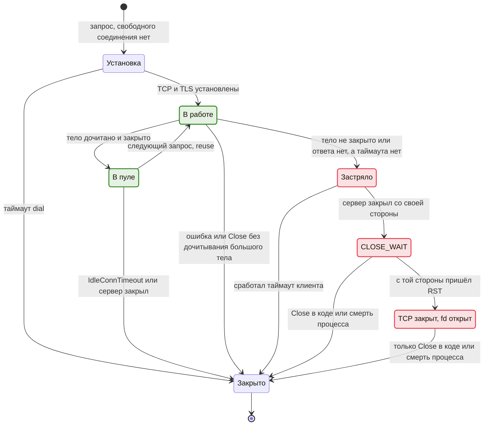

Привет, `%username%`! Одногруппник спросил меня, какими диаграммами лучше описывать взаимодействие сервисов с асинхронными функциями. Вопрос звучит как выбор нотации: UML или C4, sequence или activity, PlantUML или mermaid. Я задал встречный: что там за модель — события через очереди и pub/sub или потоки данных через конвейер? Ответ уложился в два слова: «Не знаю».

Контекст оказался такой: он разбирает код продукта своей команды, явной архитектуры в коде не видно, всё переплетено, а схемы, которые у него получаются, не объясняют, как система работает в рантайме. Через пару сообщений всплыла и настоящая цель. Удалённые вызовы в коде сделаны кто во что горазд — единого клиента нет, а за установленными подключениями потом никто не следит: жизненным циклом соединений не управляет никто.

Получается, диаграмма ему нужна не для того, чтобы повесить её в Confluence рядом с десятком других, которые никто не открывает. Ему нужно найти, где разработчики ошиблись, и картинка тут — всего лишь инструмент поиска.

Пока модель системы неизвестна, нотация вторична. Рисовать надо под конкретный вопрос: где соединение открылось и кто его закрывает. Ниже порядок работы: от инвентаризации вызовов до сверки с живым процессом. Показываю на синтетическом сервисе заказов и на лабе на Go и Python, где каждая утечка видна в выводе `lsof`, в счётчике соединений на сервере и в дампе горутин. Код лабы, синтетический сервис и скрипты замеров лежат в репозитории [lab-async-calls-connection-audit](https://github.com/jtprogru/lab-async-calls-connection-audit), там же команды, чтобы повторить всё на macOS, на Linux и в Docker.


Расскажи в [чате](/go/chat/?src=async-calls-connection-audit), какую утечку ты нашёл последней и сколько её искали. Анонсы новых постов выходят в [канале](/go/tg/?src=async-calls-connection-audit).


## Что ты унесёшь из статьи

Статья длинная (~74 000 знаков), заметная часть из них — код и его вывод. Сразу о том, что заберёт каждая роль:

- **Разработчик, которому достался чужой код.** Порядок разбора системы без документации: с какого уровня абстракции начинать, какие две диаграммы рисовать и как за полчаса найти все точки выхода в сеть через `rg`.
- **SRE и дежурный.** Как по состояниям TCP, числу дескрипторов и дампу горутин или задач понять, что сервис течёт, и найти зависимость, к которой копятся незакрытые соединения. Команды для Linux и macOS.
- **Тимлид и ревьюер.** Чек-лист аудита из восьми вопросов, таблицу «что ловят линтеры, а что нет» для Go и Python и [план](#что-сделать-завтра-утром) на ближайшую неделю.

## TL;DR (если читать дальше уже некогда)

- Не знаешь модель взаимодействия — не выбирай нотацию. Сначала реши, на каком уровне абстракции смотришь, и возьми карандаш.
- Для поиска утечек соединений нужны две диаграммы: sequence самого нагруженного сценария (кто кого ждёт и что переживает запрос) и state жизненного цикла соединения (где оно может застрять).
- Начинать надо с инвентаризации: сколькими способами код ходит в сеть. Почти всегда их больше, чем думает команда. В синтетическом примере к одному сервису ведут четыре клиента: у двух таймаута нет вовсе, у двух других он разный.
- Типовые утечки — пул на каждый вызов, незакрытое тело ответа, вызов без таймаута, fire-and-forget без отмены и синхронный вызов в асинхронном коде. Каждая видна в рантайме: `CLOSE_WAIT`, растущие дескрипторы, горутины в `persistConn.readLoop`, задачи без родителя.
- Линтеры ловят дешёвую половину. Пул HTTP или базы на каждый вызов и незакрытую сессию в Python не поймал ни один из тех, что я прогнал.
- Код показывает, как задумано, рантайм — как есть. Любой вывод из чтения кода проверяй на живом процессе.

## Вопрос про нотацию задают слишком рано

### Модель взаимодействия решает, что вообще рисовать

У каждой из трёх распространённых моделей взаимодействия своя естественная картинка, и рисовать одну в нотации другой — верный способ соврать самому себе.

**Запрос — ответ.** Сервис A зовёт B по HTTP или gRPC и ждёт. Здесь всё решают порядок вызовов и то, кто кого ждёт, поэтому естественная диаграмма — sequence.

**События.** A публикует событие в очередь или топик и ничего не ждёт. Кто его прочитает, когда и сколько раз, A не знает. Sequence тут начинает врать: у события нет ответа, а между публикацией и обработкой может пройти и миллисекунда, и час. Здесь нужен event flow: продюсеры, топики, консьюмеры и что каждый делает с сообщением.

**Поток данных.** Данные идут через конвейер шагов: извлечь, преобразовать, сложить. Важно, что откуда течёт и где меняет форму, и это DFD.

Мой встречный вопрос был как раз про это. А «не знаю» — нормальный ответ для первой недели в чужом коде: в спагетти обычно живут все три модели сразу. Синхронный вызов в платёжку соседствует с публикацией в Kafka и с фоновой задачей, которая раз в минуту что-то пересчитывает. Выбрать одну нотацию на всю систему в такой ситуации нельзя, и не нужно.

### Сначала уровень абстракции

Схема «не объясняет, как работает система» чаще всего потому, что на одном листе смешаны уровни: стрелка между двумя функциями соседствует со стрелкой между двумя дата-центрами. Прежде чем рисовать, реши, на каком уровне ты сейчас.

| Уровень | На какой вопрос отвечает | Чем рисовать | Типичная ошибка |
| --- | --- | --- | --- |
| Функции | что происходит внутри одного вызова: где открыли, где закрыли, что в error-ветке | sequence внутри процесса, иногда просто код с пометками на полях | утонуть в деталях до того, как понял общую картину |
| Модули приложения | какие части сервиса ходят наружу и каким способом | карта модулей с исходящими стрелками | считать сервис одним клиентом, хотя внутри их пять |
| Сервисы | кто с кем говорит, синхронно или через очередь | карта сервисов, sequence сценария | нарисовать задуманную архитектуру вместо реальной |
| Продукт целиком | какие внешние системы и пользователи участвуют | контекстная диаграмма | начать отсюда, когда задача — найти баг |

Это почти дословно уровни [модели C4](https://c4model.com/) Саймона Брауна: System Context, Container, Component, Code. Рисовать строго по C4 не обязательно, но словарь полезен: фраза «давай посмотрим на уровне контейнеров» сразу отсекает половину лишнего.

Для задачи «найти, где течёт» порядок такой: сначала модули и сервисы, чтобы понять, где копать, потом функции, чтобы найти конкретную строку. Продукт целиком подождёт.

### Карандаш раньше нотации

На этапе исследования лучший инструмент — карандаш и лист бумаги. Дело не в романтике. На бумаге ты не думаешь, правильный ли у стрелки наконечник, и перерисовываешь схему пять раз за двадцать минут — а в draw.io или PlantUML каждая перерисовка чего-то стоит, поэтому очень быстро перестаёшь перерисовывать и начинаешь украшать. Исследовательская схема — черновик, её выбрасывают. Аккуратную версию для документации рисуют потом, когда понятно, что именно она должна объяснять.

Схемы ниже нарисованы в mermaid: текст хорошо живёт в git и в блоге. Но начинать их стоит на листе A4, и тебе советую так же.

### Какая диаграмма на какой вопрос отвечает

| Вопрос | Диаграмма | Что видно | Чего не видно |
| --- | --- | --- | --- |
| Кто с кем говорит и каким способом | карта сервисов (C4 Container или Component) | узлы, связи, протоколы, клиенты | время, порядок, жизненный цикл соединения |
| В каком порядке идут вызовы и кто кого ждёт | sequence | sync и async, ожидания, работа, которая переживает запрос | сколько таких сценариев идёт параллельно |
| Где может застрять соединение | state | состояния и переходы, тупики без выхода | в какой строке кода это происходит |
| Куда текут события и данные | event flow или DFD | продюсеры, очереди, консьюмеры, трансформации | задержки, ретраи, порядок обработки |

Для поиска утечек соединений из этих четырёх хватает двух: sequence для сценариев и state для жизненного цикла соединения. Карта нужна как оглавление: по ней выбираешь, какие сценарии разбирать первыми.

## Сквозной кейс: сервис заказов

Дальше всё показываю на синтетическом примере. Он собран из типовых находок, а не из конкретного продукта, и маленький настолько, насколько возможно, чтобы проблемы не утонули в коде.

Сервис `orders` на Go принимает заказ. Он резервирует товар на складе `inventory` (самописный текстовый протокол поверх TCP, наследство), списывает деньги в `payments` по HTTP, при отказе отправляет возврат, читает статус заказа из Postgres и после успеха сообщает воркеру `notifier`. Воркер на Python с asyncio проверяет статус оплаты в том же `payments` и отправляет SMS и письмо через внешних провайдеров.

Каждый файл в этом примере будто писала другая команда в другой год — и спагетти так обычно и появляется: не от одного плохого разработчика, а от пяти хороших, которые ни разу не договорились, как ходить в сеть.

## Шаг 1. Инвентаризация точек выхода в сеть

Карту надо строить из фактов, а факты лежат в коде. Первый вопрос — сколькими способами этот код вообще ходит в сеть. Для Go хватает одного `rg`:

```bash
rg -n --type go \
  -e 'http\.(Get|Post|PostForm|Head)\(' -e 'http\.DefaultClient' \
  -e '&http\.(Client|Transport)\{' -e 'http\.NewRequest' \
  -e 'net\.Dial' -e 'sql\.Open\(' -e 'grpc\.(Dial|NewClient)\(' \
  -e '\bgo [a-zA-Z.]+\(' .
```

Последний шаблон к сети формально не относится: он ищет запуск горутин. Но горутина, которая ходит в сеть, — это асинхронный вызов, которому кто-то должен назначить таймаут и отмену. На синтетическом сервисе вывод такой:

```text
./internal/store/orders.go:7:	db, err := sql.Open("pgx", dsn)
./internal/inventory/reserve.go:11:	conn, err := net.Dial("tcp", "inventory.internal:7000")
./internal/checkout/refund.go:11:	resp, err := http.Post("http://payments.internal/refund", "application/json",
./internal/legacy/status.go:11:	c := &http.Client{Transport: &http.Transport{MaxIdleConns: 10}}
./internal/payments/client.go:14:var Client = &http.Client{Timeout: 3 * time.Second}
./internal/payments/client.go:17:	req, err := http.NewRequestWithContext(ctx, http.MethodPost, baseURL+"/charge",
./cmd/orders/main.go:20:		go checkout.Refund(id) // fire-and-forget: ошибку никто не увидит
./cmd/orders/main.go:24:	go notify(context.Background(), id) // отвязан от запроса намеренно?
./cmd/orders/main.go:29:	req, _ := http.NewRequestWithContext(ctx, http.MethodPost, "http://notifier.internal/order/"+id, nil)
./cmd/orders/main.go:30:	resp, err := http.DefaultClient.Do(req)
```

Для Python шаблоны другие, смысл тот же:

```bash
rg -n --type py \
  -e 'requests\.(get|post|put|patch|delete|request|Session)\(' \
  -e 'httpx\.(AsyncClient|Client|get|post)\(' -e 'aiohttp\.ClientSession\(' \
  -e 'asyncio\.(create_task|ensure_future)\(' -e 'open_connection\(' .
```

```text
./notifier/sms.py:7:    resp = requests.post(SMS_URL, json={"phone": phone, "text": text})
./notifier/email.py:5:    session = aiohttp.ClientSession()
./notifier/handlers.py:12:    asyncio.create_task(send_sms(event["phone"], "Заказ оплачен"))
./notifier/handlers.py:13:    asyncio.create_task(send_email(event["email"], "Заказ оплачен"))
./notifier/payments.py:5:    async with httpx.AsyncClient() as client:  # новый пул на каждый вызов
```

Пятнадцать строк. Сгруппируй их по адресату и способу, и картина сложится сама:

| Где | Куда | Чем | Что настораживает |
| --- | --- | --- | --- |
| `internal/payments/client.go` | payments | общий `http.Client` с `Timeout: 3s`, контекст запроса | ничего, это эталон |
| `internal/checkout/refund.go` | payments | `http.Post`, то есть `DefaultClient` | нет таймаута и контекста, тело ответа не закрыто |
| `internal/legacy/status.go` | payments | `&http.Transport{}` на каждый вызов | новый пул на вызов, `defer` до проверки ошибки |
| `notifier/payments.py` | payments | `httpx.AsyncClient` на каждый вызов | новый пул на вызов |
| `internal/inventory/reserve.go` | inventory | `net.Dial` | нет дедлайна, соединение не закрывается |
| `internal/store/orders.go` | Postgres | `sql.Open` на каждый вызов | новый пул к базе на каждый запрос |
| `cmd/orders/main.go` | payments, notifier | `go checkout.Refund(...)`, `go notify(context.Background(), ...)` | горутины без отмены, ошибка возврата теряется |
| `notifier/sms.py` | SMS-шлюз | `requests.post` внутри `async def` | блокирует event loop, нет таймаута |
| `notifier/email.py` | почтовый API | `aiohttp.ClientSession()` без закрытия | сессия и её соединения живут, пока их не соберёт GC |
| `notifier/handlers.py` | SMS, почта | `asyncio.create_task` без сохранённой ссылки | задача может пропасть, её ошибка до тебя не дойдёт |

В `payments` из одной системы ведут четыре разных клиента. Таймауты у них такие: 3 секунды, никакого, никакого и 5 секунд, которые httpx ставит по умолчанию. Когда `payments` начнёт тормозить, четыре части системы будут деградировать четырьмя разными способами, и на разборе инцидента это потом ищут очень долго: «клиент к платёжке у нас нормальный, с таймаутом» — и это правда про один файл из четырёх.

Всевидящим `rg` при этом не назовёшь:

- Он находит вызовы стандартных клиентов, но не обёртки. Если у команды есть своя `httpclient.New()`, ищи по её имени и смотри, что внутри.
- SDK облаков, платёжных систем и ORM ходят в сеть сами и прячут свой пул. Их ищут по импортам, например `rg -n '^(import|from) ' --type py | rg 'boto3|stripe|sqlalchemy'`.
- Конфиг — отличная перекрёстная проверка. Выпиши из манифестов, Helm values и `.env` все переменные с `_URL`, `_ADDR`, `_HOST`, `_DSN`. Адрес из конфига, которого нет в инвентаризации, означает, что ты пропустил способ.

## Шаг 2. Грубая карта на уровне сервисов

Из таблицы получается карта. Подписи на стрелках — не протокол, а способ: здесь важен именно он. Подозрительные связи нарисованы пунктиром.



Карта отвечает на вопрос «где копать». Копать надо там, где в одну точку сходится больше всего разных подписей. Здесь это `payments`: четыре входящих стрелки, четыре поведения при отказе. Вторая точка — `notifier`: почти все его исходящие вызовы асинхронные, и ни у одного нет хозяина.

## Шаг 3. Sequence самого нагруженного сценария

Сценарий для разбора выбирай по двум признакам: он нагружен, и в нём есть ветка ошибки. Счастливый путь обычно оттестирован, утечки живут в error-ветках. В нашем случае это создание заказа, когда списание не прошло.



Без нотации стрелок такая схема не читается, поэтому сначала про неё. В UML синхронный вызов — сплошная линия с закрашенным наконечником, асинхронный — сплошная линия с открытым наконечником, ответ — пунктир. В mermaid это `->>` для синхронного вызова, `-->>` для ответа и `-)` для асинхронного: у последнего наконечник открытый, как в UML.

Плюс и минус после стрелки управляют полосами активации. Это узкие прямоугольники на вертикальной линии участника, и каждый показывает, сколько времени участник занят чужим вызовом. `->>+` открывает полосу у того, кого вызвали, а `-->>-` закрывает её у того, кто ответил. На схеме выше полоса `inventory` тянется от `RESERVE` до `OK`, полоса `payments` от `/charge` до 402, а полоса `orders` проходит через весь запрос клиента: всё это время `orders` держит входящее соединение и ждёт ответов от соседей. У асинхронных стрелок `-)` плюса нет, и полоса для них не открывается, потому что окончания этой работы никто не ждёт. Поэтому плюсы и минусы стоит расставлять аккуратно: работа, у которой на схеме нет полосы, это работа без хозяина.

Дальше смотришь на одно: что начинается открытой стрелкой и заканчивается ниже ответа клиенту. Такая работа переживает запрос, и здесь её две — возврат и уведомление. Потом к каждой стрелке задаёшь четыре вопроса:

1. Для сплошной стрелки: какой у неё таймаут и где он записан? Нет ответа — это находка.
2. Для открытой: кто её отменит и куда денется ошибка?
3. Что живёт ниже ответа клиенту, и сколько таких хвостов накопится при 500 RPS?
4. Есть ли на стрелке ретраи, и открывает ли каждая попытка новое соединение?

Ответы на них дают три находки, и для этого не нужно открывать ни одного файла глубже инвентаризации. У `RESERVE` нет дедлайна: если склад зависнет, `orders` будет ждать вечно, держа горутину и сокет, хотя клиент давно получил таймаут от балансировщика. Возврат идёт без таймаута, с незакрытым телом, и его ошибка теряется: деньги не вернулись, и первым об этом узнает клиент — из банковской выписки. Уведомление отвязано от запроса через `context.Background()`. Иногда так и задумано: уведомление должно уйти, даже если клиент закрыл вкладку. Но тогда у фоновой работы должны быть свой таймаут и своя политика повторов, а не «вечно».

У воркера `notifier` своя картина, и она хорошо показывает, как sequence выглядит для asyncio:



Блок `par` тут с подвохом. Задачи запущены параллельно, но одна из них синхронно ждёт SMS-шлюз и на это время останавливает весь event loop. На схеме это видно сразу, а в коде прячется за словом `async`.

## Шаг 4. State: жизненный цикл соединения

Sequence показывает, кто кого ждёт. Утечка же — история одного соединения, и её удобнее рисовать state-диаграммой: какие у соединения бывают состояния и из каких нет выхода.



Здоровое соединение живёт в цикле «в работе — в пуле», на схеме эти два состояния зелёные. Уходит оно в «закрыто» по таймауту простоя или по ошибке. Утечка — это «застряло» и всё, что ниже него, и эти состояния красные. Туда попадают, когда никто не закрыл тело ответа или ответа нет вовсе, а таймаут не задан. Выходов из «застряло» два: таймаут клиента или `CLOSE_WAIT`, когда сдаётся сервер. Из `CLOSE_WAIT` соединение по-настоящему выводит только `Close` в коде. Ядро может перевести такой сокет в `CLOSED`, если с той стороны придёт RST, но дескриптор останется открытым, и утечка просто перестанет быть видна по состоянию TCP. В лабе ниже это видно вживую.

Нижняя половина этой схемы уже про TCP, и её стоит держать в голове, когда смотришь вывод `ss`:

| Состояние TCP | На чьей стороне | Что значит | Когда тревожиться |
| --- | --- | --- | --- |
| `ESTABLISHED` | обе | соединение живо | число растёт, а нагрузка нет |
| `CLOSE_WAIT` | у той стороны, что получила FIN | удалённая сторона закрыла, наше приложение — нет | всегда: это баг в нашем коде, таймера у этого состояния нет |
| `FIN_WAIT_2` | у той, что закрыла первой | ждём, когда закроет другая сторона | много — значит, у соседа `CLOSE_WAIT` |
| `TIME_WAIT` | у той, что закрыла первой | соединение закрыто, ядро ещё держит пару адресов: по RFC это 2×MSL, то есть четыре минуты, а Linux держит фиксированные 60 секунд | десятки тысяч — соединения не переиспользуются, и эфемерные порты могут кончиться |

Про `TIME_WAIT` живёт популярный миф: будто его укорачивает `net.ipv4.tcp_fin_timeout`. Не укорачивает. По [описанию в документации ядра](https://github.com/torvalds/linux/blob/v7.3/Documentation/networking/ip-sysctl.rst#L534-L544) этот параметр отвечает за осиротевший `FIN_WAIT_2`, то есть за соединение, которое приложение уже закрыло и забыло, а другая сторона ещё нет. Читает его функция [`tcp_fin_time()`](https://github.com/torvalds/linux/blob/v7.3/include/net/tcp.h#L1891-L1901). А 60 секунд `TIME_WAIT` в ванильном ядре зашиты константой [`TCP_TIMEWAIT_LEN`](https://github.com/torvalds/linux/blob/v7.3/include/net/tcp.h#L140-L147), и при переходе в `TIME_WAIT` таймер [ставится именно на неё](https://github.com/torvalds/linux/blob/v7.3/net/ipv4/tcp_minisocks.c#L373-L383), sysctl там не участвует. Я проверил на ядре 7.0: с `tcp_fin_timeout=10` осиротевший `FIN_WAIT_2` прожил 10–12 секунд, а `TIME_WAIT` как жил свою минуту, так и прожил. Лечится `TIME_WAIT` не крутилками ядра, а переиспользованием соединений.

## Лаборатория: как выглядит каждая утечка

Чтобы не верить на слово ни мне, ни документации, я собрал маленькую лабу. Весь её код лежит в [репозитории лабы](https://github.com/jtprogru/lab-async-calls-connection-audit), а в README для каждого раздела ниже есть своя команда запуска. Тестовый сервер `target` на Go умеет четыре вещи: `/ok` отдаёт три байта, `/big` — мегабайт, `/slow?ms=N` отвечает через N миллисекунд, а `/hang` не отвечает вовсе, пока клиент не уйдёт. Сервер считает принятые соединения через хук `ConnState`, а статистику отдаёт на отдельном порту, чтобы служебные запросы не портили счёт:

```go
srv := &http.Server{Addr: *addr, Handler: mux, IdleTimeout: *idle,
	ConnState: func(c net.Conn, s http.ConnState) {
		switch s {
		case http.StateNew:
			accepted.Add(1)
			active.Add(1)
		case http.StateClosed, http.StateHijacked:
			active.Add(-1)
		}
	}}
```

Сокеты клиента считаю через `lsof -nP -a -p <pid> -iTCP:18080`, горутины — через `runtime.NumGoroutine()`, переиспользование соединений — через `httptrace`:

```go
ctx = httptrace.WithClientTrace(ctx, &httptrace.ClientTrace{
	GotConn: func(i httptrace.GotConnInfo) {
		if i.Reused {
			reused++
		} else {
			fresh++
		}
	},
})
```

Основной прогон на macOS: Go 1.27.3, Python 3.14.6, httpx 0.28.1, requests 2.34.2. Весь набор я повторил на Ubuntu 26.04 с ядром 7.0 и в Docker Desktop. Числа совпали, а там, где Linux ведёт себя иначе, это сказано по месту. Сырые выводы всех трёх сред лежат в каталоге `results/` репозитория, а снаружи процесса на Linux те же сокеты покажет `ss`, команды в шаге 5. Абсолютные числа на твоей машине будут другими, порядок величин — тот же.

### Go: новый Transport на каждый вызов

```go
// антипаттерн: свой Transport внутри функции
for i := 0; i < n; i++ {
	c := &http.Client{Transport: &http.Transport{}, Timeout: 5 * time.Second}
	resp, err := c.Get(base + "/ok")
	if err != nil {
		return err
	}
	io.Copy(io.Discard, resp.Body)
	resp.Body.Close()
}
```

Тело дочитано и закрыто, всё по учебнику. Для сравнения рядом ещё два варианта: новый `http.Client` на каждый вызов, но без своего `Transport`, и один общий клиент на всё. По 50 вызовов каждый:

```text
transport-per-call     сервер принял соединений: 50, переиспользовано: 0, новых: 50
                       сокеты клиента: ESTABLISHED=50; горутин: 103
client-per-call        сервер принял соединений: 1, переиспользовано: 49, новых: 1
                       сокеты клиента: ESTABLISHED=1; горутин: 5
shared                 сервер принял соединений: 1, переиспользовано: 49, новых: 1
                       сокеты клиента: ESTABLISHED=1; горутин: 5
```

Пятьдесят вызовов дали пятьдесят соединений, и все пятьдесят остались открытыми. А второй вариант, который выглядит как тот же антипаттерн, оказался безвредным. Причина в том, где в Go живёт пул: в `Transport`, а `http.Client` — тонкая обёртка над ним, поэтому новый `http.Client` без своего `Transport` берёт `DefaultTransport` и спокойно переиспользует его соединения. Так что «клиент на каждый запрос» в Go безобиден ровно до тех пор, пока кто-нибудь не положит `&http.Transport{}` внутрь функции.

Брошенный `Transport` свои простаивающие соединения не закрывает: каждое держит сокет и две горутины, на чтение и на запись, — отсюда 103 горутины на 50 соединений. Хуже того, нулевой `Transport` теряет все настройки `DefaultTransport`: таймаут установки соединения в 30 секунд, таймаут TLS в 10 секунд, прокси из окружения и `IdleConnTimeout` в 90 секунд. Нулевой `IdleConnTimeout` означает «без ограничения», поэтому клиент сам эти соединения не закроет никогда — только сервер со своей стороны. Если отдельный `Transport` действительно нужен, его клонируют один раз при старте:

```go
t := http.DefaultTransport.(*http.Transport).Clone()
t.MaxIdleConnsPerHost = 32
paymentsClient := &http.Client{Transport: t, Timeout: 3 * time.Second}
```

В дампе горутин эта утечка выглядит характерно:

```text
goroutine profile: total 103
51 @ ...
#	0x1028dcf07	net/http.(*persistConn).Read+0x47		net/http/transport.go:2300
#	0x1028ddacf	net/http.(*persistConn).readLoop+0x11f		net/http/transport.go:2493
51 @ ...
#	0x1028def77	net/http.(*persistConn).writeLoop+0x97	net/http/transport.go:2833
```

Пятьдесят одна пара: пятьдесят брошенных соединений и одно служебное, к порту статистики. В проде тот же дамп отдаёт `/debug/pprof/goroutine?debug=1`, если подключён `net/http/pprof`. Число горутин в `persistConn.readLoop` примерно равно числу живых клиентских HTTP/1-соединений процесса. Растёт со временем, а не с нагрузкой, — это оно.

### Go: тело ответа не закрыто

```go
for i := 0; i < n; i++ {
	resp, err := c.Get(base + "/ok")
	if err != nil {
		return err
	}
	_ = resp // ни чтения, ни Close
}
```

Сервер запущен с `IdleTimeout: 2s`. Двадцать запросов, потом смотрим на сокеты через 3, 6 и 30 секунд. Клиентов два: с `Client.Timeout` в 5 секунд и `http.DefaultClient` без таймаута.

```text
# Client.Timeout = 5s
no-close               сервер принял соединений: 20, переиспользовано: 0, новых: 20
                       сокеты клиента: ESTABLISHED=20; горутин: 43
  +3s                  сервер принял соединений: 20, переиспользовано: 0, новых: 20
                       сокеты клиента: CLOSE_WAIT=20; горутин: 43
  +6s                  сервер принял соединений: 20, переиспользовано: 0, новых: 20
                       сокеты клиента: нет; горутин: 3

# http.DefaultClient
no-close-default       сервер принял соединений: 20, переиспользовано: 0, новых: 20
                       сокеты клиента: ESTABLISHED=20; горутин: 43
  +3s                  сервер принял соединений: 20, переиспользовано: 0, новых: 20
                       сокеты клиента: CLOSE_WAIT=20; горутин: 43
  +6s                  сервер принял соединений: 20, переиспользовано: 0, новых: 20
                       сокеты клиента: CLOSE_WAIT=20; горутин: 43
  +30s                 сервер принял соединений: 20, переиспользовано: 0, новых: 20
                       сокеты клиента: CLOSE_WAIT=20; горутин: 43
```

Каждый запрос берёт новое соединение: предыдущее всё ещё занято, потому что никто не сказал, что с ним закончили. Через две секунды сервер считает их простаивающими и закрывает со своей стороны. Клиент получает FIN, ядро переводит сокет в `CLOSE_WAIT` и ждёт, пока приложение вызовет `Close`. С `DefaultClient` это навсегда: через 30 секунд те же двадцать `CLOSE_WAIT` и сорок лишних горутин, а в проде — до рестарта процесса.

Навсегда — но не в одном и том же виде. Я оставил тот же прогон на четыре минуты:

```text
  +1m30s               сервер принял соединений: 20, переиспользовано: 0, новых: 20
                       сокеты клиента: CLOSED=20; горутин: 43
  +4m0s                сервер принял соединений: 20, переиспользовано: 0, новых: 20
                       сокеты клиента: CLOSED=20; горутин: 43
```

На 62-й секунде все двадцать сокетов разом ушли из `CLOSE_WAIT` в `CLOSED`, а `lsof` по процессу показал двадцать открытых дескрипторов `IPv4 (CLOSED)`. Горутин по-прежнему 43. Это две секунды `IdleTimeout` плюс 60: на стороне сервера истёк осиротевший `FIN_WAIT_2` (на macOS его держит `net.inet.tcp.fin_timeout`, 60 секунд), и ядро сервера прислало клиенту RST. Keepalive клиента на macOS ни при чём: с отключённым keepalive картина та же, а с `IdleTimeout` в 10 секунд переход сдвигается на 70-ю секунду.

На Linux механика другая, я проверил её на Ubuntu 26.04 с ядром 7.0. Осиротевший `FIN_WAIT_2` сервера ядро сразу превращает в облегчённый timewait-сокет, и в `ss` он виден как `FIN-WAIT-2` с таймером `timewait`. Живёт он те же 60 секунд `tcp_fin_timeout`, но умирает молча, без RST, а пока жив, сам [отвечает ACK](https://github.com/torvalds/linux/blob/v7.3/net/ipv4/tcp_minisocks.c#L132-L184) на keepalive-пробы клиента. RST клиент получает от ядра сервера только на первую пробу после его смерти. Так это выглядит в tcpdump для одного соединения из прогона с `DefaultClient` (опции TCP вырезаны):

```text
12:41:03.959096 IP 127.0.0.1.54132 > 127.0.0.1.28080: Flags [P.], seq 1:99, ack 1
12:41:05.961357 IP 127.0.0.1.28080 > 127.0.0.1.54132: Flags [F.], seq 120, ack 99
12:41:06.001593 IP 127.0.0.1.54132 > 127.0.0.1.28080: Flags [.], ack 121
12:41:35.985653 IP 127.0.0.1.54132 > 127.0.0.1.28080: Flags [.], ack 121
12:41:35.985656 IP 127.0.0.1.28080 > 127.0.0.1.54132: Flags [.], ack 99
12:42:06.193653 IP 127.0.0.1.54132 > 127.0.0.1.28080: Flags [.], ack 121
12:42:06.193682 IP 127.0.0.1.28080 > 127.0.0.1.54132: Flags [.], ack 99
12:42:36.401674 IP 127.0.0.1.54132 > 127.0.0.1.28080: Flags [.], ack 121
12:42:36.401688 IP 127.0.0.1.28080 > 127.0.0.1.54132: Flags [R], seq 351603888, win 0, length 0
```

Запрос ушёл в 12:41:03, через две секунды сервер прислал FIN, и клиентский сокет встал в `CLOSE_WAIT`. Дальше раз в 30 секунд клиент шлёт keepalive-пробу. Проба в 12:42:06 пришла через 60,2 секунды после FIN, но сокет сервера ещё доживал последние миллисекунды и ответил ACK. Следующая проба получила RST. Выходит, на Linux момент перехода задаёт keepalive клиента:

| Клиент | Keepalive-пробы | `CLOSE_WAIT` → `CLOSED` после запроса |
| --- | --- | --- |
| `http.DefaultClient` | раз в 30 секунд | через 92 секунды |
| свой `Transport` с `net.Dialer{}` | раз в 15 секунд, это умолчание Go | через 79 секунд |
| `net.Dialer{KeepAlive: 10 * time.Second}` | первая через 10 секунд, дальше раз в 15 | через 73 секунды |
| `net.Dialer{KeepAlive: -1}` | нет | никогда: `CLOSE_WAIT`, пока жив процесс |

Это типичные значения, и у них есть подвох. Периоды проб 30, 15 и 10 секунд делят 60 нацело, поэтому одна из проб приходится почти на момент смерти серверного сокета. Таймеры ядра немного плывут, и если проба опоздала на долю секунды, RST приходит сразу, на 62–63-й секунде, как на macOS. В моих прогонах так вышло один раз из шести с `DefaultClient` и три раза из восьми с 15-секундными пробами.

Ядро свою часть сделало и закрыло TCP-соединение, но дескриптор принадлежит приложению, и закрыть его может только `Close`. Утечка никуда не делась — она перестала быть видна по состоянию TCP. На Linux после RST процесс держит те же двадцать дескрипторов и те же горутины, а сам сокет пропадает и из `ss -a`, и из `lsof -iTCP`. Счётчик `CLOSE_WAIT` поэтому даёт только нижнюю границу, а надёжнее считать дескрипторы и горутины.

С `Client.Timeout` картина другая, и это ловушка. [Документация](https://pkg.go.dev/net/http#Client.Timeout) об этом предупреждает: таймер этого таймаута «remains running after Get, Head, Post, or Do return and will interrupt reading of the Response.Body». На пятой секунде таймер прибил все утёкшие соединения. Выходит, таймаут маскирует утечку — на графике вместо лестницы получается пила, но до срабатывания таймера каждое такое соединение всё равно занимает слот пула и дескриптор. При 500 RPS и пятисекундном таймауте это порядка 2 500 соединений, висящих постоянно.

### Go: закрыть ещё не значит дочитать

Три варианта по 50 запросов: тело дочитано до EOF, но `Close` не вызван; `Close` вызван без чтения на трёхбайтовом ответе; то же самое на мегабайтном.

```text
read-no-close          сервер принял соединений: 1, переиспользовано: 49, новых: 1
                       сокеты клиента: ESTABLISHED=1; горутин: 5
close-no-read          сервер принял соединений: 1, переиспользовано: 49, новых: 1
                       сокеты клиента: ESTABLISHED=1; горутин: 5
close-no-read-big      сервер принял соединений: 50, переиспользовано: 0, новых: 50
                       сокеты клиента: нет; горутин: 3
```

[Документация `Client.Do`](https://pkg.go.dev/net/http#Client.Do) формулирует правило так: «If the Body is not both read to EOF and closed, the Client's underlying RoundTripper (typically Transport) may not be able to re-use a persistent TCP connection». И сразу оговаривается, что Transport сам пытается дочитать тело после `Close` «up to a conservative limit». В [исходниках Go 1.27.3](https://github.com/golang/go/blob/go1.27.3/src/net/http/transport.go#L2417-L2425) этот предел выглядит так:

```go
const maxPostCloseReadBytes = 256 << 10
const maxPostCloseReadTime = 50 * time.Millisecond
```

После `Close` Transport дочитывает до 256 КиБ и тратит на это не больше 50 мс. Три байта влезают, и соединение возвращается в пул. Мегабайт не влезает, и соединение закрывается вместо возврата. Утечки нет, все сокеты закрыты, но каждый запрос теперь — новое TCP-рукопожатие, а в проде ещё и TLS. Зато `TIME_WAIT` не копится. Клиент закрывает сокет, в котором остались непрочитанные данные, и ядро вместо вежливого FIN [шлёт RST](https://github.com/torvalds/linux/blob/v7.3/net/ipv4/tcp.c#L3173-L3186). На Linux я пересчитал пакеты: 50 запросов, 50 RST, ни одного FIN и ни одного `TIME_WAIT` ни на одной стороне. Дочитывание появилось в Go 1.27 ([CL 737720](https://go-review.googlesource.com/c/go/+/737720)) и работает только для HTTP/1 с keep-alive, когда длина тела не больше 256 КиБ или неизвестна. До 1.27 Transport при `Close` тело не дочитывал, и недочитанный ответ любого размера стоил соединения, так что на своей версии прогони тот же тест.

Вариант «дочитал, но не закрыл» сработал случайно: соединение вернулось в пул на EOF. Документация такого не обещает, поэтому правило остаётся простым: `defer resp.Body.Close()` сразу после проверки ошибки, всегда. Если тело может быть большим, а оно тебе не нужно, решай явно: либо дочитать с пределом через `io.Copy(io.Discard, io.LimitReader(resp.Body, 1<<20))`, либо смириться с потерей соединения.

### Go: вызов без таймаута

```go
for i := 0; i < 5; i++ {
	go func() {
		resp, err := http.Get(base + "/hang") // DefaultClient: таймаута нет
		if err == nil {
			resp.Body.Close()
		}
	}()
}
```

```text
через ~ 1 с: висит запросов на сервере: 5, сокеты клиента: ESTABLISHED=5, горутин: 18
через ~ 5 с: висит запросов на сервере: 5, сокеты клиента: ESTABLISHED=5, горутин: 18
через ~30 с: висит запросов на сервере: 5, сокеты клиента: ESTABLISHED=5, горутин: 18
```

Ничего не меняется и не изменится. У `DefaultClient` `Timeout` нулевой, а [документация](https://pkg.go.dev/net/http#Client.Timeout) на этот счёт коротка: «A Timeout of zero means no timeout». `DefaultTransport` ограничивает установку соединения 30 секундами и TLS 10 секундами, но если сервер соединение принял и молчит, ждать можно бесконечно. В нашем кейсе это `go checkout.Refund(id)` в тот момент, когда `payments` подвис: каждое неудачное списание оставляет горутину и сокет навсегда.

Ограничить это можно четырьмя способами, и в логах они выглядят по-разному:

```text
Client.Timeout:           Get "http://127.0.0.1:18080/hang": context deadline exceeded (Client.Timeout exceeded while awaiting headers)
context.WithTimeout:      Get "http://127.0.0.1:18080/hang": context deadline exceeded
ResponseHeaderTimeout:    Get "http://127.0.0.1:18080/hang": net/http: timeout awaiting response headers
dial в никуда:            Get "http://10.255.255.1:81/": context deadline exceeded (Client.Timeout exceeded while awaiting headers)
висит запросов на сервере: 0
```

Две вещи в этом выводе важнее самих сообщений. Последняя строка: после таймаутов на клиенте освободился и сервер. Отменяя запрос, Go закрывает соединение, и обработчик на сервере получает отмену контекста. Таймаут на клиенте защищает и соседа. Четвёртая строка: адрес, до которого не дойти, а сообщение всё равно говорит «while awaiting headers», хотя соединение даже не установилось. Запомни это: «awaiting headers» в сообщении `Client.Timeout` не означает, что сервер получил запрос. В следующем разделе эта же строка отправит дежурного не к той команде.

| Настройка | Что ограничивает | В `DefaultTransport` и `DefaultClient` |
| --- | --- | --- |
| `net.Dialer.Timeout` | установку TCP-соединения | 30 с |
| `Transport.TLSHandshakeTimeout` | TLS-рукопожатие | 10 с |
| `Transport.ResponseHeaderTimeout` | время от отправки запроса до заголовков ответа | нет |
| `Transport.IdleConnTimeout` | сколько соединение может лежать в пуле без дела | 90 с |
| `Client.Timeout` | весь вызов, включая чтение тела | нет |
| дедлайн контекста | весь вызов, и отменяется вместе с родительским запросом | нет |

На практике внешний предел — дедлайн контекста от входящего запроса (он заодно даёт отмену) или `Client.Timeout`. Внутренние — dial, TLS и `ResponseHeaderTimeout`, чтобы медленный ответ отличался в логах от недоступного хоста. Подробный разбор того, какой таймаут что покрывает, написал Филиппо Вальсорда в блоге Cloudflare: [The complete guide to Go net/http timeouts](https://blog.cloudflare.com/the-complete-guide-to-golang-net-http-timeouts/). Статья 2016 года, поэтому сверяй её с документацией своей версии Go.

### Go: пул кончился, а ошибка показывает не туда

```go
t := http.DefaultTransport.(*http.Transport).Clone()
t.MaxConnsPerHost = 3
c := &http.Client{Transport: t, Timeout: 2 * time.Second}
for i := 0; i < 3; i++ {
	c.Get(base + "/ok") // тело не закрыто: соединение занято
}
_, err := c.Get(base + "/ok")
```

```text
четвёртый запрос через 2.0 с: Get "http://127.0.0.1:18080/ok": context deadline exceeded (Client.Timeout exceeded while awaiting headers)
сервер обслужил запросов: 3
```

По-моему, это самая подлая находка всей лабы. Сообщение говорит, что клиент ждал заголовков, а сервер при этом обслужил три запроса: четвёртый до него не дошёл и две секунды простоял в нашей собственной очереди за свободным соединением. Дежурный читает «timeout awaiting headers from payments» и идёт к команде `payments`, а у тех графики чистые — запроса-то не было. Без `Client.Timeout` тот же четвёртый запрос просто висит:

```text
четвёртый запрос висит уже 10 с и будет висеть дальше
```

По умолчанию `MaxConnsPerHost` равен нулю, то есть лимита нет, и пул сам по себе не кончается. Кончаются дескрипторы, и тогда `too many open files` вылезает совсем в другом месте: на приёме входящих соединений или при открытии файла. Есть и обратная ловушка: [`DefaultMaxIdleConnsPerHost`](https://pkg.go.dev/net/http#DefaultMaxIdleConnsPerHost) равен 2, то есть в пуле на каждый хост остаются максимум два простаивающих соединения. Всего два. При 50 параллельных запросах к одному хосту 48 соединений закрываются после каждого всплеска и заново открываются на следующем. Это не утечка, но лишние рукопожатия и `TIME_WAIT`, поэтому для нагруженной зависимости `MaxIdleConnsPerHost` задают явно.

Для sequence-схемы вывод неприятный. Стрелка «POST /charge, 3 с» в реальности может оказаться «2,9 секунды в своём пуле плюс 0,1 секунды в `payments`». В трейсах это выглядит как длинный клиентский спан, под которым нет серверного.

### Python: клиент на каждый вызов

А вот в httpx пул живёт в самом клиенте. Новый клиент — новый пул, новый пул — новое соединение.

```python
for _ in range(n):
    async with httpx.AsyncClient() as client:  # новый пул на каждый вызов
        (await client.get(BASE + "/ok")).raise_for_status()
```

```text
client-per-call      сервер принял соединений: 50, сокеты клиента: нет
shared               сервер принял соединений: 1, сокеты клиента: ESTABLISHED=1
```

Утечки нет, `async with` всё закрыл, но вместо одного рукопожатия их пятьдесят — а с TLS каждое стоит ещё одного-двух round trip и процессорного времени на обеих сторонах. В aiohttp то же самое, и [его документация](https://docs.aiohttp.org/en/stable/client_quickstart.html#make-a-request) говорит об этом без обиняков: «Don’t create a session per request. Most likely you need a session per application».

Теперь тот же цикл, но без `async with`:

```python
for _ in range(n):
    client = httpx.AsyncClient()  # aclose() никто не вызовет
    (await client.get(BASE + "/ok")).raise_for_status()
```

```text
client-unclosed      сервер принял соединений: 20, сокеты клиента: ESTABLISHED=20
  после gc.collect() сервер принял соединений: 20, сокеты клиента: ESTABLISHED=1
```

Двадцать соединений прожили до сборки мусора: в моём коротком прогоне до явного `gc.collect()`, а в живом сервисе до случайного прохода сборщика, так что число открытых сокетов будет плавать. После `gc.collect()` осталось одно — то, на которое всё ещё ссылается переменная `client`. Когда сборщик освобождает транспорты, Python предупреждает: двадцать строк `ResourceWarning: unclosed transport <_SelectorSocketTransport fd=9 ...>`. Только по умолчанию `ResourceWarning` не показывается, я увидел их лишь с `-W always`. Поэтому тесты и стенд стоит гонять с `python -X dev` или `-W always::ResourceWarning`, чтобы эти строки хотя бы попадали в лог. Голый `python -W error` упавшей программы из них не сделает: предупреждение рождается в финализаторе, исключение оттуда не всплывает, и Python печатает «Exception ignored…» и работает дальше. А вот pytest такие проглоченные исключения перехватывает: под `-W error::ResourceWarning -W error::pytest.PytestUnraisableExceptionWarning` прогон с утёкшим клиентом становится красным, если сборщик успел пройти до конца теста. Надёжнее позвать `gc.collect()` в фикстуре: тогда находка всплывёт гарантированно, и pytest запишет её как ERROR на этапе teardown этого теста.

### Python: незакрытый стрим и честный PoolTimeout

```python
limits = httpx.Limits(max_connections=3)
timeout = httpx.Timeout(5.0, pool=2.0)
async with httpx.AsyncClient(limits=limits, timeout=timeout) as client:
    for _ in range(3):
        req = client.build_request("GET", BASE + "/ok")
        await client.send(req, stream=True)  # ответ не закрыт: соединение занято
    await client.get(BASE + "/ok")
```

```text
четвёртый запрос через 2.0 с: httpx.PoolTimeout: PoolTimeout('')
сервер обслужил запросов: 3
```

Ситуация та же, что в Go, но ошибка честная: `PoolTimeout` прямо говорит, что виноват пул, а не сервер. Дефолты у httpx такие: `max_connections=100`, `max_keepalive_connections=20` и 5 секунд на каждую фазу — connect, read, write и ожидание пула. В проде ты увидишь это на сто первом незакрытом стриме, через пять секунд. Лечится через `async with client.stream("GET", url) as resp:` или `await resp.aclose()` в `finally`. Только учти: закрытый, но не дочитанный стрим место в пуле освобождает, а само соединение httpx закрывает, и следующий запрос снова платит за рукопожатие. Как и в Go, закрыть ещё не значит дочитать.

### Python: fire-and-forget

```python
async def send_receipt(order_id: int) -> None:
    await asyncio.sleep(0.1)
    raise RuntimeError(f"SMS-провайдер ответил 503 для заказа {order_id}")


async def create_order(order_id: int) -> str:
    asyncio.create_task(send_receipt(order_id))  # fire-and-forget
    return "201 Created"
```

```text
[ 0.0 с] handler вернул: 201 Created
Task exception was never retrieved
future: <Task finished name='Task-2' coro=<send_receipt() done, defined at pylab.py:85> exception=RuntimeError('SMS-провайдер ответил 503 для заказа 42')>
Traceback (most recent call last):
  File "pylab.py", line 87, in send_receipt
    raise RuntimeError(f"SMS-провайдер ответил 503 для заказа {order_id}")
RuntimeError: SMS-провайдер ответил 503 для заказа 42
[ 1.0 с] ждём ещё секунду, ошибки никто не видел
[ 2.0 с] конец
```

Клиент получил `201`, чек не ушёл. Ошибка попала в логгер asyncio с текстом «Task exception was never retrieved»: без идентификатора запроса, без повтора, без метрики. Если логи у тебя в JSON и уходят в агрегатор, эта строка может даже не выглядеть как ошибка твоего сервиса.

Вторая проблема описана в [документации `create_task`](https://docs.python.org/3/library/asyncio-task.html#asyncio.create_task): «Save a reference to the result of this function, to avoid a task disappearing mid-execution. The event loop only keeps weak references to tasks». Воспроизвести пропажу задачи стабильно у меня не вышло: она зависит от того, когда придёт сборщик мусора, и от этого только неприятнее. Ловит её ruff, правило [`RUF006`](https://docs.astral.sh/ruff/rules/asyncio-dangling-task/).

Как чинить, зависит от того, что это за работа. Должна завершиться вместе с запросом — `await` или `TaskGroup`. Может идти в фоне, но теряться не должна — держи ссылку и обрабатывай результат:

```python
background: set[asyncio.Task] = set()


def spawn(coro, *, name: str) -> asyncio.Task:
    task = asyncio.create_task(coro, name=name)
    background.add(task)
    task.add_done_callback(_finished)
    return task


def _finished(task: asyncio.Task) -> None:
    background.discard(task)
    if not task.cancelled() and task.exception() is not None:
        log.error("фоновая задача %s упала", task.get_name(), exc_info=task.exception())
```

Заодно `len(background)` — готовая метрика числа живых фоновых задач. А если работа должна пережить рестарт процесса и повториться при сбое, это вообще не задача, а сообщение в очереди. Sequence-схема помогает это решить: открытая стрелка, которая заканчивается после ответа клиенту, — первый кандидат в очередь.

### Python: отмена не доходит до фоновой задачи

Два обработчика. Первый запускает фоновый аудит через `create_task` и сам ходит в медленный эндпоинт, второй делает то же внутри `TaskGroup`:

```python
async def handler_detached(client):
    asyncio.create_task(audit_call(client))  # живёт своей жизнью
    await client.get(BASE + "/slow", params={"ms": 3000})


async def handler_structured(client):
    async with asyncio.TaskGroup() as tg:  # дети не переживут родителя
        tg.create_task(audit_call(client))
        await client.get(BASE + "/slow", params={"ms": 3000})
```

Оба запускаются под `asyncio.timeout(1)`: так выглядит запрос, от которого ушёл клиент или который отрезал балансировщик.

```text
# create_task
[ 1.0 с] handler отменён по таймауту 1 с
[ 1.3 с] висит запросов на сервере: 1
[ 3.0 с] audit: запрос в фоне всё-таки завершился
[ 3.8 с] висит запросов на сервере: 0

# TaskGroup
[ 1.0 с] audit: отменён вместе с родителем
[ 1.0 с] handler отменён по таймауту 1 с
[ 1.3 с] висит запросов на сервере: 0
[ 3.8 с] висит запросов на сервере: 0
```

В первом случае обработчик отменён на первой секунде, а сервер ещё две секунды обслуживает фоновый запрос, который уже никому не нужен. Под нагрузкой это превращается в механизм самоусиления: сосед тормозит, таймаутов становится больше, отмен — тоже, и каждая отмена оставляет фоновый хвост, который нагружает того самого соседа, что и так не справляется. Механика та же, что у штормов ретраев: система сама подливает масла в огонь, причём ровно тогда, когда уже горит.

Правило, которое это лечит, называется structured concurrency: дочерняя задача не переживает блок, в котором её запустили. Классическое его изложение — эссе Натаниэла Смита [«Go statement considered harmful»](https://vorpus.org/blog/notes-on-structured-concurrency-or-go-statement-considered-harmful/) 2018 года. В Python это `asyncio.TaskGroup` начиная с 3.11.

В Go аналог — `go notify(context.Background(), id)` из нашего кейса. Если работа действительно должна пережить запрос, её отвязывают от отмены, но не от всего остального:

```go
ctx, cancel := context.WithTimeout(context.WithoutCancel(r.Context()), 10*time.Second)
go func() {
	defer cancel()
	notify(ctx, id)
}()
```

`context.WithoutCancel` (Go 1.21+) сохраняет значения контекста, например trace ID, но не отмену, а `WithTimeout` ограничивает жизнь фоновой работы. Линтер `contextcheck`, который ругается на `context.Background()` в этом месте, такой вариант пропускает.

Найти осиротевшие задачи в живом процессе помогает Python 3.14. В нём появились [`asyncio.print_call_graph()` и `asyncio.capture_call_graph()`](https://docs.python.org/3.14/library/asyncio-graph.html), которые показывают, кто кого ждёт:

```python
for t in asyncio.all_tasks():
    asyncio.print_call_graph(t)
```

```text
* Task(name='audit-0', id=0x108b30b30)
  + Call stack:
  |   File 'asyncio/locks.py', line 213, in async Event.wait()
  |   ...
  |   File 'httpx/_client.py', line 1768, in async AsyncClient.get()
  |   File 'callgraph.py', line 7, in async audit()
* Task(name='order-0', id=0x108a6cd70)
  + Call stack:
  |   ...
  |   File 'httpx/_client.py', line 1768, in async AsyncClient.get()
  |   File 'callgraph.py', line 11, in async handle_order()
  + Awaited by:
    * Task(name='Task-1', id=0x10878b2f0)
      + Call stack:
      |   File 'callgraph.py', line 25, in async main()
```

У `order-0` есть секция «Awaited by», у `audit-0` её нет: эту задачу не ждёт никто. Снаружи, по PID, то же показывают `python -m asyncio ps <PID>` и `python -m asyncio pstree <PID>`, но им нужен доступ к памяти чужого процесса. На macOS он по умолчанию закрыт: без `sudo` мне отказали со ссылкой на [раздел документации про права](https://docs.python.org/3.14/howto/remote_debugging.html#permission-requirements), второй вариант — ad-hoc подпись интерпретатора с entitlement `get-task-allow`. На Linux мешает [Yama](https://www.kernel.org/doc/html/latest/admin-guide/LSM/Yama.html), модуль безопасности ядра, который ограничивает `ptrace` и чтение памяти других процессов. В Ubuntu по умолчанию `kernel.yama.ptrace_scope=1`, и подключиться можно только к собственным потомкам. Поэтому `python -m asyncio ps` к соседнему процессу того же пользователя на Ubuntu 26.04 у меня упал, причём с обманчивым `Failed to find the PyRuntime section`, хотя дело в правах. Помогает `sudo` или запуск сервиса через `setpriv --ptracer any`, оба способа описаны в том же разделе документации. Со значением 2 подключиться может только процесс с `CAP_SYS_PTRACE`, а 3 запрещает `ptrace` совсем, до перезагрузки.

### Python: синхронный вызов в асинхронном коде

```python
async def call():
    return requests.get(url, timeout=5)  # синхронный вызов внутри async def

await asyncio.gather(*(call() for _ in range(10)))
```

```text
requests  10 «параллельных» запросов по 300 мс: 3.05 с
httpx     10 «параллельных» запросов по 300 мс: 0.32 с
```

`async def` не делает вызов асинхронным. Пока `requests` ждёт ответа, event loop стоит: не обслуживаются другие запросы, не отвечают health checks, не уходят heartbeat-ы брокеру, которые крутятся в том же loop, — и десять вызовов выполнились по очереди. В нашем кейсе `send_sms` на каждой SMS останавливает весь `notifier`. А таймаута у `requests` по умолчанию нет, и [его документация](https://requests.readthedocs.io/en/latest/user/quickstart/#timeouts) об этом предупреждает отдельно: «Failure to do so can cause your program to hang indefinitely». Подвиснет SMS-шлюз — подвиснет весь воркер.

В рантайме это ловит debug-режим asyncio, `python -X dev` или `asyncio.run(main(), debug=True)`. Он пишет в лог каждый шаг задачи длиннее 100 мс:

```text
Executing <Task finished name='Task-2' coro=<blocking.<locals>.call() done, defined at pylab.py:140> result=<Response [200]> created at ...> took 0.306 seconds
```

Порог задаётся через `loop.slow_callback_duration`, по умолчанию это 0,1 секунды, подробности в [разделе документации про debug-режим](https://docs.python.org/3/library/asyncio-dev.html#debug-mode). Лечится асинхронным клиентом или, если у библиотеки нет асинхронной версии, через `await asyncio.to_thread(requests.get, url, timeout=5)`.

### Сводка лабы

| Антипаттерн | Go | Python | Что видно в рантайме |
| --- | --- | --- | --- |
| Пул на каждый вызов | `&http.Transport{}` в функции: 50 вызовов, 50 открытых соединений и 103 горутины | `httpx.AsyncClient()` в функции: 50 вызовов, 50 соединений; без `aclose()` они живут до GC | сервер принимает столько соединений, сколько запросов; `ESTABLISHED` или `TIME_WAIT` растут вместе с трафиком |
| Ответ не закрыт | без таймаута сокет висит навсегда: сначала `CLOSE_WAIT`, потом, когда придёт RST, `CLOSED` с открытым дескриптором; с `Client.Timeout` — пила | `PoolTimeout`, когда пул кончился | `CLOSE_WAIT`, рост дескрипторов, горутины в `persistConn.readLoop` |
| Нет таймаута | горутина и сокет висят вечно | `requests` без `timeout` висит вечно | `ESTABLISHED` без трафика, растущее число горутин или задач |
| Пул исчерпан | ошибка «awaiting headers», хотя запрос не ушёл | честный `httpx.PoolTimeout` | длинный клиентский спан без серверного |
| Fire-and-forget | `go f()` без контекста и без обработки ошибки | `create_task` без ссылки: ошибка уходит в лог asyncio, задача может пропасть | спаны без родителя, «Task exception was never retrieved» в логах |
| Отмена не доходит | `context.Background()` в горутине из обработчика | `create_task` вместо `TaskGroup`: фоновый запрос живёт после отмены | сосед получает запросы, которые клиенту уже не нужны |
| Синхронный вызов в async | — | `requests` в `async def`: десять запросов идут по очереди | `Executing <Task ...> took 0.306 seconds` в debug-режиме, латентность растёт ступенькой |

## Шаг 5. Сверка с рантаймом

Код показывает, как задумано, рантайм показывает, как есть. Всё, что выше получилось в лабе, получено из рантайма, и в проде сигналы те же самые — отличается только то, где их искать.

### Сокеты и дескрипторы

На Linux основной инструмент — `ss`:

```bash
# сводка по сокетам на хосте
ss -s

# все CLOSE_WAIT вместе с процессами
ss -tnp state close-wait

# к кому копятся CLOSE_WAIT: группировка по удалённому адресу
ss -Htn state close-wait | awk '{print $NF}' | sort | uniq -c | sort -rn | head

# дескрипторы процесса и его лимит
ls /proc/"$PID"/fd | wc -l
grep 'open files' /proc/"$PID"/limits
```

Группировка по удалённому адресу работает для исходящих соединений: у них удалённая сторона — это адрес сервиса, и он стабилен. Если течёт входящая сторона, то есть твой сервер не закрывает соединения клиентов, удалённые адреса будут все разные, и группировать надо по локальному порту, `$(NF-1)`. Ключи `-p`, `-e` и `-o` к этой команде не добавляй: они дописывают свои поля в конец строки, и `$NF` перестаёт быть адресом. С `-i` ещё веселее: детали идут отдельной строкой, и `awk` посчитает каждую как ещё одно соединение.

И помни про хвост из лабы: сокет, на который пришёл RST, из `CLOSE_WAIT` уходит, а дескриптор остаётся. Число `CLOSE_WAIT` — нижняя граница утечки, а точнее её показывает число дескрипторов процесса, растущее без роста нагрузки. На Linux такой сокет пропадает из `ss` целиком, даже из `ss -a`, и `lsof -iTCP` его тоже не находит: без фильтра он виден как `sock … protocol: TCP` без адресов. Сами RST косвенно видны в счётчике `TcpEstabResets` из `nstat`.

На macOS и везде, где есть `lsof`, то же самое делается так:

```bash
lsof -nP -a -p "$PID" -iTCP -sTCP:CLOSE_WAIT

# состояния всех TCP-сокетов процесса
lsof -nP -a -p "$PID" -iTCP | awk 'NR>1 {print $NF}' | sort | uniq -c
```

В минимальном контейнере, где нет ни `ss`, ни `netstat`, есть два выхода. Первый — запустить `ss` с хоста в сетевом namespace контейнера: `nsenter -t "$PID" -n ss -tn state close-wait`. Второй — разобрать `/proc/net/tcp` руками, где состояние `08` и есть `CLOSE_WAIT`. Скрипт на awk для этого я когда-то [выкладывал в канале](https://t.me/jtprogru_channel/4263).

Вывод `ss` здесь замыкается на карту. `CLOSE_WAIT`, сгруппированные к адресу `payments`, означают, что смотреть надо на четыре стрелки, которые ведут в `payments`, и ни на что больше.

### Метрики

Разовый снимок `ss` ловит утечку, которая уже случилась. Метрики ловят её форму.

- **`process_open_fds` и `process_max_fds`.** Их отдаёт process collector в официальных клиентах Prometheus: в Python только на Linux, в Go ещё и на macOS (начиная с client_golang 1.21) и на Windows, где это число handle'ов. Лестница при постоянном RPS — утечка. Пила — утечка, которую маскирует таймаут, как с `Client.Timeout` выше. Возврат к базовому уровню после снятия нагрузки — норма.
- **`go_goroutines`.** Та же лестница видна и здесь: каждое утёкшее HTTP/1-соединение стоит двух горутин.
- **`CLOSE_WAIT` на хосте.** У node_exporter для этого есть коллектор `tcpstat`, по умолчанию выключенный. Он отдаёт `node_tcp_connection_states` с меткой `state`.
- **Пул базы.** `db.Stats()` в `database/sql` возвращает `InUse`, `Idle`, `WaitCount` и `WaitDuration`. Растущий `WaitCount` — запросы стоят в очереди за соединением, тот же сюжет, что с «awaiting headers», только для базы. Готовый экспортёр есть в `client_golang`: `collectors.NewDBStatsCollector`.
- **Доля переиспользованных соединений.** `httptrace` с `GotConn.Reused` превращается в метрику за десять строк кода. Около нуля для зависимости с keep-alive — значит, пул на каждый вызов или недочитанные тела.
- **Python.** Публичного API для размера пула у httpx нет: заглянуть можно только в приватный `client._transport._pool.connections` из httpcore, а приватное ломается на первом же обновлении. Надёжнее считать сокеты процесса и выставить `len(asyncio.all_tasks())` gauge-метрикой.

### Трейсы

Распределённый трейс — это sequence-диаграмма, нарисованная самой системой. Открой его в Jaeger UI или в Grafana, и увидишь порядок и параллельность вызовов такими, какие они есть, а не какими их помнит команда. Где при этом хранятся трейсы, в Jaeger, Tempo или VictoriaTraces, для аудита неважно. Для аудита соединений в трейсе ищут три признака:

- **Дочерний спан заканчивается позже корневого.** Это работа, которая переживает запрос: наши возврат и уведомление. Если так задумано, у неё должен быть свой таймаут.
- **Длинный клиентский спан, под которым нет серверного.** Время ушло в собственный пул или в установку соединения, как в истории с `MaxConnsPerHost`.
- **Трейс без родителя, который начинается с фоновой задачи.** Fire-and-forget без передачи контекста. Для очередей родителя заменяют span links: в сообщение кладут исходный trace ID, и трейс консьюмера привязывается к трейсу продюсера, даже если между ними прошёл час.

### Нагрузочный прогон

Самая убедительная проверка — постоянная нагрузка на стенде минут на 20–30. Смотришь на дескрипторы, горутины или задачи, `CLOSE_WAIT` и число принятых соединений на стороне зависимости по сравнению с RPS. Утечка — монотонный рост при постоянном RPS. Потом снимаешь нагрузку и ждёшь дольше самого длинного таймаута простоя (для `DefaultTransport` это 90 секунд), и если числа не вернулись к базовому уровню, утечка подтверждена.

Счастливого пути при этом мало. Утечки живут в error-ветках, поэтому в самую вызываемую зависимость стоит внести сбои: пусть отвечает 5xx, тормозит и иногда не отвечает совсем. Для этого есть [toxiproxy](https://github.com/Shopify/toxiproxy), а эндпоинт `/hang` из лабы — та же идея в миниатюре.

## Чек-лист аудита

Восемь вопросов к каждому способу выхода в сеть из инвентаризации:

| # | Вопрос | Как проверить в Go | Как проверить в Python | Что видно в рантайме |
| --- | --- | --- | --- | --- |
| 1 | Клиент создаётся один раз на зависимость или на каждый вызов? | `&http.Transport{}`, `sql.Open`, `grpc.NewClient` внутри функций | `AsyncClient()`, `ClientSession()`, `requests.Session()` внутри функций, голые `requests.get()` и `post()`: каждый такой вызов создаёт свою `Session` | соединений на сервере столько же, сколько запросов |
| 2 | Пул настроен и ограничен? | `MaxConnsPerHost`, `MaxIdleConnsPerHost` (по умолчанию 2), `SetMaxOpenConns` | `httpx.Limits`, `TCPConnector(limit=...)` | растёт `WaitCount`, появляется `PoolTimeout` |
| 3 | Заданы таймауты на connect, на ответ и на весь вызов? | `Client.Timeout` или дедлайн контекста, `Dialer.Timeout`, `ResponseHeaderTimeout` | `httpx.Timeout`, `timeout=` у requests, `ClientTimeout` у aiohttp | висящие `ESTABLISHED` без трафика |
| 4 | Ответ закрывается явно? | `defer resp.Body.Close()` сразу после проверки ошибки | `async with`, `aclose()` в `finally` | `CLOSE_WAIT`, рост дескрипторов |
| 5 | Закрывается ли он в error-ветке? | ранний `return` до `Close`, `defer` до проверки `err` | исключение между `send` и `aclose` | утечка растёт вместе с error rate |
| 6 | Есть ли ретраи, и не открывают ли они новые соединения? | клиент создаётся внутри цикла попыток | то же, плюс retry-декоратор вокруг функции, которая создаёт клиента | при деградации соединений на сервере кратно больше, чем запросов |
| 7 | Отменяется ли асинхронная работа вместе с родительским запросом? | `context.Background()` в горутинах из обработчика | `create_task` вместо `TaskGroup` | зависимость получает запросы после отмены |
| 8 | Согласованы ли keep-alive и таймауты простоя на двух сторонах? | `IdleConnTimeout` клиента меньше keep-alive таймаута сервера | `keepalive_expiry` у httpx | редкие `EOF` и `connection reset by peer` на первом запросе после паузы |

Восьмой пункт — самый коварный. Если клиент держит простаивающее соединение дольше, чем сервер, клиент время от времени отправляет запрос в соединение, которое сервер как раз закрывает. Получается редкая ошибка, которая не воспроизводится руками. Классическая пара: у nginx `keepalive_timeout` по умолчанию 75 секунд, а у `DefaultTransport` `IdleConnTimeout` 90. Go сам повторяет запрос, попавший в такое соединение, но только GET, HEAD, OPTIONS и TRACE, которые можно отправить заново, или запрос с заголовком `Idempotency-Key`. Поэтому чаще всего это всплывает на `POST`, а заодно на `PUT` и `DELETE`, хотя по RFC они идемпотентны.

## Что ловят линтеры, а что нет

Синтетический сервис я прогнал через `go vet`, golangci-lint 2.15.0 и ruff 0.17.2. Он лежит в каталоге `service/` [репозитория лабы](https://github.com/jtprogru/lab-async-calls-connection-audit) вместе с конфигами линтеров. Для Go хватило такого конфига:

```yaml
version: "2"
linters:
  default: none
  enable:
    - bodyclose
    - noctx
    - errcheck
    - contextcheck
```

`bodyclose` и `noctx`:

```text
internal/checkout/refund.go:11:24: response body must be closed (bodyclose)
internal/inventory/reserve.go:11:23: net.Dial must not be called. use (*net.Dialer).DialContext (noctx)
internal/legacy/status.go:12:20: (*net/http.Client).Get must not be called. use (*net/http.Client).Do(*http.Request) (noctx)
internal/store/orders.go:13:19: (*database/sql.DB).QueryRow must not be called. use (*database/sql.DB).QueryRowContext (noctx)
```

На `http.Post` в `refund.go` контекста тоже нет, но находки `noctx` на этой строке в выводе нет. Причина в том, что golangci-lint по умолчанию показывает одну находку на строку, и строку занял `bodyclose`. С флагом `--uniq-by-line=false` (в конфиге v2 это `issues.uniq-by-line: false`) появляется и вторая:

```text
internal/checkout/refund.go:11:24: net/http.Post must not be called. use net/http.NewRequestWithContext and (*net/http.Client).Do(*http.Request) (noctx)
```

`errcheck` и `contextcheck` ловят горутины из обработчика:

```text
cmd/orders/main.go:24:2: Non-inherited new context, use function like `context.WithXXX` or `r.Context` instead (contextcheck)
cmd/orders/main.go:20:21: Error return value of `checkout.Refund` is not checked (errcheck)
```

Плюс шесть находок `errcheck` про непроверенные `resp.Body.Close()`, `db.Close()` и `fmt.Fprintf`. Их обычно исключают в конфиге, иначе полезное тонет в шуме. `go vet` поймал своё:

```text
internal/legacy/status.go:13:8: using resp before checking for errors
```

Ruff с правилами [`RUF006`](https://docs.astral.sh/ruff/rules/asyncio-dangling-task/), [`S113`](https://docs.astral.sh/ruff/rules/request-without-timeout/) и [`ASYNC`](https://docs.astral.sh/ruff/rules/#flake8-async-async) (вывод сокращён до заголовков):

```text
RUF006 Store a reference to the return value of `asyncio.create_task`
  --> notifier/handlers.py:12:5
RUF006 Store a reference to the return value of `asyncio.create_task`
  --> notifier/handlers.py:13:5
ASYNC210 Async functions should not call blocking HTTP methods
 --> notifier/sms.py:7:12
S113 Probable use of `requests` call without timeout
 --> notifier/sms.py:7:12
```

У ruff здесь есть оговорка, которую видно только по исходникам. `S113` и [`ASYNC210`](https://docs.astral.sh/ruff/rules/blocking-http-call-in-async-function/) смотрят только на модульные функции вроде `requests.post` и `httpx.get`, а вызов через `requests.Session` пропускают оба. Синхронный `httpx.Client` внутри `async def` ловит отдельное правило [`ASYNC212`](https://docs.astral.sh/ruff/rules/blocking-http-call-httpx-in-async-function/), а для `requests.Session` такого правила нет. Для httpx `S113` срабатывает только на явный `timeout=None`. В нашем кейсе повезло: `sms.py` зовёт `requests.post` напрямую.

Итог по всем находкам из инвентаризации:

| Проблема | Где | Кто поймал |
| --- | --- | --- |
| тело ответа не закрыто | `refund.go` | `bodyclose` |
| вызов без контекста | `refund.go`, `status.go`, `reserve.go`, `orders.go` | `noctx` |
| `defer Close` до проверки ошибки | `status.go` | `go vet` |
| ошибка fire-and-forget горутины | `main.go:20` | `errcheck` |
| `context.Background()` в горутине из обработчика | `main.go:24` | `contextcheck` |
| `create_task` без ссылки | `handlers.py` | ruff `RUF006` |
| `requests` внутри `async def` | `sms.py` | ruff `ASYNC210` |
| `requests` без таймаута | `sms.py` | ruff `S113` |
| `Transport` на каждый вызов | `status.go` | никто |
| `sql.Open` на каждый вызов | `orders.go` | никто |
| соединение со складом без дедлайна и без `Close` | `reserve.go` | никто: `noctx` видит только отсутствие контекста |
| `httpx.AsyncClient` на каждый вызов | `notifier/payments.py` | никто |
| `ClientSession` без закрытия | `email.py` | никто |

Линтеры хорошо ловят локальные ошибки в одной строке: нет `Close`, нет контекста, потеряна ошибка. Решения они не ловят. «Создавать пул на каждый вызов» — синтаксически безупречный код, и найти его можно только инвентаризацией и картой, а подтвердить — рантаймом. Поэтому линтеры стоит включить в CI в первый же день, но зелёная галочка «линтеры прошли» аудитом не считается.

## Где этот подход не работает

- **Service mesh.** Istio и Linkerd перехватывают исходящие соединения через iptables `REDIRECT`: приложение на деле говорит с sidecar, а соединения к `payments` держит уже он. Утечки остаются между приложением и sidecar, но в `ss` пиром у сокета приложения всё равно числится адрес `payments`: NAT переписывает пакеты, а не сокет. Группировка по удалённому адресу поэтому работает и здесь, только `CLOSE_WAIT` теперь порождает таймаут простоя sidecar, а не сам `payments`. `127.0.0.1` в пирах будет, только если приложение ходит в sidecar явно, как в Dapr. Карту «кто с кем» в такой системе удобнее брать из телеметрии mesh, но ответ на вопрос «каким способом» всё равно лежит только в коде.
- **HTTP/2 и gRPC.** Одно TCP-соединение несёт много потоков. Утечка проявляется как зависшие потоки и горутины, а не сокеты: `ss` показывает одно спокойное `ESTABLISHED`, пока застрявшие запросы не выберут лимит потоков сервера. Дальше gRPC ставит вызовы в очередь клиента, а HTTP/2-клиент из `net/http` по умолчанию открывает следующее соединение, так что утечка выглядит как редкая лестница. Канал gRPC долгоживущий по замыслу, и соединение, которое висит часами, — норма. В [гайде gRPC по производительности](https://grpc.io/docs/guides/performance/) так и написано: «Always re-use stubs and channels when possible», так что канал на каждый вызов — тот же пул на каждый вызов.
- **Пулы баз данных.** Простаивающие соединения они держат специально, и открытое соединение ещё не утечка. Смотреть надо на `InUse` и `WaitCount`. Если между приложением и базой стоит PgBouncer, пулов два: в приложении и в баунсере, и течь может любой.
- **Событийные части системы.** Sequence там ломается, о чём было в начале. Вместо неё — event flow, лаг консьюмеров и span links.
- **Короткоживущие процессы.** CLI, cron, serverless. Утечка умирает вместе с процессом, и сигналы в рантайме не копятся. Цена при этом остаётся: новое соединение на каждый вызов. Здесь измеряют рукопожатия, а не `CLOSE_WAIT`.
- **Код, которого ты не видишь.** SDK и ORM со своими пулами. Здесь чтению кода веры меньше, а счётчикам в рантайме — больше.

## Что сделать завтра утром

1. **За час.** Прогони два `rg` из шага 1 по своему репозиторию и посчитай для каждой внешней зависимости, сколькими способами её вызывают. Больше одного способа — первый кандидат на разбор.
2. **За день.** Нарисуй карту по этой таблице и одну sequence самого нагруженного сценария вместе с его error-веткой. Задай каждой стрелке четыре вопроса из шага 3. Включи в CI `bodyclose`, `noctx`, `errcheck`, `contextcheck` и ruff-правила `RUF006`, `ASYNC`, `S113`, сначала как предупреждения.
3. **За неделю.** Заведи дашборд с `process_open_fds`, числом горутин или задач и `CLOSE_WAIT` на хостах. Устрой получасовой нагрузочный прогон с внесением сбоев в самую вызываемую зависимость.
4. **Дальше.** Договорись о правиле: один клиент на зависимость, создаётся при старте, с явными таймаутами и лимитами. Оберни его в общую библиотеку и запиши решение в ADR, чтобы следующая команда не принесла пятый способ.

## Заключение

Одногруппник спрашивал про нотацию, а ответ вышел про всё остальное. Нотация в этом списке последняя. Сначала уровень абстракции, карандаш и инвентаризация вызовов. Потом две диаграммы под конкретную цель: sequence показывает, кто кого ждёт и что переживает запрос, а state — где соединение может застрять. Потом рантайм, который закрывает любой спор о том, что делает код.

Схема в этой работе — вопрос, который ты задаёшь системе. Отвечает система в `ss`, в дампе горутин и в счётчике соединений у соседа. А картинку для Confluence нарисуешь потом, если она вообще кому-то понадобится.

## Что почитать

- [lab-async-calls-connection-audit](https://github.com/jtprogru/lab-async-calls-connection-audit) — код лабы и синтетического сервиса из этой статьи, команды запуска и сырые выводы прогонов на macOS и Linux.
- [Пакет net/http](https://pkg.go.dev/net/http): `Client`, `Transport`, `Response.Body` — документация короче, чем кажется, и отвечает на половину вопросов из этой статьи.
- [The complete guide to Go net/http timeouts](https://blog.cloudflare.com/the-complete-guide-to-golang-net-http-timeouts/) — Cloudflare о том, какой таймаут что покрывает.
- [Coroutines and Tasks](https://docs.python.org/3/library/asyncio-task.html) — про `create_task`, слабые ссылки на задачи и `TaskGroup`.
- [httpx: Resource Limits](https://www.python-httpx.org/advanced/resource-limits/) и [Timeouts](https://www.python-httpx.org/advanced/timeouts/).
- [Notes on structured concurrency, or: Go statement considered harmful](https://vorpus.org/blog/notes-on-structured-concurrency-or-go-statement-considered-harmful/) — Натаниэл Смит, 2018.
- [Модель C4](https://c4model.com/), [sequence-](https://mermaid.js.org/syntax/sequenceDiagram.html) и [state-диаграммы](https://mermaid.js.org/syntax/stateDiagram.html) в mermaid.
- [ss(8)](https://man7.org/linux/man-pages/man8/ss.8.html).
- [golangci-lint](https://golangci-lint.run/) и [правила ruff](https://docs.astral.sh/ruff/rules/).
- [Что происходит, когда ты открываешь сайт](/posts/what-happens-when-you-open-website/) — мой разбор TCP- и TLS-рукопожатий, если хочется понять, сколько стоит каждое новое соединение.
