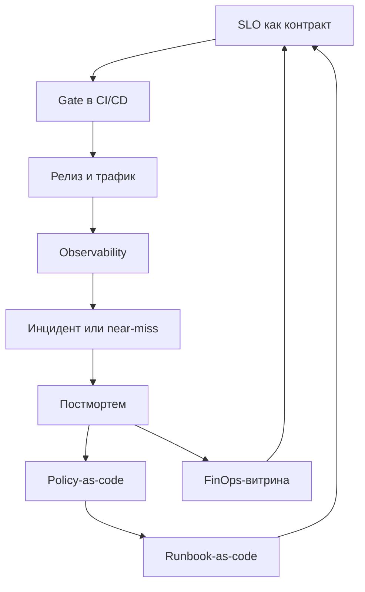

Привет, `%username%`! В [февральской заметке про DIS](/posts/digital-immune-system/) я разбирал концепцию через шесть столпов Gartner — observability, AI-augmented testing, chaos engineering, auto remediation, SRE, supply chain security. Это была карта поверхности: что входит, зачем оно нужно, с чего начать. С тех пор накопилось мыслей, которые в эту карту уже не влезают.

**DIS держится на связях.** Архитектура, SLO, релизная дисциплина, наблюдаемость и экономика надёжности замкнуты в одну петлю обратной связи — вот что отличает иммунную систему от склада инструментов. Шесть столпов отвечают на вопрос «из чего собрано». Интереснее другое: как эти шесть друг друга питают, ограничивают и обучают.

Статичная защита ловит известное. Иммунная система учится на отклонениях — в этой метафоре мне важна именно обратная связь. После инцидента изменились тесты, архитектура, runbook, политика поставки или лимиты автодействий? Проверяется это вопросом: замыкается ли у тебя цикл «инцидент → разбор → проверяемое изменение». Одной записи action item для этого мало.

Дальше разбираю, что связность означает в инженерных решениях, где проходит граница безопасной автоматики, как проектируется сознательное право на отказ и почему про DIS в какой-то момент приходится говорить с финансистами.

## Операциональное определение

Цифровая иммунная система — это совокупность архитектурных ограничений, инженерных практик и оргритуалов, которая:

- минимизирует blast radius и вероятность каскадных отказов;
- переводит редкие ручные героизмы в воспроизводимую автоматику с понятными границами;
- использует наблюдаемость и SLO как язык контрактов между командами;
- учится на каждом отклонении (включая «почти инциденты») и обновляет политику изменений;
- считает деньги наравне с аптаймом: стоимость девяточек, цену шума, цену эскалаций.

Это моя рабочая инженерная рамка, а не официальная шкала Gartner. Для проверки нужны свидетельства по конкретному сервису и периоду: решения, артефакты и результаты испытаний. «Не знаю» здесь полноценный ответ, который нельзя превращать в «нет».

## Связность вместо перечисления

DIS обычно описывают через [шесть практик](/posts/digital-immune-system/#шесть-столпов-dis) — в таком виде концепцию упаковал Gartner в [Top Strategic Technology Trends for 2023](https://www.gartner.com/en/articles/gartner-top-10-strategic-technology-trends-for-2023), анонсированных в октябре 2022 года. Каждая закрывает часть проблем, но шесть квадратов в презентации ещё не делают систему иммунной. Иммунитет рождается из связей между ними.

У самого термина, кстати, судьба показательная. По месту DIS в ежегодных списках трендов нельзя судить о зрелости практик или их распространении. В [прогнозе Gartner 2022 года](https://www.gartner.com/en/newsroom/press-releases/2022-10-17-gartner-identifies-the-top-10-strategic-technology-trends-for-2023) речь шла о сокращении downtime **до 80% к 2025 году** у инвестировавших в digital immunity. Это прогноз, а не измеренный эффект внедрения; независимого подтверждения именно этого прогноза в рассмотренных материалах я не нашёл. Термин продолжает встречаться в исследованиях и материалах компаний, например [Infosys TechCompass](https://www.infosys.com/iki/techcompass/digital-immune-system.html). Другие подходы к устойчивости пересекаются с DIS, но это не делает их полными синонимами. Дальше я говорю про содержание и связи между практиками, а не про популярность вывески.

Связь первая — **SLO влияют на решения о поставке**. Observability и release safety встречаются там, где метрики ошибок и латентности меняют решение: продолжать релиз, остановить или ограничить риск. [SLO должны работать как архитектурный контракт](/posts/slo-as-architecture-blueprint/). Автоматический gate — один способ обеспечить это; документированная политика с ручным решением тоже может работать. Разрыв начинается, когда показатели ни на что не влияют.

Связь вторая — **постмортем меняет систему**. Разбор может привести к новому тесту, архитектурному ограничению, исправленному runbook или безопасной автоматизации. Повторяющееся ручное действие стоит разбирать: можно ли убрать его причину или сделать выполнение надёжнее. Автоматизация каждого шага не обязательна.

Связь третья — **policy-as-code делает правила проверяемыми**. OPA, Sentinel или своя самописка — неважно; важно, что у требований к supply chain, release safety и blast radius есть владельцы, версии и понятный способ применения. Единый центр политик удобен, но согласованные правила могут исполняться несколькими системами.

Связь четвёртая — **финансы как читатель SLO**. SRE и FinOps говорят на одном языке: стоимость одной девяточки, стоимость минуты простоя для конкретного домена, стоимость флапающего алерта. Без этой связи надёжность остаётся «инженерной заботой» и проигрывает фичам в борьбе за время команды. Каждый раз.

Схематически петля выглядит так:

Это один вариант реализации петли, с автоматическими gate и runbook-as-code. Каждая стрелка — правило, которое команда поддерживает сознательно. В другом контуре переход может быть ручным; проверять нужно, дошёл ли урок инцидента до изменения системы и проверки результата.

## Право на отказ и организованная деградация

Когда я слышу разговоры о надёжности, рамка почти всегда одна — «всё должно работать». Зрелый подход добавляет к ней сознательно спроектированный отказ: что и в каком порядке выключается, когда поддерживать полный функционал уже невозможно.

Право на отказ — **архитектурная сущность**: контур деградации проектируешь так же, как нормальный путь запроса. И отвечаешь на четыре вопроса: какие функции выключаются первыми, какие последними, кто жмёт кнопку и какие сигналы триггерят автоматическую деградацию без человека.

Канонический публичный пример — [инцидент GitHub 21 октября 2018](https://github.blog/news-insights/company-news/oct21-post-incident-analysis/). После 43-секундного разрыва между восточными ДЦ orchestrator автоматически промоутнул реплики MySQL, и в данных образовалось расхождение. Команда сознательно остановила доставку 5 миллионов webhook-событий и 80 тысяч Pages-сборок на время восстановления целостности БД — формулировка из постмортема: «explicit choice to partially degrade site usability […] instead of jeopardizing data we had already received from users». Это и есть приоритет «целостность данных > доступность фичи», превращённый в решение под давлением.

Другой угол: деградацию можно продавать. Cloudflare продаёт [Always Online](https://developers.cloudflare.com/cache/how-to/always-online/) как явный контракт: если origin недоступен, edge отдаст статическую копию из кеша или версию из Internet Archive, динамика честно режется до статики. Клиент покупает «худший, но живой» ответ заранее. Netflix формализовал ту же идею в Hystrix (проект давно в maintenance mode, но паттерн пережил инструмент) и архитектуре рекомендательных пайплайнов: онлайн-расчёт не уложился в SLA — сервис отдаёт precomputed fallback, неперсонализированную подборку вместо пятисотки. Свежее продолжение той же линии — [service-level prioritized load shedding](https://netflixtechblog.com/enhancing-netflix-reliability-with-service-level-prioritized-load-shedding-e735e6ce8f7d): приоритизированный сброс нагрузки переехал с edge внутрь отдельных сервисов, где команда сама решает, какими запросами жертвовать первыми. Проверку боем устроил инфраструктурный сбой: на восстановлении Netflix поймал двенадцатикратный всплеск pre-fetch-запросов с Android-устройств, и шеддинг это съел. Показательно, куда сместился центр тяжести Netflix за десять лет: от «сломай прод и посмотри» к деградации, встроенной в каждый сервис как штатный механизм.

Отсюда три практических следствия.

**Домены отказа определяют, какой кусок продукта можно уронить целиком.** Независимые ingress, балансировщики, DNS-резолверы и хранилища секретов на вертикаль. Падает один домен — продукт теряет одну способность и остаётся живым. Без изоляции пользователь получает белую страницу. Стоимость такой изоляции — выше; стоимость отказа от неё — каскад при первом серьёзном инциденте.

**Self-bootstrap, когда control-зависимости отвалились.** Кэшированные сертификаты и токены, emergency-конфиги, offline-режим для критичных путей. Система запускается или хотя бы дотягивает существующий трафик, даже когда её control plane недоступен. Для облака это значит: приватный кластер переживает падение IAM или API провайдера.

**Региональную репликацию решаешь per-domain.** Для платёжной вертикали приоритет — согласованность; для каталога — доступность. Глобальное «давайте всё реплицировать активно-активно» приводит к тому, что часть доменов плохо ложится в выбранную модель и компенсирует это сложными ad-hoc обходами.

## Граница безопасной автоматики

Auto remediation на бумаге звучит как «система сама перезапускает сервисы и масштабирует ресурсы». На практике у автоматики всегда есть граница, и она важнее самой автоматики.

**Control plane и data plane требуют разных сценариев отказа.** Но название плоскости само по себе не определяет безопасность: рестарт stateful data plane тоже способен уничтожить доступность или данные. Для каждого действия проверяешь состояние, зависимости, blast radius и восстановимость. Изменения IAM, доступа и межрегиональной маршрутизации обычно требуют особенно строгих ограничений и независимого аварийного управления.

[Глобальный отказ Facebook 4 октября 2021](https://engineering.fb.com/2021/10/05/networking-traffic/outage-details/)[^meta] — учебник по тому, что происходит, когда control plane завязан сам на себя. Рутинная команда оценки доступности backbone обвалила все межДЦ-линки; audit-инструмент, который должен был такую команду остановить, не сработал из-за бага. DNS-серверы автоматически сняли BGP-анонсы дата-центров — корректная политика «unhealthy = снимаем» превратилась в самоблокировку, когда «unhealthy» стало «всё одновременно». Инженеры на полдня лишились внутренних инструментов диагностики и физического доступа к части помещений. Урок: у автоматики control plane должен быть канал управления, не завязанный на то, что она контролирует.

Зеркальный кейс — [платформа Yandex Infrastructure](https://habr.com/ru/companies/yandex_cloud_and_infra/articles/1004584/), где тот же урок заложили заранее, до аварии. Компоненты основного облака выкатывает отдельный редко обновляемый админский контур: сервис не деплоит сам себя, и кольцо «чтобы поднять облако, нужно облако» разорвано архитектурно. Система прав живёт внутри облака, но у дежурного есть аварийный обход — кнопка выдаёт абсолютный доступ мимо IDM, чтобы разбор инцидента не ждал восстановления той самой системы, которая лежит. SSH-сервер написан с нулём онлайновых зависимостей, аутентификация переведена с ключей на сертификаты, и раскатка прав по хостам перестала занимать 15 минут и ушла с критического пути. По словам авторов статьи, за шесть лет произошло три серьёзных инцидента с компонентами внутреннего облака и ни одного полного краха; описанный масштаб — около 150 000 хостов. Это самоотчёт об определённом контуре, а не общий показатель надёжности Яндекса. За красивой фразой «канал управления, не зависящий от контролируемого» стоит вот такой список конкретных решений, и каждое кто-то оплатил временем команды.

**Любое рискованное автодействие — с разрешением, bounds и возможностью остановки.** Лимиты по частоте, времени и доле парка выбираешь под конкретный сценарий и проверяешь испытаниями. Универсальных «трёх попыток» или «10% парка» здесь нет. Решение без заранее согласованного безопасного сценария требует человека. Rollback тоже меняет систему: автоматический контроллер может выполнять заранее разрешённый откат при выполнении условий, а диагностический агент не получает такое право просто потому, что нашёл подозрительный релиз.

Хрестоматийный кейс отсутствующих bounds — [Knight Capital, 1 августа 2012](https://www.sec.gov/files/litigation/admin/2013/34-70694.pdf). Новый код раскатили на 7 из 8 SMARS-серверов, а на восьмом остался мёртвый код «Power Peg», от которого Knight отказался ещё в 2003-м — и флаг, который новый код переиспользовал, на этом сервере активировал именно его. Хуже того, в 2005-м из Power Peg вынесли счётчик исполненных акций и после этого не перетестировали: останавливаться после заполнения родительского ордера код разучился. Никакой проверки «сколько ордеров в секунду — слишком много», никакого rate-cap на исходящий поток не было — за ~45 минут система отправила миллионы дочерних ордеров, набила ~4 миллиона исполнений и сожгла более $460M по оценке SEC, фактически уничтожив компанию. Автоматика без bounds масштабировала дефект поставки и отсутствие проверок быстрее, чем команда успела вмешаться.

**Auto-healing требует наблюдаемости и проверенного сценария восстановления.** До включения определяешь предусловия, критерии успеха, условия остановки и действия при неудаче. Обратимость важна, но обещание «откатим одной кнопкой» само по себе ничего не доказывает. Особенно если действие уже изменило данные.

Та же платформа Яндекса показывает ценность независимого аварийного доступа: дежурный должен добраться до системы и при отказе её штатных зависимостей. Из статьи нельзя вывести, что платформа не пытается восстанавливаться автоматически или что ручное управление заменило self-healing. Аварийный доступ дополняет автоматику. Доля автодействий и возможность вмешаться — разные характеристики.

Meta[^meta] автоматизирует и диагностику, и часть следующих действий. По [описанию DrP](https://engineering.fb.com/2025/12/19/data-infrastructure/drp-metas-root-cause-analysis-platform-at-scale/), платформой пользуются более 300 команд, она выполняет около 50 тысяч автоматических анализов в день; авторы сообщают о снижении MTTR на 20–80% в разных сценариях. DrP может отдавать результат дежурному, а post-processing — запускать задачи, создавать PR и инициировать mitigation. Это не модель «решение всегда только за человеком». Отдельный материал описывает [LLM для ранжирования подозрительных изменений](https://engineering.fb.com/2024/06/24/data-infrastructure/leveraging-ai-for-efficient-incident-response/). Анализ без прав на изменение прода уменьшает прямой риск, но неверная гипотеза всё равно может направить дежурного по опасному пути.

**Runbook-as-code: повторяющееся действие становится воспроизводимым.** Попало в постмортем — разбираешь, можно ли убрать причину, улучшить ручную процедуру или автоматизировать её с лимитами. Сохранить ручное подтверждение иногда разумнее. Симптом разрыва — повторение проблемы без проверенного улучшения, а не сам факт ручного шага.

**Release safety как код.** Канареечный релиз с автоматическим rollback по порогам ошибок и латентности, freeze windows на пиковые периоды (новогодние праздники, чёрная пятница, день платежей), обязательные проверки политик. Автоматическая проверка уменьшает зависимость от памяти команды. Но и код можно обойти: исключения, права на override и аварийные процедуры тоже должны быть управляемыми.

Главное правило: автоматика делает только то, за что инженер готов отвечать ночью. Всё остальное — под kill-switch и по шагам.

## Экономика надёжности

Самый сильный признак зрелого DIS — споры переезжают с веры на экономику. До этого [разговор о надёжности](/posts/reliability-is-a-conversation/) сводится к «нам нужна ещё одна девятка» или «у нас слишком много шума в алертах» — без цифр.

**Стоимость одной девяточки** — конкретная сумма, привязанная к домену отказа. Девятка для платёжного домена и девятка для рекомендательной выдачи стоят разных денег и приносят разную ценность. Глобальный SLO «99.95% по всему сервису» — худший компромисс между этими крайностями.

**Цена шума** — стоимость флапающего алерта. Измеряется в человеко-часах ночной работы, в том, какие решения принимаются на следующее утро, в проценте пропущенных P1 на фоне P3-шума. Шумовой бюджет — управляемая метрика: команда видит свой flap rate, владеет качеством сигналов и платит за избыточное оповещение тем же бюджетом, что и за реальные инциденты.

**Цена эскалаций.** Путь от P3 до P0 имеет свою стоимость: каждое повышение уровня — это человек, которого подняли среди ночи. Срежешь этот путь через policy-as-code — автоматическая первичная диагностика, маршрутизация к нужному owner-у, обогащение алерта контекстом — и это сразу деньги.

**FinOps-витрина «стоимость простоя»** висит рядом с MTTR-дашбордом. Один отвечает на «как быстро мы поднимаем», другой — на «во сколько нам обошлась минута». Без второй цифры приоритеты надёжности расставляют «по ощущениям».

**Управляемая девяточность.** Целишься в оптимум, а максимум оставляешь тем, кому его оплатят. Лишняя девятка стоит дорого: переход с 99.9% на 99.99% кратно увеличивает вложения в инфраструктуру и команду, а прирост пользовательской ценности с этими вложениями несопоставим. Зрелая команда умеет сказать руководству «нам не нужна следующая девятка» и объяснить, почему.

Сколько у тебя стоит минута простоя платёжного пути? Если ответа нет, весь дальнейший разговор про девятки — вкусовщина, и спорить в нём будет тот, кто громче.

Когда про DIS говорят на языке денег, руководство принимает решения о надёжности так же, как о фичах. Пока этого языка нет, надёжность живёт только на инженерных совещаниях, а бюджет уходит туда, где ценность показана в деньгах.

## Чужие лестницы зрелости

Прежде чем предлагать свою диагностику, честный вопрос: может, готовая линейка уже есть? В рассмотренных открытых материалах я не нашёл общепринятой, проверенной на данных сводной шкалы зрелости DIS. Это граница поиска, а не доказательство, что модели не существует. Исторические ссылки на [статью Gartner](https://www.gartner.com/en/articles/what-is-a-digital-immune-system-and-why-does-it-matter) и [глоссарий](https://www.gartner.com/en/information-technology/glossary/digital-immune-system) при сверке в ноябре 2026 года перенаправлялись на общий раздел: по этому нельзя восстановить всё содержание прежних страниц. Зато есть модели смежных практик, с которыми полезно сопоставить свою диагностику.

Один из полезных ориентиров — [Reliability Maturity Model](https://learn.microsoft.com/en-us/azure/well-architected/reliability/maturity-model) из Azure Well-Architected Framework, появившаяся в 2025 году. Пять уровней: Get resilient → Self-preservation → Recovery readiness → Maintain stability → Stay resilient. SRE как роль появляется на третьем уровне, выделенная SRE-функция и safe deployment practices — на четвёртом, а пятый честно объявлен бесконечным: устойчивость к рискам, которые ещё не случались. Это модель надёжности Azure, а не официальная модель зрелости DIS от Gartner.

AWS пошёл другим путём, и для этого поста он показательнее. [Resilience Lifecycle Framework](https://docs.aws.amazon.com/prescriptive-guidance/latest/resilience-lifecycle-framework/introduction.html) — пять стадий, сознательно замкнутых в круг: Set Objectives → Design and Implement → Evaluate and Test → Operate → Respond and Learn. Последняя стадия возвращает тебя к первой: выучил урок инцидента — пересмотрел цели. AWS независимо пришёл к тому же выводу, вокруг которого построен весь этот пост: зрелость — это замкнутая петля, а не этаж, на который поднялся и остался. Инструментальная обвязка тоже живая: [Resilience Hub](https://aws.amazon.com/about-aws/whats-new/2024/12/aws-resilience-hub-fault-injection-service-recommendations/) с конца 2024 года сам рекомендует эксперименты Fault Injection Service под конкретную архитектуру — chaos engineering из ручной дисциплины превращается в подсказку сервиса.

У CNCF есть [Cloud Native Maturity Model](https://maturitymodel.cncf.io/): пять уровней и измерения People, Process, Policy, Technology. На момент сверки опубликована CNMM 4.0 Beta; модель развивается и учитывает контекст организации. Её ступени полезны для обсуждения пути развития cloud native, но переносить их на DIS как универсальную шкалу нельзя. Самовосстановление может быть целью развития, а допустимый объём автоматики определяется риском конкретного действия.

По отдельным столпам DIS лестницы существуют давно, но живут независимо друг от друга. Chaos engineering — классическая Chaos Maturity Model из книги Netflix/O'Reilly с осями sophistication и adoption, плюс практические руководства по внедрению у [Gremlin](https://www.gremlin.com/community/tutorials/chaos-engineering-adoption-guide) и [eBook Harness](https://www.harness.io/resources/the-chaos-engineering-maturity-model). Observability — [Grafana Observability Journey](https://grafana.com/blog/2024/01/29/how-to-improve-your-observability-strategy-introducing-the-observability-journey-maturity-model/) (Reactive → Proactive → Systematic) и [модель New Relic](https://docs.newrelic.com/docs/new-relic-solutions/observability-maturity/introduction/). Reliability целиком — [Reliability Maturity Model](https://www.usenix.org/publications/loginonline/reliability-maturity-model) в журнале [;login:](https://www.usenix.org/publications/loginonline) от USENIX (absent → reactive → proactive → strategic → visionary) и опросник [Google CRE Production Maturity Assessment](https://sre.google/static/pdf/cloud-cre-production-maturity-assessment.pdf). Обе — гугловые, и мерят они разное: первая описывает зрелость организации и её отношение к надёжности, вторая опрашивает про готовность конкретного прода. Supply chain — [SLSA](https://slsa.dev/spec/latest/levels) с уровнями L0–L3, пример формализованной модели требований. Для auto remediation в рассмотренных материалах единой сопоставимой шкалы я не нашёл; разные модели нужно сначала сравнить по предмету оценки.

Кроме уровней полезно смотреть на методы. В статье [«The Evolution of SRE at Google»](https://www.usenix.org/publications/loginonline/evolution-sre-google) в журнале [;login:](https://www.usenix.org/publications/loginonline) обсуждаются ограничения традиционного подхода для систем с недопустимым ущербом и применение [STAMP/STPA](https://sre.google/resources/practices-and-processes/stpa/). Это не универсальная отмена error budgets: анализ опасностей отвечает на другие вопросы. Meta развивает диагностику и автоматизацию действий, о которых я писал выше. Эти примеры помогают расширить набор методов, но не доказывают отсутствие других моделей зрелости.

Среди академических работ по DIS — [«A Conceptual Model of Digital Immune System to Increase the Resilience of Technology Ecosystems»](https://link.springer.com/chapter/10.1007/978-3-031-59465-6_6) Беате Краузе и Яниса Грабиса (RCIS 2024, Springer): концептуальная модель устойчивости технологической экосистемы в контексте европейской регуляторики NIS2 и DORA. Есть и [продолжение 2025 года](https://link.springer.com/chapter/10.1007/978-3-031-92471-2_13). Наличие концептуальной модели само по себе ещё не означает, что получилась откалиброванная шкала для сравнения компаний. В библиографии есть и книга про DIS — [«Digital Immune System: Principles and Practices»](https://onlinelibrary.wiley.com/doi/book/10.1002/9781394383788) (Wiley-Scrivener): уклон в security и AI, но отдельная глава про экономику внедрения там есть. Приятно: не мне одному кажется, что разговор про DIS — это в том числе разговор экономистов.

Для этой статьи я выбираю пять вопросов на связность. Они дополняют компонентные модели и не претендуют на замену всем существующим шкалам.

## Маркеры зрелого DIS

Как отличить «у нас DIS» от «у нас отдельные практики»? Ниже пять вопросов для разбора своего контура. Это авторская эвристика, не валидированная шкала: порог «три из пяти» не доказывает зрелость. Для каждого ответа нужны свидетельство, дата и область применимости; неизвестное отмечается отдельно.

1. **SLO двигают решения.** Видно, как SLO и error budget влияют на поставку, приоритеты и допустимый риск — автоматически или через исполняемую ручную политику.
2. **Уроки инцидентов проверяются.** После разбора меняются тесты, архитектура, процедуры или политики; есть проверка результата. Снижение повторяемости — измеряемая цель, а не гарантия от самого факта постмортема.
3. **Автоматика делает только обоснованное.** Каждое автодействие имеет владельца, лимиты и kill-switch. Всё остальное живёт под человеком в петле.
4. **Команды спорят на языке экономики.** Приоритеты надёжности обсуждают в рублях: стоимость девяточек, шума, эскалаций. Фразу «у нас плохо с алертами» на таком совещании перебивают вопросом «сколько это стоит».
5. **Руководство видит стоимость надёжности** и принимает решения на этом языке. На совещании уровня CTO рядом с дашбордом MTTR висит дашборд FinOps.

Ответы образуют профиль сильных сторон и пробелов. Если данных нет, сначала собираешь их; если практика не нужна для выбранного контура, обосновываешь это отдельно. По публичному интервью с пропущенными NDA-вопросами такую оценку за компанию не выставить.

## Что ломает DIS на масштабе

Разваливается всё тихо: кто-то пропускает один шаг в петле, и дальше система живёт по инерции. Архитектура при этом обычно нормальная. Ниже — типичные failure modes.

**SLO без последствий для решений.** Есть метрика, SLO и [error budget](/posts/burn-rate-is-not-speed/), но их нарушение никак не меняет поставку или приоритеты. Цикл разомкнут: измеряем, но не действуем. Лечение — исполняемая политика реакции; автоматический gate может быть её частью.

**Автоматика, которой никто не поставил границ.** Auto-healing пытается «починить» инфраструктурный инцидент — рестартит поды, перекидывает трафик, масштабирует кластер — и тем самым расширяет blast radius. Каждому автодействию нужны bounds: сколько раз за период, какой процент парка, при каких условиях остановиться и позвать человека.

**Постмортем без обучения.** Разбор сделан, документ есть, action items записаны — runbook не обновлён, политики не изменены, lessons learned остались на странице в Confluence, которую с тех пор никто не открывал. Петля «инцидент → разбор → изменение правил» обрывается на втором шаге.

**За шумом никто не следит.** Flap rate растёт, доверие к алертам падает, инженеры выключают нотификации канала, P1 пропускается на фоне P3-шума. Шум — управляемая метрика. Брошенный без присмотра, он деградирует наблюдаемость тише и сильнее, чем кажется.

**Про деньги молчат.** Надёжность обсуждают только инженеры, бизнес решает вслепую. Любое сокращение бюджета в таком раскладе первым делом бьёт по надёжности: её ценность просто не переведена в те же единицы, что и всё остальное.

Любое из этих узких мест разрывает петлю обратной связи и возвращает DIS к набору практик.

## Итого

DIS — это про связность и дисциплину. Архитектура режет blast radius на домены отказа. SLO превращает обещания в измеримый контракт. Нагрузка и хаос по регламенту проверяют гипотезы надёжности. Автоматика работает под kill-switch и bounds. Онколл живёт в шумовом бюджете и имеет право остановить поставку. Экономика показывает, во сколько всё это обошлось. Ни один элемент по отдельности систему иммунной не делает — иммунитет возникает, когда они замыкаются в петлю обучения.

Про российский контекст и **кибериммунитет** я уже писал в [февральской заметке](/posts/digital-immune-system/#связь-с-другими-концепциями). Эти понятия пересекаются, но не синонимы: кибериммунитет акцентирует архитектурную защищённость, DIS связывает практики устойчивости разработки и эксплуатации. Self-healing — одна из возможностей в этой системе, а не её полное определение.

Порядок, в котором эти элементы вообще имеет смысл строить, — отдельный разговор: пока нет мониторинга, обсуждать автоматическое восстановление рано. Я развернул его в [иерархию надёжности](https://jtprogru.github.io/The-Way-of-SRE/reliability-hierarchy/), а проверку контролов безопасности тем же методом хаос-экспериментов — в [Security Chaos Engineering](https://jtprogru.github.io/The-Way-of-SRE/practices/security-chaos-engineering/).

Хочешь понять, где стоишь — пройдись по пяти вопросам и собери свидетельства по своему контуру. Зафиксируй, что работает, что неизвестно и какую гипотезу проверишь следующей. Инструменты и уровни полезны, когда помогают улучшить эту картину.

PS: эта статья — то, что я не разобрал в [февральской заметке про DIS](/posts/digital-immune-system/). Если первая отвечала на «что это такое и из чего состоит», эта — на «что отличает зрелый DIS от витрины из шести квадратов».

## Публичные кейсы

Подборка постмортемов, инженерных описаний и моделей зрелости, на которых строится бо́льшая часть тезисов выше. Полезна как карта дальнейшего чтения.

**Право на отказ и организованная деградация:**

- [GitHub, 21.10.2018](https://github.blog/news-insights/company-news/oct21-post-incident-analysis/) — сознательная пауза webhooks и Pages ради целостности БД.
- [Cloudflare Always Online](https://blog.cloudflare.com/always-online-v2/) и [интеграция с Internet Archive](https://blog.cloudflare.com/cloudflares-always-online-and-the-internet-archive-team-up-to-fight-origin-errors/) — деградация как продуктовый контракт.
- [Netflix Hystrix](https://github.com/Netflix/Hystrix/wiki/How-it-Works) и [архитектура персонализации](https://netflixtechblog.com/system-architectures-for-personalization-and-recommendation-e081aa94b5d8) — fallback на precomputed-результат, встроенный в пайплайн.
- [Cloudflare, 2.07.2019](https://blog.cloudflare.com/details-of-the-cloudflare-outage-on-july-2-2019/) — global WAF terminate как заранее построенный kill-switch уровня домена.
- [Cloudflare, 18.11.2025](https://blog.cloudflare.com/18-november-2025-outage/) — bypass на prior-version proxy для Workers KV и Access как реактивная деградация.

**Граница безопасной автоматики:**

- [Knight Capital, 1.08.2012](https://www.sec.gov/files/litigation/admin/2013/34-70694.pdf) — переиспользованный флаг + неполный деплой + автоматика без rate-cap, $460M+ за ~45 минут.
- [Facebook BGP, 4.10.2021](https://engineering.fb.com/2021/10/05/networking-traffic/outage-details/) — баг audit-инструмента + автоснятие DNS-анонсов = control plane выпиливает сам себя.
- [AWS S3, 28.02.2017](https://aws.amazon.com/message/41926/) — playbook-инструмент без safety-check на минимальную ёмкость масштабировал опечатку оператора.
- [Cloudflare WAF, 2.07.2019](https://blog.cloudflare.com/details-of-the-cloudflare-outage-on-july-2-2019/) — regex-правило раскатилось глобально без canary, потому что SOP для конфигов отличался от SOP для бинарей.
- [GitLab, 31.01.2017](https://about.gitlab.com/blog/postmortem-of-database-outage-of-january-31/) — оператор стёр primary; параллельно [все пять механизмов бэкапа](https://about.gitlab.com/blog/2017/02/01/gitlab-dot-com-database-incident/) тихо не работали (silent failure).
- [Cloudflare, 18.11.2025](https://blog.cloudflare.com/18-november-2025-outage/) — изменение прав ClickHouse → дубль строк → превышен hard limit → `Result::unwrap()` panic в Rust-проксе → автогенерация плохого файла каждые 5 минут.
- [Discord, 25.03.2026](https://discord.com/blog/behind-the-scenes-of-the-3-25-26-voice-outage) — при вертикальном K8s-rescale termination grace period истёк раньше, чем начался handoff сессий; волна автоматических reconnect'ов добавила thundering herd.
- [Yandex Infrastructure, 10.03.2026](https://habr.com/ru/companies/yandex_cloud_and_infra/articles/1004584/) — не постмортем, а инженерное описание: админский контур, break-glass мимо IDM и SSH с нулём онлайновых зависимостей как заранее построенный ответ на урок Facebook.

**Обратная сторона — где автоматика спасла:**

- [Google Cloud Networking, 2.06.2019](https://status.cloud.google.com/incident/cloud-networking/19009) — первый пункт follow-up в постмортеме — «immediately halted the datacenter automation software».
- [Netflix Chaos Monkey](https://github.com/Netflix/chaosmonkey) и [Simian Army](https://netflixtechblog.com/the-netflix-simian-army-16e57fbab116) — автоматика как тренажёр: регулярная поломка прода посреди рабочего дня приучила архитектуру к фоллбекам.

**Модели зрелости и свежие публикации (2024–2026):**

- [Azure Well-Architected Reliability Maturity Model](https://learn.microsoft.com/en-us/azure/well-architected/reliability/maturity-model) — пять уровней от Get resilient до Stay resilient; ориентир по зрелости надёжности Azure, без автоматического переноса на DIS.
- [AWS Resilience Lifecycle Framework](https://docs.aws.amazon.com/prescriptive-guidance/latest/resilience-lifecycle-framework/introduction.html) — пять стадий циклом, а не лестницей; финальная стадия Respond and Learn возвращает к пересмотру целей.
- [CNCF Cloud Native Maturity Model](https://maturitymodel.cncf.io/) — развивающаяся модель cloud native; версия и контекст важны при переносе её уровней на DIS.
- [The Evolution of SRE at Google](https://www.usenix.org/publications/loginonline/evolution-sre-google) (журнал [;login:](https://www.usenix.org/publications/loginonline) от USENIX) и [STPA на sre.google](https://sre.google/resources/practices-and-processes/stpa/) — отказ от error budgets как универсального инструмента в пользу системного анализа опасностей.
- [DrP: Meta's Root Cause Analysis Platform at Scale](https://engineering.fb.com/2025/12/19/data-infrastructure/drp-metas-root-cause-analysis-platform-at-scale/) и [Leveraging AI for efficient incident response](https://engineering.fb.com/2024/06/24/data-infrastructure/leveraging-ai-for-efficient-incident-response/) — автоматизация диагностики и возможных следующих действий; разные сценарии требуют разных разрешений.
- [Netflix: service-level prioritized load shedding](https://netflixtechblog.com/enhancing-netflix-reliability-with-service-level-prioritized-load-shedding-e735e6ce8f7d) — деградация как штатный механизм каждого сервиса.
- [DORA Research](https://dora.dev/) — отчёты 2024–2025: метрики throughput/instability и reliability как операционная характеристика.
- [Krauze, Grabis — A Conceptual Model of Digital Immune System…](https://link.springer.com/chapter/10.1007/978-3-031-59465-6_6) (RCIS 2024, Springer, полный текст платный) и [продолжение 2025 года](https://link.springer.com/chapter/10.1007/978-3-031-92471-2_13) — академические работы о концептуальной модели DIS; это не доказательство наличия валидированной сравнительной шкалы.
- [Digital Immune System: Principles and Practices](https://onlinelibrary.wiley.com/doi/book/10.1002/9781394383788) (Wiley-Scrivener, ноябрь 2025, платная) — книга про DIS, включая экономику внедрения.
- Gartner: [What Is a Digital Immune System and Why Does It Matter](https://www.gartner.com/en/articles/what-is-a-digital-immune-system-and-why-does-it-matter), [глоссарий](https://www.gartner.com/en/information-technology/glossary/digital-immune-system), [Hype Cycle for Emerging Technologies 2024](https://www.gartner.com/en/newsroom/press-releases/2024-08-21-gartner-2024-hype-cycle-for-emerging-technologies-highlights-developer-productivity-total-experience-ai-and-security) — первоисточники; часть страниц Gartner прячет за регистрацию.
- [Infosys TechCompass: Digital Immune System](https://www.infosys.com/iki/techcompass/digital-immune-system.html) — редкий пример живого использования термина у сервисных компаний.

[^meta]: Meta Platforms Inc. (владелец Facebook и Instagram) признана экстремистской организацией, её деятельность запрещена на территории РФ. Упоминается здесь исключительно в инженерном контексте.
