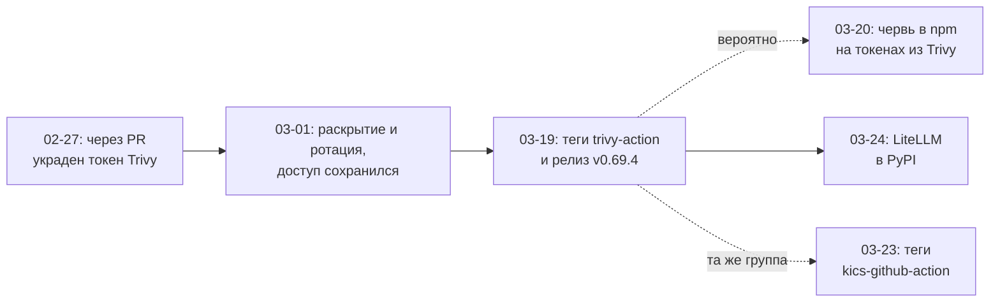

Привет, `%username%`! 2026-03-19 в 17:43 UTC в репозитории Trivy появился тег `v0.69.4`. Релизный пайплайн отработал штатно, бинарники разъехались по GitHub Releases, Docker Hub, GHCR, ECR и deb/rpm-репозиториям. В тот же день почти все теги `aquasecurity/trivy-action` переехали на чужие коммиты. Сканер уязвимостей, который ставят в пайплайн ради безопасности, начал читать память раннера, собирать SSH-ключи, облачные учётки и токены Kubernetes и отправлять их на `scan.aquasecurtiy[.]org`. Перечитай имя домена: в нём переставлены две буквы.

Через пять дней в PyPI вышли заражённые релизы LiteLLM. Ломать саму библиотеку не пришлось: её CI ставил Trivy из apt-репозитория без фиксации версии — свежий сканер приехал сам и, по версии самой LiteLLM, унёс токен публикации.

Вход атакующим дала история трёхнедельной давности: в конце февраля через ошибку в GitHub Actions того же репозитория украли токен сервисного аккаунта. Секреты после этого перевыпустили, но не одномоментно, и доступ у атакующих сохранился.

В контурах, с которыми я работал в разных компаниях, провайдеры Terraform приезжали тремя способами: напрямую из публичного реестра, через чужое зеркало и через своё. Про образы приложений такой разнобой уже трудно представить: registry со сканером давно стал нормой. А здесь он никого не смущал. Меня тоже.

Тезис статьи: инструмент, которым ты строишь и проверяешь инфраструктуру, входит в твою цепочку поставки. Прав у него больше, чем у любого сервиса в проде, а проверок по дороге меньше, чем у npm-пакета во фронтенде. За последние пять лет по этому месту били больше десяти раз. Ниже — хроника этих ударов, разбор того, что каждый инструмент проверяет сам, и настройки, которые закрывают большую часть сценариев.


Про инструмент, который оказался дырой в цепочке поставки, расскажи в [чате](/go/chat/?src=iac-tooling-supply-chain). Там же можно поспорить с выводами. Анонсы новых постов выходят в [канале](/go/tg/?src=iac-tooling-supply-chain).


## Что ты унесёшь из статьи

Статья длинная (~61 000 знаков). Сразу — что заберёт каждая роль:

- **SRE, DevOps, платформенная команда.** Таблицу «что инструмент проверяет сам, а что нет» для Terraform, Ansible, Puppet, Salt, Helm и CI. Плюс рабочие настройки зеркала, пина по хэшу и карантина для GitLab CI и GitHub Actions.
- **Security и AppSec.** Аргументы, почему инфраструктурный тулинг обязан попасть в scope, с датами и ссылками на первичные разборы инцидентов.
- **Тимлид и руководитель.** Семь шагов по возрастанию цены и [план](#что-сделать-в-понедельник), где они разложены по срокам: что делается за час, за день, за неделю и за квартал. И раздел о том, где эти меры не помогают.

## TL;DR (если читать дальше уже некогда)

- Провайдер Terraform, коллекция Ansible, модуль Puppet, экшен в CI и линтер в pre-commit исполняют чужой код с правами пайплайна или инженера. Это зависимости, причём самые привилегированные из всех.
- С 2021 по 2026 год их ломали через угнанные токены мейнтейнеров, перезаписанные теги, тайпсквоттинг и инфраструктуру реестров. В 2026-м атаки стали прицельными: Trivy, KICS, реестр Coder, поддельные провайдеры.
- Хэш зависимости между запусками из коробки запоминает только Terraform, и только для провайдеров. Модули, роли, экшены по тегу и хуки pre-commit не сверяются ни с чем.
- У российских команд есть вторая ветка той же проблемы: после блокировок 2022–2024 годов многие ходят за провайдерами и образами через чужие зеркала.
- Лечится это тем же, чем давно лечат зависимости приложений: своё зеркало, карантин новых версий, пин по хэшу, раздельные раннеры. Придумывать новое не нужно.

## Привилегированный слепой угол

### Что я называю инфраструктурным тулингом

Всё, что исполняется, пока ты строишь, меняешь или проверяешь инфраструктуру, и что написал не ты. Список длиннее, чем хотелось бы.

| Класс | Примеры | Откуда приезжает | Где и с какими правами исполняется |
| --- | --- | --- | --- |
| Провайдеры и модули IaC | провайдеры Terraform и OpenTofu, модули из реестра и из git | `registry.terraform.io`, `registry.opentofu.org`, GitHub | раннер или ноутбук, ключи облака из окружения |
| Содержимое систем управления конфигурацией | коллекции и роли Ansible, модули Puppet, формулы и расширения Salt | Galaxy, Forge, PyPI, GitHub | control node или master, root на каждом управляемом хосте |
| Обвязка Kubernetes | Helm-чарты и плагины, плагины `kubectl` из krew | OCI-реестры, GitHub Releases | контекст инженера или деплой-раннера, часто `cluster-admin` |
| Кирпичи CI | GitHub Actions, компоненты и `include` в GitLab CI, образы для джобов | Marketplace, CI/CD Catalog, Docker Hub | раннер, все секреты и токен джобы |
| Линтеры и сканеры | Trivy, KICS, Checkov, `tflint`, `ansible-lint`, хуки pre-commit | GitHub Releases, apt, pip, образы | раннер или ноутбук, читают весь репозиторий и окружение |
| Установщики | `curl ... \| sh`, bootstrap-скрипты, apt- и yum-репозитории вендоров | сайт вендора | root на хосте в момент установки |

Последняя строка выглядит мелочью, пока не вспомнишь, что LiteLLM заразили именно через неё.

### Чем это отличается от зависимости приложения

Зависимость приложения получает ровно те права, которые есть у сервиса: скомпрометированный пакет в сервисе корзины дотянется до базы корзины и её секретов. Неприятно, но у ущерба есть граница — и рисовал её ты сам.

У инфраструктурного инструмента такой границы нет и быть не может: он существует, чтобы менять всё — создавать сети, выдавать роли, раскатывать конфигурацию на весь парк. Отсюда и права:

- Провайдер Terraform — отдельный бинарник, который Terraform запускает дочерним процессом. Он наследует окружение, а в окружении лежат ключи облака.
- Плагины из коллекции Ansible исполняются на control node, а модули уезжают на хосты и работают там под `become`.
- Модуль Puppet приносит Ruby-код, который выполняется на сервере при компиляции каталога, и факты, которые исполняются от root на каждом агенте.
- Расширение Salt — pip-пакет, который ставится на master и миньоны. На миньоне он работает от root, на master — с правами процесса, который раздаёт команды всему парку.
- Экшен в CI исполняется в том же раннере, что и твои шаги, и может прочитать память процесса со всеми секретами джобы. Именно так работала нагрузка в атаках на `tj-actions` и Trivy.
- Хук pre-commit запускается на ноутбуке инженера, где лежат kubeconfig, SSH-ключи и живая сессия облачного CLI.

### `terraform plan` не read-only

На одном заблуждении держится половина пайплайнов: `plan` безопасен, он же ничего не меняет, только показывает разницу. Поэтому plan запускают автоматически на любой merge request, а строгие проверки вешают на apply.

В ноябре 2024 года Эллиот Уорд из Snyk Labs [проверил пять платформ автоматизации Terraform](https://labs.snyk.io/resources/gitflops-dangers-of-terraform-automation-platforms): Terraform Cloud, Atlantis, Digger, Env0 и Terrateam. Все пять в конфигурации по умолчанию позволяли исполнить произвольный код на этапе plan. Способов два. Первый — data-источник `external`, который по определению запускает локальную программу. Второй — собственный провайдер: Terraform скачает его на `init` и запустит на `plan`. В эксперименте с Terraform Cloud исследователь получил шелл в контейнере и увидел там AWS-ключи, которыми разворачивается настоящая инфраструктура.

Проверить первое можно за минуту на своём ноутбуке:

```hcl
data "external" "innocent" {
  program = ["sh", "-c", "id > plan-was-here.txt; echo '{}'"]
}
```

```bash
terraform init && terraform plan
cat plan-was-here.txt
```

На Terraform 1.15 план отвечает `No changes. Your infrastructure matches the configuration`, а файл с выводом `id` уже лежит рядом. Вместо `id` там может стоять что угодно.

Блока такого вида в чужом merge request достаточно. Его же 2026-08-31 нашли в модулях, которые 14 часов отдавались [с адреса реестра Coder](https://github.com/coder/coder/security/advisories/GHSA-vx42-ghc9-gw65): через доступ к Cloudflare атакующие добавили в пул свои серверы, и часть запросов уходила к ним.

### Что обычно проверяют

Сначала точка отсчёта. В компании со средней зрелостью безопасность цепочки поставки, она же шестой столп [Digital Immune System](/posts/digital-immune-system/#шесть-столпов-dis), означает примерно такой набор:

- **Lock-файлы и SCA.** Зависимости приложения зафиксированы, сканер сверяет их с базами уязвимостей на каждом merge request.
- **SAST и DAST.** Первый смотрит свой код, второй — собранное приложение.
- **Зеркало пакетов.** npm, PyPI, Maven и NuGet идут через Nexus или Artifactory, прямой выход в публичные реестры из CI закрыт.
- **Карантин.** Новая версия пакета становится доступна сборкам через несколько дней или недель, когда на неё уже наступил кто-то другой.
- **Свой registry образов** со сканером на входе.
- **Подписи и SBOM.** Cosign для образов, CycloneDX или SPDX для состава, admission-политика в кластере, которая не пускает неподписанное.

Набор рабочий, спорить с ним я не собираюсь. Но все шесть пунктов отвечают на вопрос «что мы выпускаем», а вопрос «чем мы это собираем, раскатываем и проверяем» в scope не входит вовсе. Граница проходит по коду приложения и его зависимостям — всё по другую сторону пайплайна считается средой.

### Перевёрнутая пирамида

Наложи этот набор на права — и пирамида переворачивается: чем больше прав у артефакта, тем меньше из перечисленного до него доходит.

| Что приезжает | Права при исполнении | Что обычно проверяют |
| --- | --- | --- |
| npm-пакет фронтенда | сборочный контейнер | lock-файл, SCA, карантин в зеркале |
| Образ сервиса | namespace сервиса | свой registry, сканер, подпись, admission-политика |
| Helm-чарт инфраструктурного компонента | кластер | иногда зеркало |
| Провайдер Terraform | облачный аккаунт целиком | lock-файл, если его не забыли закоммитить |
| Коллекция Ansible, модуль Puppet, формула Salt | root на всём парке | версия в requirements, если повезло |
| Экшен или `include` в CI | все секреты джобы | тег |
| Линтер в pre-commit | ноутбук инженера | тег |

Security-команда смотрит на верх таблицы: там код, который пишет компания, и привычные сканеры. Низ таблицы числится «инструментами», а инструменту вопрос «откуда ты это взял» задают редко. Про популярный npm-пакет так перестали думать после [event-stream](https://github.com/dominictarr/event-stream/issues/116) и [node-ipc](https://www.bleepingcomputer.com/news/security/big-sabotage-famous-npm-package-deletes-files-to-protest-ukraine-war/). Про популярный провайдер думают до сих пор.

## Хроника 2021–2026

В таблицу попало только то, что било по инструментам сборки, доставки и проверки инфраструктуры. Обычные заражённые пакеты из npm, PyPI и других реестров я не считал: [по подсчёту Sonatype](https://www.sonatype.com/press-releases/sonatypes-10th-annual-state-of-the-software-supply-chain-report), с 2019 года по осень 2024-го их набралось больше 700 тысяч. Последняя колонка забегает вперёд: в ней мера из практической части, которая закрыла бы сценарий на твоей стороне.

| Когда | Что случилось | Вектор | Чем закрывается |
| --- | --- | --- | --- |
| 2021-01 … 04 | Bash Uploader у Codecov два месяца периодически подменяли, изменённая версия отправляла наружу окружение CI. У HashiCorp утёк GPG-ключ подписи релизов | скрипт по `curl \| bash` без сверки хэша | пин и сверка контрольной суммы |
| 2021-07 | Через Kaseya VSA шифровальщик REvil разошёлся по клиентам нескольких десятков MSP | уязвимость в сервере управления | сегментация, права агента |
| 2023-01 | CircleCI: украдена сессия инженера, из платформы вынесли секреты клиентов | CI-платформа как хранилище секретов | короткоживущие учётки вместо статических |
| 2023-06 | BoostSecurity нашла в Terraform Registry несколько сотен уязвимых модулей, у многих можно перехватить уже опубликованные версии | подвижные теги, `pull_request_target` | пин модулей по коммиту |
| 2024-11 | Snyk показала исполнение кода на `terraform plan` в пяти платформах | plan на недоверенном коде | allowlist провайдеров, отдельный раннер |
| 2025-03 | Перезаписаны тег `v1` у `reviewdog/action-setup` и все теги `tj-actions/changed-files`, секреты уходили в логи сборок | подвижный тег экшена | пин по SHA коммита |
| 2025-08 | Заражённые версии Nx искали секреты с помощью локальных AI-ассистентов | токен публикации, украденный через CI | карантин новых версий |
| 2026-02 … 03 | Бот hackerbot-claw за десять дней атаковал как минимум семь репозиториев, у Trivy украли токен и снесли релизы | `pull_request_target` в CI самого инструмента | зеркало бинарников |
| 2026-03-19 | Trivy: перезаписаны теги экшенов, выпущен заражённый `v0.69.4` | неполная ротация учёток после прошлого инцидента | пин по SHA, карантин, egress-фильтр |
| 2026-03-23 | KICS: 35 тегов экшена на четыре часа подменены стилером | судя по всему, угнанный сервисный аккаунт | пин по SHA |
| 2026-03-24 | LiteLLM: заражённые релизы в PyPI | сканер из apt без фиксации версии | пин версии инструмента |
| 2026-06 … 07 | CVE-2026-11332 и CVE-2026-16493 в `ansible-galaxy`: установка роли исполняет команды, для коллекций описана та же ошибка | подстановка аргументов в `git clone` | свой Galaxy с проверенным содержимым |
| 2026-07 | Найден троянизированный провайдер `terraform-provider-awsbeta` | поддельный провайдер | allowlist пространств имён, зеркало |
| 2026-08-31 | Реестр Coder 14 часов раздавал Terraform-модули со стилером | угнанный Cloudflare-ключ, чужие серверы за доменом реестра | своё зеркало модулей, сверка содержимого |
| 2026-09 | Провайдер `kreuzwenker/docker`, тайпсквот `kreuzwerker/docker` | имя с опечаткой | allowlist, зеркало |

Теперь по периодам, с деталями, которые в таблицу не влезли.

### 2021: скрипт из интернета и сервер управления

С 2021-01-31 по 2021-04-01 Bash Uploader, который Codecov предлагал запускать в CI одной строкой, периодически подменяли: изменённая версия отправляла на сторонний сервер переменные окружения сборки. [Заметили подмену не сканеры](https://about.codecov.io/security-update/): клиент сверил контрольную сумму скачанного скрипта с опубликованной, и они не сошлись. До этого два месяца о расхождении никто не сообщал.

Среди пострадавших — HashiCorp. В её CI лежал приватный GPG-ключ, которым подписаны файлы `SHA256SUMS` всех релизов, и по нему же `terraform init` проверяет официальные провайдеры HashiCorp. [Ключ отозвали](https://discuss.hashicorp.com/t/hcsec-2021-12-codecov-security-event-and-hashicorp-gpg-key-exposure/23512), следов злоупотребления не нашли, но [Terraform пришлось обновлять](https://discuss.hashicorp.com/t/terraform-updates-for-hcsec-2021-12/23570): в старые версии зашит прежний ключ, и релизы провайдеров, подписанные новым, они проверить не могут. Это первый случай в хронике, когда удар по вспомогательному инструменту CI дотянулся до корня доверия всей IaC-экосистемы.

Вторая история того же года формально про другое. 2021-07-02 группа REvil воспользовалась уязвимостью в серверах [Kaseya VSA](https://en.wikipedia.org/wiki/Kaseya_VSA_ransomware_attack). VSA — система удалённого управления: агент стоит на каждой машине, сервер умеет исполнить на них что угодно. По [оценке самой Kaseya](https://www.kaseya.com/press-release/kaseya-responds-swiftly-to-sophisticated-cyberattack-mitigating-global-disruption-to-customers/), напрямую пострадали около 50 клиентов. Многие клиенты Kaseya — MSP, то есть подрядчики, которые администрируют чужую инфраструктуру, и через них пострадали ещё от 800 до 1 500 компаний. Шведская сеть Coop в первый же день [закрыла больше половины](https://www.bbc.com/news/technology-57707530) из своих 800 магазинов. Подрядчик в роли входной двери — сюжет знакомый: через него же [зашли в «Аэрофлот»](/posts/hacking-aeroflot/#подрядчик-как-входная-дверь).

VSA — не Ansible и не Salt, но архитектура та же: центральный узел, которому root на всём парке положен по должности. С Salt ровно это случилось годом раньше: через [CVE-2020-11651](https://nvd.nist.gov/vuln/detail/CVE-2020-11651) в открытые в интернет мастера заходили без аутентификации и [раскатывали майнеры](https://www.tenable.com/blog/cve-2020-11651-cve-2020-11652-critical-salt-framework-vulnerabilities-exploited-in-the-wild) по всем миньонам.

### 2023–2024: CI оказался сейфом, а к реестрам появились вопросы

2023-01-04 CircleCI попросила всех клиентов немедленно сменить все секреты, которые хранились в платформе. Из [отчёта](https://circleci.com/blog/jan-4-2023-incident-report): 2022-12-16 малварь на ноутбуке инженера украла сессию с уже пройденной двухфакторной аутентификацией, 2022-12-22 через неё вынесли переменные окружения, токены и ключи клиентов. Данные были зашифрованы, но ключи шифрования атакующий достал из работающего процесса.

Вывод неприятный. CI хранит ключи от всего, что умеет твоя автоматизация, а значит, статический ключ облака в переменной CI рано или поздно утечёт вместе с CI.

В июне 2023 года Франсуа Пру из BoostSecurity [посмотрел на Terraform Registry](https://labs.boostsecurity.io/articles/erosion-of-trust-unmasking-supply-chain-vulnerabilities-in-the-terraform-registry) глазами атакующего. Главное наблюдение: модули, в отличие от провайдеров, lock-файлом не покрыты. Версия модуля — это git-тег, а тег можно передвинуть, поэтому план, который ты ревьюил в merge request, и план, который применится через час, могут не совпасть. Из 13 с лишним тысяч модулей реестра несколько сотен оказались уязвимы, и во многих случаях это позволяло перехватить уже опубликованные версии. В январе 2024 года HashiCorp [закрыла в публичном реестре две дыры](https://discuss.hashicorp.com/t/hcsec-2024-04-terraform-registry-module-supply-chain-security-improvements/62815): подвижные теги и перехват переименованного репозитория. Версия модуля теперь привязана к SHA коммита, сохранённому при публикации, а сама публикация — к неизменяемому ID репозитория. Уязвимые workflow в репозиториях модулей остались заботой их авторов, и модуль, подключённый напрямую из git по тегу, эта защита тоже не покрывает.

2024-03-29 Андрес Фройнд публично рассказал о бэкдоре в xz-utils 5.6.0 и 5.6.1. В таблице его нет, потому что xz не инструмент инфраструктуры, но [эта история](https://research.swtch.com/xz-timeline) изменила сам разговор. Человек под именем Jia Tan почти полтора года присылал нормальные патчи, прежде чем выпустил свой первый релиз, и ещё почти год вёл проект до бэкдора. После xz довод «этим пользуются все» перестал работать как доказательство безопасности.

### 2025: теги оказались переменными

2025-03-11 между 18:42 и 20:31 UTC тег `v1` экшена `reviewdog/action-setup` указывал на коммит, который выгружал секреты раннера в лог сборки. Этим экшеном пользовался CI проекта `tj-actions`, и через него, скорее всего, утёк токен бота с правом записи. 2025-03-14 атакующий передвинул все теги `tj-actions/changed-files` на свой коммит. [CISA](https://www.cisa.gov/news-events/alerts/2025/03/18/supply-chain-compromise-third-party-tj-actionschanged-files-cve-2025-30066-and-reviewdogaction) просит проверить все проекты, где экшен запускался с 2025-03-12 по 2025-03-15, а найденные в логах секреты считать скомпрометированными.

Экшен стоял в 23 000 репозиториев. [Endor Labs](https://www.endorlabs.com/learn/blast-radius-of-the-tj-actions-changed-files-supply-chain-attack) нашла 5 416 репозиториев со ссылкой на него: за сутки атаки workflow запускался в 614, а секреты попали в лог в 218, и в основном это короткоживущие `GITHUB_TOKEN`. По данным [Unit 42](https://unit42.paloaltonetworks.com/github-actions-supply-chain-attack/), изначально целились в проект `coinbase/agentkit`, а все теги атакующий перезаписал через двадцать минут после того, как там убрали уязвимый workflow. Почему он пошёл на шумную массовую атаку, в Unit 42 не знают.

Одну деталь этой истории запомни, она вернётся в разделе про ограничения. Кто закрепил `tj-actions/changed-files` по SHA коммита, не пострадал — если только в эти дни не передвинул пин на заражённый коммит. С экшенами reviewdog пин спасал не всегда: составные экшены внутри себя ссылались на `reviewdog/action-setup@v1` по тегу.

2025-08-26 в npm вышли заражённые версии Nx, системы сборки монорепозиториев. Токен публикации, по [advisory проекта](https://github.com/nrwl/nx/security/advisories/GHSA-cxm3-wv7p-598c), украли через workflow на `pull_request_target`, который подставлял заголовок pull request в шелл-скрипт. По [разбору Wiz](https://www.wiz.io/blog/s1ngularitys-aftermath), postinstall-скрипт искал на машине ключи и токены, а для разведки вызывал установленные AI-ассистенты: Claude Code, Gemini CLI и Amazon Q с флагами, отключающими подтверждения. Найденное складывалось в публичный репозиторий `s1ngularity-repository` в аккаунте самой жертвы. Утёкших секретов в Wiz насчитали больше двух тысяч. Для сверки по номерам: инциденту присвоена [CVE-2025-10894](https://nvd.nist.gov/vuln/detail/CVE-2025-10894), и она опубликована. Запись GHSA-cxm3-wv7p-598c в [общей базе GitHub](https://github.com/advisories/GHSA-cxm3-wv7p-598c) с 2026-07-28 помечена отозванной, причина не названа. Advisory в репозитории проекта при этом на месте.

### 2026: по инструментам бьют прицельно

С 2026-02-21 по 2026-03-02 аккаунт hackerbot-claw, который представлялся «автономным агентом для исследований безопасности», [атаковал как минимум семь репозиториев](https://www.stepsecurity.io/blog/hackerbot-claw-github-actions-exploitation) через ошибки в GitHub Actions. В списке два инструмента проверки инфраструктуры: Trivy и `DataDog/datadog-iac-scanner`. Токен у Trivy украли 2026-02-27 через workflow на `pull_request_target`. Тот pull request, по [разбору BoostSecurity](https://labs.boostsecurity.io/articles/megagame10418-the-user-behind-hackerbot-claw), открыл другой аккаунт, которого на GitHub уже нет, а hackerbot-claw пришёл в тот же workflow сутки спустя. Мейнтейнеры Trivy считают, что за обоими стоит один атакующий. Дальше с этим токеном репозиторий переименовали и закрыли, релизы с 0.27.0 по 0.69.1 удалили, а в расширение для VS Code на Open VSX залили подозрительный артефакт. Для потребителей первый удар выглядел как отказ: пайплайны, которые скачивали бинарник Trivy с GitHub Releases, перестали его находить.

Aqua сменила учётные данные, но не разом: по её же [advisory](https://github.com/aquasecurity/trivy/security/advisories/GHSA-69fq-xp46-6x23), ротация была не одномоментной, и атакующий мог успеть подсмотреть уже новые секреты. 2026-03-19 этим воспользовалась группа, которая называет себя TeamPCP. По [данным Wiz](https://www.wiz.io/blog/trivy-compromised-teampcp-supply-chain-attack), перезаписаны 75 из 76 тегов `trivy-action` (в advisory Aqua — 76 из 77) и семь тегов `setup-trivy`. В 17:43 UTC атакующий запушил тег `v0.69.4`, и к 18:22 автоматика выложила релиз с тем же стилером. 2026-03-20 по npm пошёл самораспространяющийся червь CanisterWorm: в [Aikido](https://www.aikido.dev/blog/teampcp-deploys-worm-npm-trivy-compromise) считают его прямым продолжением атаки на Trivy и работой той же группы. 2026-03-22 на Docker Hub появились ещё два заражённых образа, `0.69.5` и `0.69.6`.



2026-03-23 с 12:58 до 16:50 UTC то же произошло с [`kics-github-action`](https://www.wiz.io/blog/teampcp-attack-kics-github-action): 35 тегов указывали на стилер. KICS — сканер IaC от Checkmarx. На следующий день в PyPI вышли [LiteLLM 1.82.7 и 1.82.8](https://research.jfrog.com/post/litellm-compromised-teampcp/). В 1.82.8 лежал `.pth`-файл, который запускал сбор учётных данных при каждом старте интерпретатора Python. По [версии самой LiteLLM](https://docs.litellm.ai/blog/security-update-march-2026), токен публикации утёк через Trivy в её CI. JFrog в том же разборе показывает как: скрипт проверок ставил сканер из apt-репозитория, всегда последнюю версию.

2026-06-05 раскрыта [CVE-2026-11332](https://github.com/advisories/GHSA-w8p5-mx5w-cpqj). Команда `ansible-galaxy role install` передавала поля `src` и `name` из `meta/requirements.yml` роли в `git clone` без разделителя `--`. Автор вредоносной роли мог так составить запись о зависимости, чтобы подставить опции git и выполнить команду на машине того, кто роль ставит. Для ролей это [исправили](https://github.com/ansible/ansible/pull/87070) в ansible-core 2.21.1 и бэкпортировали в 2.20.7, 2.19.11, 2.18.18 и 2.16.19. Исправление оказалось неполным: [CVE-2026-16493](https://github.com/advisories/GHSA-m37p-hmh2-w6j2) от 2026-07-21 описывает ту же ошибку в `ansible-galaxy collection install`. В upstream на 2026-10-12 она не закрыта: [патч](https://github.com/ansible/ansible/pull/87177) висит с конца июня, мейнтейнеры считают его перестраховкой и сомневаются, что через коллекции до уязвимого вызова можно добраться. Red Hat при этом оценила уязвимость как Important и [числит её исправленной](https://access.redhat.com/errata/RHSA-2026:63386) только в Satellite. Сведений об эксплуатации я не нашёл. Важен сам класс: код исполняется на этапе установки, до первого запуска плейбука.

Летом и осенью дошла очередь до Terraform, причём тремя разными способами.

В июле Zscaler [нашла `terraform-provider-awsbeta`](https://www.zscaler.com/blogs/security-research/suspected-tradertraitor-group-uses-trojanized-terraform-provider-deliver). Провайдер ведёт себя как настоящий: внутри рабочий каркас с примерами ресурса и data-источника, Terraform получает от него штатные ответы. При запуске он заодно скачивает загрузчик с `hashicorp-terraform[.]io` и ставит бэкдор FLATROOF. Исследователи осторожно связывают кампанию с группой TraderTraitor и не скрывают, что не знают, как именно этот провайдер попал к жертве. Вероятный путь описан в смежном [разборе SentinelLabs](https://www.sentinelone.com/labs/dont-call-us-well-call-your-apis-tradertraitor-backdoors-resurface-on-victim-with-no-crypto-ties/): фальшивое собеседование и тестовое задание, в репозитории которого лежит Terraform-проект с подложенным `.terraform.lock.hcl` и провайдером из реестра на домене-двойнике.

2026-08-31 с 07:35 до 21:45 UTC часть запросов к `registry.coder.com` уходила на серверы атакующего. Сам реестр не взламывали: украли Cloudflare API-ключ и добавили свои адреса в пул, который отвечает за домен. Модули приезжали настоящие, но с лишним блоком `data "external"`. Он отправлял на `coder-infra[.]com` переменные окружения и секреты провижинера, а при сборке workspace ещё и OIDC-токен пользователя, его SSH-ключ и токены внешней аутентификации. В [разборе CSA](https://labs.cloudsecurityalliance.org/research/csa-research-note-coder-registry-terraform-supply-chain-2026/) есть фраза, которую стоит запомнить: одной фиксации версии модуля мало, чтобы такую подмену обнаружить.

В начале сентября были опубликованы провайдеры `gocommunity-io/dockerd` и `kreuzwenker/docker`. Второй отличается от популярного `kreuzwerker/docker` одной буквой. Вредоносный код просыпался, только если SHA-256 от двух переменных конфигурации совпадал с зашитым значением, то есть ждал конкретную жертву. [Aikido](https://www.aikido.dev/blog/graphalgo-terraform-go-modules) описала находку 2026-09-22.

### Что видно из хроники

**Вспомогательный инструмент перестал быть побочной жертвой.** В 2021-м Codecov ломали ради секретов его клиентов. В 2026-м ломают сам сканер, потому что он стоит в тысячах пайплайнов и ему разрешено читать всё.

**Сканеры и линтеры стали самой выгодной целью.** Codecov, reviewdog, Trivy, KICS, `datadog-iac-scanner` — пять инструментов проверки, по которым били за пять лет. Их ставят ради безопасности, им выдают доступ ко всему репозиторию и окружению, а сами они не проходят ни одной проверки.

**Векторов всего четыре, и они повторяются:**

- подвижная ссылка: тег, `latest`, скрипт по URL;
- CI самого инструмента, чаще всего `pull_request_target`;
- инфраструктура доставки: реестр, DNS, бакет;
- имя, похожее на настоящее.

**Окно обнаружения сжалось.** Codecov жил с подменой два месяца, `tj-actions` — меньше суток, Coder — 14 часов, KICS — четыре часа. Для карантина новых версий это хорошая новость: теперь хватает дней, а не месяцев. Но треть строк в таблице описывает подмену уже существующей версии, а против неё выдержка бессильна — помогает только хэш.

**В четырёх историях 2026 года есть домен-двойник.** У Trivy украденное уходило на `aquasecurtiy`, у Coder — на `coder-infra`, у KICS — на домен, похожий на Checkmarx, а у поддельного провайдера двойник `hashicorp-terraform[.]io` раздавал загрузчик. Раннер, которому разрешено ходить только на известные адреса, поднял бы тревогу в первых трёх историях. Совсем закрыть утечку такой фильтр не обещает: у стилера Trivy был запасной канал через репозиторий в аккаунте самой жертвы.

## Вторая ветка: тебя не взломали, тебе закрыли дверь

Цепочка поставки рвётся и без атакующего. За те же пять лет поставщики инфраструктурных инструментов несколько раз меняли правила, и каждый раз кто-то узнавал об этом по упавшему пайплайну.

| Когда | Что изменилось | Как это выглядело у потребителя |
| --- | --- | --- |
| 2022-03 | HashiCorp закрыла `registry.terraform.io` и `releases.hashicorp.com` для российских IP | `Failed to query available provider packages` на `terraform init` |
| 2023-08 | Terraform сменил лицензию с MPL на BSL, появился форк OpenTofu | ничего не упало, но выбор инструмента стал юридическим вопросом |
| 2024-05-30 | Docker Hub начал отвечать 403 российским IP, через несколько дней доступ вернулся | `docker pull` падает на базовых образах |
| 2024-08 | OpenTofu закрыл реестр для российских IP и удалил провайдеры Yandex Cloud, Cloud.ru (провайдер `sbercloud`) и Rustack | провайдер твоего же облака пропал из реестра |
| 2024-10 … 2025-01 | Репозитории Salt переехали на инфраструктуру Broadcom, старые адреса и bootstrap-поддомены отключены | bootstrap-скрипт не находит пакеты |
| 2024-11 … 2025-01 | Perforce объявила, что с начала 2025 года новые пакеты Puppet уходят в закрытый репозиторий, сообщество ответило форком OpenVox | в публичном репозитории нет новых версий |
| 2025-08 … 09 | Bitnami перенесла версионированные образы в `bitnamilegacy` без обновлений | `ErrImagePull` у чартов с закреплённым тегом |
| 2026-05 | В Salt 3008 из поставки убрали сотни модулей (в [анонсе 2024 года](https://saltproject.io/blog/the-great-salt-module-migration/) называли около 750), часть из них стала отдельными расширениями | стейт ссылается на модуль, которого больше нет |

Ни одна строка не про взлом, а последствия те же: в какой-то день твой пайплайн зависит от решения, которое принял не ты. Лекарство тоже совпадает: копия того, от чего ты зависишь, должна лежать у тебя.

По первой строке: отдельного анонса я не нашёл, но 2022-03-01 сотрудник HashiCorp подтвердил запрет в [issue про `releases.hashicorp.com`](https://github.com/hashicorp/terraform/issues/30591). Про реестр то же самое как факт пишет [документация Yandex Cloud](https://yandex.cloud/ru/docs/troubleshooting/terraform/known-issues/failed-to-quety-available-provider-packages), правда, без даты. Остальное подтверждается открытыми источниками: [смена лицензии Terraform](https://www.hashicorp.com/blog/hashicorp-adopts-business-source-license), [блокировка Docker Hub](https://habr.com/ru/articles/818565/), [решение о блокировке](https://github.com/opentofu/opentofu/blob/ea558d9d4b5ef4919356aabc8f3bc3d23af1d853/TSC_SUMMARY.md) и [удаление провайдеров](https://github.com/opentofu/registry/pull/817) в OpenTofu, [переезд репозиториев Salt](https://saltproject.io/blog/salt-project-package-repo-migration-and-guidance/), [поломка bootstrap](https://saltproject.io/blog/salt-bootstrap-breakage/) и [release notes 3008](https://docs.saltproject.io/en/latest/topics/releases/3008.0.html), [объявление Perforce](https://www.puppet.com/blog/open-source-puppet-updates-2025) и [первый релиз OpenVox](https://voxpupuli.org/blog/2025/01/21/openvox-release/), [объявление Bitnami](https://github.com/bitnami/charts/issues/35164).

Для российских команд у этой ветки есть продолжение, о котором редко говорят вслух. После марта 2022-го зеркало для провайдеров появилось почти у всех, кто работает из России. Только чаще всего чужое. Вот блок из [документации Yandex Cloud](https://yandex.cloud/ru/docs/tutorials/infrastructure-management/terraform-quickstart#configure-provider), который с тех пор живёт в `~/.terraformrc` у многих:

```hcl
provider_installation {
  network_mirror {
    url     = "https://terraform-mirror.yandexcloud.net/"
    include = ["registry.terraform.io/*/*"]
  }
  direct {
    exclude = ["registry.terraform.io/*/*"]
  }
}
```

К самому зеркалу у меня претензий нет, задачу доступности оно решает честно. Но с этого момента в цепочке поставки появилось новое звено, и доверие к нему нигде не записано. Кто его наполняет? Как быстро туда попадает отозванная версия? Что будет, если по этому адресу начнёт отвечать кто-то другой? История Coder показывает, что последний вопрос не теоретический.

С образами после 2024-05-30 вышло ещё проще. Списки «рабочих зеркал Docker Hub» разошлись по чатам за сутки — вперемешку зеркала крупных облаков и сервисы, поднятые неизвестно кем за вечер. Строка в `registry-mirrors` означает, что оператор зеркала может отдать тебе любой образ под любым тегом.

Обе ветки сходятся в одной точке: и от атаки на поставщика, и от его решения спасает одно и то же — своя копия и доверие, привязанное к содержимому, а не к имени и адресу. Прежде чем строить это у себя, полезно понять, что каждый инструмент проверяет сам.

## Анатомия доверия: что инструмент проверяет сам

У менеджера зависимостей есть три уровня проверки: целостность доставки (приехало то, что отдал сервер), неизменность (сегодня приехало то же, что вчера) и происхождение (это выпустил тот, за кого оно себя выдаёт). Ниже — разбор по инструментам: какой уровень работает из коробки, какой включается руками, а какого нет вовсе. Вывод команд я снимал на Terraform 1.15, ansible-core 2.21, Helm 4.3 и pre-commit 4.6.

### Провайдеры Terraform и OpenTofu

Лучший случай во всём разделе, и у него всё равно три оговорки.

При установке из исходного реестра Terraform сверяет пакет с файлом `SHA256SUMS` и проверяет подпись этого файла GPG-ключом издателя. В выводе `terraform init` это одна строка:

```text
- Installed hashicorp/external v2.4.2 (signed by HashiCorp)
```

После этого в `.terraform.lock.hcl` ложатся хэши пакета: один `h1:` по содержимому и по одному `zh:` на zip каждой платформы (у меня получилось тринадцать). При следующем `init` несовпадение даёт ошибку `doesn't match any of the checksums previously recorded in the dependency lock file`. Документация честно называет эту модель trust on first use.

OpenTofu здесь слабее. Вывод `tofu` я не снимал, но в [документации](https://opentofu.org/docs/cli/plugins/signing/) сказано прямо: из своего основного реестра он по умолчанию ставит и провайдеры без GPG-ключа, пропуская проверку подписи. Строгий режим включается переменной `OPENTOFU_ENFORCE_GPG_VALIDATION=true`.

Оговорка первая: подпись говорит только, что пакет выпустил владелец пространства имён. Вот настоящий, не поддельный провайдер Docker:

```text
- Installed kreuzwerker/docker v4.6.0 (self-signed, key ID 0DCE698927DAF8EC)
```

У тайпсквота `kreuzwenker/docker` строка была бы такой же, с другим ID ключа. Наизусть этот ID не помнит никто.

Оговорка вторая: через зеркало подпись не проверяется совсем. Тот же `hashicorp/external` из локального зеркала:

```text
- Installed hashicorp/external v2.4.2 (unauthenticated)
...
Warning: Incomplete lock file information for providers
```

В lock-файл при этом попадает один хэш вместо четырнадцати, и это хэш того, что отдало зеркало. Собрал lock-файл через зеркало — поверил зеркалу на слово. При настроенном зеркале подписанные суммы издателя приносит только `terraform providers lock`: он игнорирует `provider_installation` и идёт в исходный реестр. По [документации](https://developer.hashicorp.com/terraform/cli/commands/providers/lock), официальные контрольные суммы под подписью разработчика отдаёт только исходный реестр.

Оговорка третья: вся конструкция работает, пока lock-файл лежит в git. Проверь `.gitignore` в инфраструктурных репозиториях: `.terraform.lock.hcl` иногда попадает туда по ошибке вместе с каталогом `.terraform`.

### Модули Terraform

Здесь проверять нечего, и в [документации](https://developer.hashicorp.com/terraform/language/files/dependency-lock) это написано прямо: lock-файл отслеживает только провайдеры, выбор версий удалённых модулей Terraform не запоминает.

Модуль из реестра приезжает по версии, модуль из git — по `ref`. Если `ref` указывает на тег или ветку, содержимое может измениться между двумя `terraform init` (например, между джобами plan и apply с чистым каталогом). Встроенная защита одна: `ref` в виде SHA коммита для git-источников. У модулей из реестра нет и её. Остаётся верить реестру, а цену этой веры показала история Coder.

### Ansible: роли и коллекции

[Роли](/posts/ansible-roles/) и коллекции устроены по-разному, и путать их опасно.

Роль — это git-репозиторий или tarball с GitHub. Контрольных сумм и подписей нет. Версия в `requirements.yml` задаётся тегом, веткой или коммитом, и неизменяем из них только коммит.

Коллекция — tarball с Galaxy-сервера. Сервер отдаёт SHA-256 артефакта, клиент сверяет скачанное. Внутри лежат `MANIFEST.json` и `FILES.json` с суммами каждого файла, поэтому `ansible-galaxy collection verify` умеет сравнить установленное с тем, что лежит на сервере. Это целостность доставки. А вот неизменности нет: lock-файла у Ansible не существует, и транзитивные зависимости коллекции разрешаются заново при каждой установке.

Происхождение закрывают GPG-подписи `MANIFEST.json`. Клиент их поддерживает, для этого есть ключи `--keyring` и `--required-valid-signature-count`. Только подписи должен отдать сервер. Я спросил публичный Galaxy про `community.general` 13.5.0, одну из самых популярных коллекций:

```bash
curl -s "https://galaxy.ansible.com/api/v3/plugin/ansible/content/published/collections/index/community/general/versions/13.5.0/" | jq .signatures
# []
```

Подписей нет. Работают они там, где сервер сам подписывает содержимое: в Automation Hub или в собственном Galaxy NG. То есть как раз в своём зеркале.

Остаётся сама установка. В 2026 году в `ansible-galaxy install` закрыли подстановку аргументов git через зависимости роли: это CVE-2026-11332, закрытая в ansible-core 2.21.1 и в бэкпортах для старых веток. Для установки коллекции из git заведена парная CVE-2026-16493, и в upstream на 2026-10-12 она не исправлена: в ansible-core 2.21.5 разделителя `--` перед адресом по-прежнему нет. Мейнтейнеры, правда, сомневаются, что до этого вызова можно добраться с вредоносным адресом. Плагины коллекции в любом случае исполняются на control node при первом же запуске плейбука.

### Puppet и Salt

У Puppet модули приезжают с Forge или из git. Подписей нет. В 2021 году Puppet [объявил сканирование релизов на малварь](https://www.puppet.com/blog/malware-scanning), начав с Supported-модулей. По API Forge результата скана сегодня нет ни у community-модулей, ни у релизов 2026 года, так что рассчитывать на него не стоит. В `Puppetfile` версия модуля с Forge фиксируется точно, git-модуль закрепляется через `:commit`. У r10k есть полезное побочное свойство: он не разрешает зависимости сам, каждый модуль приходится прописать явно — и неожиданных транзитивных гостей не бывает.

У Salt источников три, и модель доверия у каждого своя.

Формулы — git-репозитории, которые подключают через `gitfs_remotes`. Мастер сам ходит в репозиторий по расписанию (по умолчанию раз в минуту) и раздаёт миньонам то, что там сейчас лежит. Это подвижная ссылка в чистом виде, и [документация Salt](https://docs.saltproject.io/en/latest/topics/development/conventions/formulas.html) прямо просит так не делать: настоятельно рекомендует форкнуть репозиторий формулы к себе, чтобы избежать неожиданных изменений в инфраструктуре.

Расширения — pip-пакеты `saltext.*` со всеми свойствами pip-пакетов. В Salt 3008, который вышел в мае 2026 года, из поставки убрали сотни модулей, и часть из них теперь ставится расширениями.

Bootstrap-скрипт теперь скачивается с GitHub Releases. Рядом лежит файл с SHA-256, и сверять его нужно руками.

### Helm: чарты и плагины

Чарт можно подписать: рядом с пакетом кладётся файл `.prov`, и `helm install --verify` откажется ставить чарт без него — но по умолчанию флаг выключен, и чарт без подписи ставится молча. У классических HTTP-репозиториев клиент не сверяет скачанный архив даже с `digest` из `index.yaml`: на Helm 4.3 `helm pull` проходит и с подменённым tgz.

У OCI-реестров есть вариант надёжнее: ссылка на чарт по digest вместо тега. Digest неизменяем по построению.

Отдельная ловушка — `Chart.lock`. Поле `digest` в нём выглядит как контрольная сумма зависимостей, но это хэш их списка: он отвечает на вопрос «актуален ли lock», а не «то ли содержимое приехало».

Плагины Helm — исполняемый код с хуками установки. В Helm 4 подпись плагина проверяется по умолчанию, но, судя по справке `helm plugin install`, только при установке из tarball. Плагины `kubectl` из krew выглядят лучше: манифест в индексе содержит SHA-256 каждого архива, и клиент его сверяет.

### Кирпичи CI

**GitHub Actions.** `uses: org/action@v4` ссылается на тег, а тег подвижен. `uses: org/action@` с сорока символами SHA ссылается на коммит, и неизменяема только такая ссылка. С августа 2025 года [политика организации](https://github.blog/changelog/2025-08-15-github-actions-policy-now-supports-blocking-and-sha-pinning-actions/) умеет требовать полный SHA и запрещать конкретные экшены. Ограничение то же, что в истории с reviewdog: закреплённый экшен может внутри ссылаться на другой по тегу, а reusable workflows политика тоже не покрывает — их по-прежнему можно подключать по тегу.

**GitLab CI.** `include: project` принимает `ref`, и туда можно поставить SHA коммита. Компонент из каталога подключается как `gitlab.example.internal/group/project/component@версия`, вместо версии тоже годится SHA. Для `include: remote` с GitLab 17.9 есть ключ [`integrity`](https://docs.gitlab.com/ci/yaml/) с SHA-256 включаемого файла: не совпало, и пайплайн падает. Образ в `image:` по тегу подвижен так же, как тег экшена. Неизменяема только форма `image: name@sha256:...`.

### Сканеры, линтеры и pre-commit

Самая слабая зона. Инструмент попадает в пайплайн одним из четырёх способов: скрипт установки по URL, бинарник с GitHub Releases, пакет из apt-репозитория вендора или готовый образ. У большинства рядом лежат контрольные суммы, у многих есть подписи cosign, но сверка во всех четырёх случаях ручная: пока ты сам не написал эту строку в пайплайне, её нет.

Подписанный apt-репозиторий здесь не спасает. Подпись репозитория защищает от подмены по дороге, а заражённый Trivy `v0.69.4` собрал и выпустил штатный релизный пайплайн.

В pre-commit поле `rev` принимает тег, и обычно там тег и стоит. Команда `pre-commit autoupdate --freeze` пишет вместо тега SHA коммита и оставляет версию в комментарии. Заодно она обновляет каждый хук до последнего тега, об этом ниже.

### Сводная таблица

| Артефакт | Целостность доставки | Неизменность между запусками | Происхождение |
| --- | --- | --- | --- |
| Провайдер Terraform из реестра | да | да, если lock-файл в git | подпись владельца пространства имён |
| Провайдер Terraform из зеркала | да | да, но хэш выдан зеркалом | нет |
| Модуль Terraform | нет | только git-`ref` по SHA | нет |
| Роль Ansible | нет | только версия по SHA | нет |
| Коллекция Ansible | да | нет | подписи, если их отдаёт сервер |
| Модуль Puppet | да | точная версия в `Puppetfile` | нет |
| Формула Salt через gitfs | нет | нет, пока не форкнешь | нет |
| Расширение Salt | как у любого pip-пакета | как у любого pip-пакета | нет |
| Helm-чарт | только в OCI-реестрах | digest в OCI | `.prov`, если включить `--verify` |
| Экшен или `include` в CI | нет | SHA коммита, `integrity` | нет |
| Сканер, линтер, хук | руками | руками | руками |

Средняя колонка объясняет, почему хроника выглядит именно так. Почти в каждой её ячейке стоит «если», «только» или «руками».

## Свой контур: где я сам стоял в этой таблице

Теперь про себя. В контурах, с которыми я работал в разных компаниях, картина повторялась с небольшими вариациями, поэтому опишу её собирательно.

Лучше всего было с чартами и образами. В одном из контуров внешний Helm-чарт проходил конвейер из шести шагов:

| Шаг | Что делает | Какой риск закрывает |
| --- | --- | --- |
| declare | чарт объявлен строкой `repo\|chart\|version` в общем списке | никто не помнит, откуда это взялось |
| validate | один merge request меняет один чарт | размытое ревью |
| lint | `ct lint` и yamllint | кривые values |
| test | установка в эфемерный kind-кластер | чарт проходит dry-run, но падает при настоящей установке |
| release | `helm package` и `helm push` в приватный OCI-реестр | прод тянет чарт из публичного источника |
| mirror images | скрипт вытаскивает образы из `values.yaml` и кладёт их в свой registry | образы идут в обход реестра |

Правило у конвейера одно: прод ничего не тянет из публичного интернета напрямую. Каждый внешний артефакт проходит через одну точку, и эта точка даёт сразу контроль, кэш и след для аудита.

Второе, что работало, — правило previous minor из регламента по инфраструктурному коду. Берём не последнюю вышедшую minor-версию, а предыдущую: свежая успевает отлежаться, а регрессии и сюрпризы ловит кто-то другой. Карантин на голой дисциплине, без единого инструмента. В том же регламенте были `CODEOWNERS`, защищённые ветки и закоммиченный lock-файл.

А вот про источник провайдеров и модулей там не было ни слова. Провайдеры Terraform, повторюсь, приезжали тремя способами: напрямую из реестра, через чужое зеркало и через своё. Про коллекции Ansible, модули Puppet и формулы Salt вопрос «откуда» звучал ещё реже.

Разложи это по сводной таблице из прошлого раздела, и вылезет перекос: для Helm-чарта построен конвейер из шести шагов, а для провайдера Terraform, у которого в руках облачный аккаунт, не было даже единого источника.

Убирается этот перекос тем же принципом, что у конвейера чартов, только применённым ко всем остальным классам: объявить, закрепить, зеркалировать, выдержать, сверить.

## Практика: тот же конвейер для всего остального

Шагов семь, с нулевого по шестой, и идут они по возрастанию цены. Первые два не требуют ни нового железа, ни согласований. Как всё раскладывается по срокам, от часа до квартала, собрано в конце, в разделе [«Что сделать в понедельник»](#что-сделать-в-понедельник). Команды для Terraform и Ansible я прогнал на тех же версиях, что и в прошлом разделе.

### Шаг 0. Инвентаризация: что у тебя ходит наружу

```bash
# Terraform: провайдеры и источники модулей
terraform get   # без установленных модулей terraform providers падает
terraform providers
grep -rhoE 'source[[:space:]]*=[[:space:]]*"[^"]+"' --include='*.tf' --exclude-dir=.terraform . | sort | uniq -c | sort -rn

# GitHub Actions: всё, что не закреплено по SHA
grep -rhoE 'uses:[[:space:]]*[^[:space:]]+' .github/workflows | grep -vE '@[0-9a-f]{40}' | sort | uniq -c

# GitLab CI: внешние include и образы
grep -nE '^[[:space:]]*-?[[:space:]]*(remote|component|project|image):' .gitlab-ci.yml

# Ansible, Puppet, Salt
ansible-galaxy collection list
ansible-galaxy role list
puppet module list --tree
salt-pip list | grep -i saltext
grep -A10 '^gitfs_remotes' /etc/salt/master

# pre-commit и плагины
grep -nE '^[[:space:]]*(- repo|rev):' .pre-commit-config.yaml
helm plugin list
kubectl krew list
```

Самый полезный источник при этом лежит не в репозитории. Возьми лог исходящих соединений раннера за неделю и посмотри, на какие домены он ходит на самом деле. Список всегда длиннее, чем следует из кода.

### Шаг 1. Закрепи то, что уже есть

Строить ничего не нужно — только заменить подвижные ссылки неизменяемыми.

**Terraform.** Lock-файл собирается из исходного реестра, с подписями издателя, сразу под все платформы команды и CI:

```bash
terraform providers lock -platform=linux_amd64 -platform=darwin_arm64
git add .terraform.lock.hcl
```

В CI `init` запускается так, чтобы lock-файл нельзя было тихо изменить:

```bash
terraform init -input=false -lockfile=readonly
```

Модули из git закрепляются по коммиту:

```hcl
module "vpc" {
  source = "git::https://git.example.internal/infra/terraform-vpc.git?ref=4f2a9c1e8b7d6a5f4e3d2c1b0a9f8e7d6c5b4a39"
}
```

**GitHub Actions.** Тег остаётся в комментарии, чтобы человек понимал, что за версия:

```yaml
steps:
  - uses: actions/checkout@11bd71901bbe5b1630ceea73d27597364c9af683  # v4.2.2
```

Руками это делать не нужно: пресет Renovate `helpers:pinGitHubActionDigests` расставит SHA и будет обновлять их вместе с комментарием. После этого включи в политике организации требование полного SHA, иначе через месяц кто-нибудь добавит новый экшен по тегу.

**GitLab CI.** То же самое для include и образов:

```yaml
include:
  - project: platform/ci-templates
    ref: 9b1d4c7e2a6f8035c1e4d7a9b2f6c8e0d3a5b7c1
    file: /terraform/plan.yml
  - remote: https://templates.example.internal/lint.yml
    integrity: sha256-<base64>

default:
  image: registry.example.internal/tools/terraform@sha256:<digest>
```

Значение для `integrity` считается так:

```bash
openssl dgst -sha256 -binary lint.yml | openssl base64 -A
```

**pre-commit.** Есть команда, которая расставляет SHA сама:

```bash
pre-commit autoupdate --freeze
```

У неё есть подвох: она сначала обновляет каждый хук до последнего тега и только потом замораживает. Для шага «закрепи то, что есть» это обновление в обход карантина. Закрепить текущую версию без обновления можно руками: SHA тега показывает `git ls-remote <repo> 'refs/tags/<тег>*'`, для аннотированного тега нужна строка с `^{}`.

**Ansible.** Точные версии коллекций, роли из своего git по коммиту:

```yaml
collections:
  - name: community.general
    version: 13.5.0

roles:
  - name: nginx
    src: https://git.example.internal/mirrors/ansible-role-nginx.git
    scm: git
    version: 7c3e1a9f5b2d8e4c6a0f1b3d5e7c9a2b4d6f8e01
```

**Puppet.** Точная версия для Forge, коммит для git:

```ruby
mod 'puppetlabs-stdlib', '9.6.0'
mod 'nginx',
  git:    'https://git.example.internal/mirrors/puppet-nginx.git',
  commit: '1e5a9c3d7b2f6e0a4c8d1b5f9e3a7c2d6b0f4e8a'
```

**Salt.** Формулы форкаются в свой git, и ветка, на которую смотрит `gitfs_remotes`, обновляется только через merge request. Расширения ставятся по файлу с хэшами:

```bash
salt-pip install --require-hashes -r saltext-requirements.txt
```

Хэши понадобятся для всего дерева зависимостей, а не только для самих расширений.

**Сканеры и прочие бинарники.** Версия и контрольная сумма записаны в репозитории, сверка идёт до запуска:

```bash
curl -fsSLO "https://tools.example.internal/trivy/0.69.3/trivy_0.69.3_Linux-64bit.tar.gz"
echo "<sha256>  trivy_0.69.3_Linux-64bit.tar.gz" | sha256sum -c -
```

Строка `apt-get install trivy` без версии в CI — ровно то, через что, по разбору JFrog, утёк токен публикации LiteLLM.

### Шаг 2. Своё зеркало, оно же allowlist

**Terraform.** Зеркало провайдеров — это каталог со статикой. Наполняется одной командой с машины, у которой есть доступ к исходному реестру:

```bash
terraform providers mirror -platform=linux_amd64 -platform=darwin_arm64 /srv/tf-mirror
```

Команда зеркалит провайдеры текущей конфигурации, поэтому запускают её в каталоге со сводным `required_providers`. Дальше каталог отдаёт любой веб-сервер по HTTPS, а в `~/.terraformrc` раннеров и инженеров пишется:

```hcl
provider_installation {
  network_mirror {
    url = "https://tf-mirror.example.internal/"
  }
}
```

Блока `direct` здесь нет, и это главное. Terraform перестаёт ходить в исходный реестр, а провайдер, которого нет в зеркале, просто не ставится:

```text
Error: Failed to query available provider packages
Could not retrieve the list of available versions for provider
kreuzwerker/docker: provider registry.terraform.io/kreuzwerker/docker was not
found in any of the search locations
```

Зеркало без `direct` само работает как allowlist. Тайпсквот не установится: его туда никто не клал. Провайдер, собранный атакующим под merge request, тоже. А если в зеркале нет `hashicorp/external`, блок `data "external"` из чужого merge request упадёт ещё на `init`.

Подпись издателя при этом не теряется. Lock-файл из шага 1 собран из исходного реестра, и `init -lockfile=readonly` через зеркало пройдёт, только если пакет из зеркала совпал с подписанным хэшем. Зеркало отвечает за доступность и за список разрешённого, lock-файл — за содержимое.

**Ansible.** В `ansible.cfg` остаётся один сервер, свой, и включается обязательная подпись:

```ini
[galaxy]
server_list = internal
gpg_keyring = /etc/ansible/galaxy.kbx
required_valid_signature_count = +1

[galaxy_server.internal]
url = https://galaxy.example.internal/api/galaxy/
```

Точный путь в `url` зависит от сервера. Оба свойства я проверил. С одним сервером в `server_list` клиент не откатывается на публичный Galaxy: при недоступном внутреннем установка падает. А знак плюс в `required_valid_signature_count` превращает отсутствие подписей в ошибку `Signature verification failed for 'community.general': no successful signatures`. Без плюса неподписанная коллекция ставится молча.

**Puppet.** Адрес своего Forge задаётся в `r10k.yaml`:

```yaml
forge:
  baseurl: 'https://forge.example.internal'
```

**Salt.** Форки формул уже лежат в своём git после шага 1. Для расширений добавляется свой индекс: `salt-pip install --index-url https://pypi.example.internal/simple/ ...`.

**CI.** В GitHub политика разрешённых экшенов ограничивается своей организацией и явным списком, критичные экшены форкаются к себе. В GitLab шаблоны и компоненты живут в своей группе, а образы с Docker Hub идут через Dependency Proxy.

Остаётся вопрос, кто наполняет зеркала. Ответ тот же, что у конвейера чартов: декларативный список в репозитории и джоба по расписанию. Добавить провайдер, коллекцию или модуль — значит открыть merge request в этот список. Вот и точка ревью, которой раньше не было.

### Шаг 3. Карантин

Правило previous minor хорошо работает как политика, но держать его на памяти людей не нужно. Renovate умеет ждать сам:

```json
{
  "extends": ["config:recommended", "helpers:pinGitHubActionDigests"],
  "minimumReleaseAge": "14 days"
}
```

Без оговорок не обходится. Security-обновления Renovate выпускает в обход выдержки, а для всего остального срочного нужен записанный обходной путь. Начиная с Renovate 42 обновление без времени релиза проверку не проходит никогда, а у образов из своего registry этого времени нет — им нужен `minimumReleaseAgeBehaviour: timestamp-optional`. Главное же следует из хроники: выдержка защищает от заражённой новой версии и ничего не делает с подменой старой. От подмены защищает шаг 1.

### Шаг 4. Plan на недоверенном коде

- Plan для merge request идёт на отдельном раннере с облачной ролью только на чтение. Apply запускается с защищённой ветки и с защищёнными переменными.
- Статических ключей облака в переменных CI нет. Джоба получает OIDC-токен и меняет его на короткоживущую роль: `id_tokens` в GitLab, `id-token: write` в GitHub.
- Зеркало без `direct` из шага 2 закрывает оба способа исполнить код на plan, пока в него не положили `hashicorp/external`. Если этот провайдер нужен команде, блоки `data "external"` придётся ловить на ревью.
- Изменения в `required_providers`, в `source` модулей и в конфигурации CI требуют апрува владельца через `CODEOWNERS`.

### Шаг 5. Сеть раннера

Раннеру для работы нужны твой VCS, твоё зеркало и API облака. Всё остальное можно закрыть. Только не сразу: начни с режима аудита, неделю собирай список доменов и лишь потом блокируй. Для GitHub-hosted раннеров это умеет Harden-Runner с режимами `audit` и `block` (бесплатно он работает только на публичных репозиториях, а режим `block` есть только на Linux), а для своих раннеров в Kubernetes подойдут сетевые политики с правилами по FQDN.

### Шаг 6. Инвентарь и учения

Образ CI, в который зашиты Terraform, Ansible и сканеры, заслуживает SBOM не меньше, чем образ сервиса. Когда выйдет следующая новость про заражённый инструмент, вопрос «а у нас он есть и какой версии» должен закрываться запросом, а не опросом в чате.

Раз в квартал полезно пройтись по декларативным спискам: что устарело, что сменило владельца, что лежит в зеркале и никем не используется.

И последнее, уже из практики инцидентов. Сценарий «скомпрометирован инструмент из пайплайна» стоит прогнать на game day заранее. Действий в нём немного: найти все запуски за окно компрометации, считать утёкшим всё, до чего дотягивался раннер, и сменить это всё. Смена в день настоящего инцидента занимает часы, если список известен, и недели, если его составляют на ходу.

## Где это не работает

Раздел про меры был бы пропагандой без раздела про их границы.

**Карантин проигрывает длинному окну обнаружения.** Бэкдор в xz прожил в релизах пять недель, подмену у Codecov два месяца никто не замечал. Выдержка в 14 дней пропускает обе истории.

**Пин замораживает и уязвимости.** Закреплённая по SHA версия сама не обновится. Без Renovate или его аналога через год ты сидишь на идеально неизменяемом дырявом наборе.

**Транзитивные ссылки остаются подвижными.** Закреплённый экшен может вызывать другой по тегу, как было у reviewdog. Коллекция Ansible тянет зависимости по диапазону версий. Образ джобы, закреплённый по digest, мог быть собран из `FROM ...:latest`.

**Зеркало не проверяет содержимое.** Оно копирует то, что upstream отдавал в момент синхронизации, и если та попала в окно компрометации, у тебя лежит аккуратная копия малвари с правильным хэшем. Поэтому зеркало без карантина и без сверки с подписью издателя решает только задачу доступности.

**Машины разработчиков остаются снаружи.** Поддельный провайдер `awsbeta`, судя по набору краденого, целил в ноутбук разработчика, а не в CI. Раздельные раннеры и сетевые фильтры туда не дотягиваются. Помогают только `~/.terraformrc` с зеркалом без `direct` на каждом ноутбуке и закреплённые хуки pre-commit.

**Проверяющий инструмент сам остаётся зависимостью.** Сканер, которым ты проверяешь зеркало, приехал откуда-то и с какими-то правами. Рекурсия не разрывается, её можно только сделать короче: закрепить сканер так же, как всё остальное, и не давать ему секретов сверх необходимого.

**Цена.** Команда из трёх человек не будет поддерживать Galaxy NG, зеркало Forge и собственный PyPI. Для неё реалистичный минимум такой: шаг 1 целиком, статическое зеркало провайдеров и форки формул, ролей и модулей в свой git. Это закрывает подмену существующих версий и тайпсквот, то есть большую часть таблицы из хроники.

## Что сделать в понедельник

Те же семь шагов, только разложенные не по цене, а по срокам. В понедельник делается первое, остальное идёт в план.

- **За час.** Начало шага 1: `terraform providers lock` под все платформы, lock-файл в git, `-lockfile=readonly` в CI.
- **За день.** Дальше по шагу 1: закрепить по SHA экшены, include, образы джобов и хуки pre-commit, включить в политике организации требование SHA. И шаг 0: инвентаризация и лог исходящих соединений раннера за неделю.
- **За неделю.** Статическое зеркало провайдеров без `direct` из шага 2 и форки формул, ролей и модулей в свой git. Сюда же шаг 3: выдержка новых версий в Renovate.
- **За квартал.** Остальное: свой Galaxy с подписями из шага 2, раздельные раннеры для plan и apply и OIDC вместо статических ключей из шага 4, сетевой фильтр из шага 5, инвентарь и учения из шага 6.

## Заключение

Конвейер из шести шагов для Helm-чарта и три случайных способа доставки для провайдера Terraform уживались в одном контуре годами. Чарт при этом управляет одним кластером, а провайдер держит ключи от облака.

Чтобы этот перекос исправить, ничего нового изобретать не нужно. Зеркало, карантин, пин по хэшу и раздельные права давно работают для зависимостей приложений. Осталось перестать называть Terraform, Ansible и сканеры «инструментами» и начать называть их зависимостями.

## Что почитать

- [GitFlops: The Dangers of Terraform Automation Platforms](https://labs.snyk.io/resources/gitflops-dangers-of-terraform-automation-platforms) — почему plan исполняет код.
- [Erosion of Trust: Unmasking Supply Chain Vulnerabilities in the Terraform Registry](https://labs.boostsecurity.io/articles/erosion-of-trust-unmasking-supply-chain-vulnerabilities-in-the-terraform-registry) — модули и подвижные теги.
- [Trivy Compromised: Everything You Need to Know](https://www.wiz.io/blog/trivy-compromised-teampcp-supply-chain-attack) — хронология и индикаторы.
- [Coder Registry Compromise](https://labs.cloudsecurityalliance.org/research/csa-research-note-coder-registry-terraform-supply-chain-2026/) — подмена модулей через инфраструктуру доставки.
- [hackerbot-claw](https://www.stepsecurity.io/blog/hackerbot-claw-github-actions-exploitation) — пять техник атаки на GitHub Actions в одном разборе.
- [Dependency Lock File](https://developer.hashicorp.com/terraform/language/files/dependency-lock) — что именно фиксирует Terraform и чего не фиксирует.
- [SLSA](https://slsa.dev) — рамка, в которую всё это укладывается.
