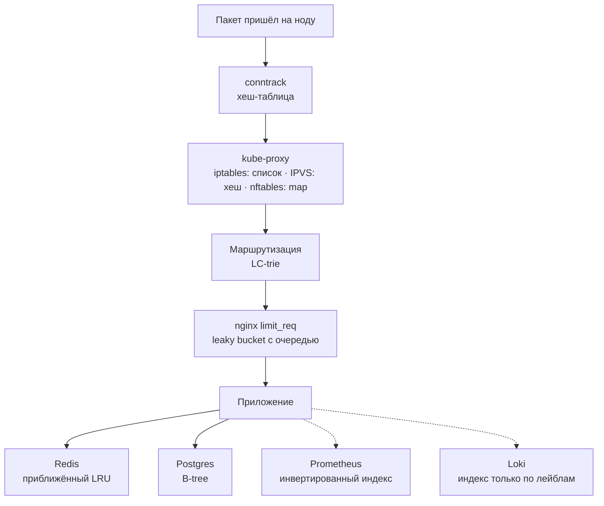

Привет, `%username%`! Структуры данных и алгоритмы у инженеров эксплуатации обычно проходят по графе «собесная повинность»: отмучился с деревом на канвасе или в онлайн-редакторе и забыл до следующего поиска работы. Я с этим не согласен.

Писать красно-чёрное дерево SRE не обязан. А вот эксплуатируются структуры данных каждый день: под именами `conntrack`, `iptables`, `limit_req`, индексов Postgres и серий Prometheus. Пока данных мало, можно и не заглядывать внутрь. Но когда растут задержки, знание устройства этих штук помогает понять, куда смотреть и что измерять.


Расскажи в [чате](/go/chat/?src=sre-data-structures), где это было и сколько искали. Там же можно поспорить с выводами. Анонсы новых постов выходят в [канале](/go/tg/?src=sre-data-structures).


Код замеров и сырые результаты доступны на [github](https://github.com/jtprogru/lab-sre-data-structures). Внутри README и команды `make local`, `make docker`, `make all`; ниже — результаты одного конкретного прогона.

## Что ты унесёшь из статьи

Проведём один запрос через стек, разберём четыре публичных инцидента и посмотрим на замеры из лабы. Если ищешь что-то конкретное:

- **«Алгоритмы нужны только на собесе».** В разборе пути запроса покажу, какие структуры стоят за привычными инструментами и что с ними происходит под нагрузкой.
- **Для дежурства** пригодятся команды рядом с каждым разбором и сводная таблица: симптом, структура, чем смотреть.
- **С чего начать учить** — ближе к концу: порядок тем и книги, в которых теория связана с устройством систем.

## TL;DR (если читать дальше уже некогда)

- Структуры данных в эксплуатации прячутся за названиями инструментов. `conntrack` и `IPVS` — хеш-таблицы, цепочки `iptables` — список, таблица маршрутизации — префиксное дерево, индекс Postgres — B-tree, Prometheus — инвертированный индекс по лейблам.
- Сложность операции — это прогноз поведения под нагрузкой. \(O(n)\) на пакет становится проблемой не в день, когда правило написали, а в день, когда сервисов стало пять тысяч.
- На маленьких тестовых данных квадратичный алгоритм может не выдать себя. В [постмортеме Stack Overflow](https://stackstatus.tumblr.com/post/147710624694/outage-postmortem-july-20-2016) и [разборе GTA Online](https://nee.lv/2021/02/28/How-I-cut-GTA-Online-loading-times-by-70/) видно, чем это заканчивается на большом входе: регулярка кладёт сайт, а два квадратичных участка кода растягивают загрузку игры до шести минут на машине автора разбора.
- `hash mod N` при переходе с десяти серверов на одиннадцать перекладывает 91% ключей, consistent hashing — около 9%. Это разница между «добавили кеш-ноду» и «положили базу промахами».
- Вероятностные структуры меняют точность на память. В [сохранённом прогоне лабы на Redis](https://github.com/jtprogru/lab-sre-data-structures/blob/main/results/redis.json) HyperLogLog посчитал миллион уникальных с ошибкой около 0,03% и занял 14 358 байт, обычный Set на тех же данных — 37 277 578 байт. Это результат конкретного замера `MEMORY USAGE`, а не обещание для любого набора данных.
- Учить стоит от вопроса «на чём это построено у меня в проде», а не от списка задач на LeetCode.

## Где инженер эксплуатации сталкивается с программированием?

Короткий ответ — везде, и про это уже было. В 2022-м, после [опроса](https://t.me/jtprogru_channel/4005) «Должен ли Ops уметь программировать?», я в посте [«Программирование и работа»](/posts/dev-and-work/) признался, что хреновый программист, и рассказал, как добивал алгоритмы на LeetCode и Codewars после проваленных лайвкодингов. В 2025-м в [«Хочу программировать на Golang»](/posts/want-coding-golang/) разобрал, где брать задачи на программирование, если на работе их «нет». Повторять не буду.

Границы профессий оставлю выпуску «SLO, инциденты и прод: где заканчивается DevOps и начинается SRE» подкаста «В SREду на кухне...» — он есть на [YouTube](https://youtu.be/OOWxI_dKTWI) и [VK Видео](https://vkvideo.ru/video-152990965_456240023). Здесь вопрос уже: как разобраться в поведении системы, которую ты эксплуатируешь, но целиком не писал.

Когда в эксплуатации говорят про программирование, обычно имеют в виду «написать»: скрипт, оператор, бота, пайплайн. А потом посреди инцидента открываешь чужой код и пытаешься понять, где он застрял. И вопрос там не в синтаксисе Go или Python, а в том, что этот код делает с данными: перебирает список, ищет по хешу, сортирует на каждом запросе. Синтаксис гуглится за минуту. Но чтобы заподозрить линейный поиск внутри цикла, надо хотя бы знать, чем он опасен на ста тысячах записей.

## Нафига знать про структуры данных?

Возьмём один запрос, `GET /api/orders/42`, и проведём его от сетевого стека ноды до базы и дальше в мониторинг. На каждой остановке посмотрим, какая структура данных его встречает, сколько стоит операция и как эта остановка выглядит, когда ломается. Как запрос идёт по сети с точки зрения протоколов, я разбирал в [«Что происходит, когда ты открываешь сайт»](/posts/what-happens-when-you-open-website/). Здесь посмотрим, как на каждом этапе хранят и ищут данные запроса.

На схеме сплошные стрелки ведут запрос от ноды к приложению и его данным: сначала ищется соединение, затем сервис и маршрут, потом проверяется лимит запросов. Приложение обращается к кешу или базе. Пунктиром показан отдельный след запроса — метрики и логи. Это карта следующих разделов: за каждым знакомым именем подписан механизм, который будем разбирать.



Порядок остановок упрощён: conntrack и NAT в netfilter работают в одних и тех же хуках, а ingress и приложение могут жить на разных нодах. Для разговора о структурах данных это не важно.

### conntrack: хеш-таблица фиксированного размера

На свежей Ubuntu параметры conntrack могут вообще отсутствовать. Это не повод сразу искать другое имя sysctl: сначала проверь, загружен ли `nf_conntrack`. На тестовой Ubuntu 24.04 с ядром `6.8.0-147-generic` команды из примера сначала вернули `cannot stat ...: No such file or directory`. Модуль был установлен, но не загружен. После его загрузки появились и параметры:

```bash
# выполнять на хосте; для загрузки модуля нужны права root
sudo modprobe nf_conntrack
sysctl net.netfilter.nf_conntrack_count net.netfilter.nf_conntrack_max net.netfilter.nf_conntrack_buckets
# на тестовой ВМ после загрузки:
# net.netfilter.nf_conntrack_count = 0
# net.netfilter.nf_conntrack_max = 65536
# net.netfilter.nf_conntrack_buckets = 65536
```

Загрузка модуля сама по себе не добавляет stateful-правил firewall и не означает, что все соединения уже отслеживаются. В контейнере дополнительно имеют значение network namespace и права: `sudo` внутри контейнера не даёт ему автоматически возможность загрузить модуль ядра хоста. Дальше команды относятся к ноде, на которой работает conntrack.

Первым пакет встречает netfilter. Для любого stateful-правила — NAT, `-m conntrack --ctstate ESTABLISHED,RELATED`, маскарадинг — ядро ищет соединение в таблице conntrack. Это хеш-таблица: число корзин задаёт `nf_conntrack_buckets`, предел записей — `nf_conntrack_max`. Поиск стоит в среднем \(O(1 + \alpha)\), где \(\alpha = 2n / b\): на \(n\) соединений приходится \(2n\) записей направлений и \(b\) корзин. Пока записей примерно столько же, сколько корзин, это почти константа.

По умолчанию ядро считает корзины от объёма памяти и зажимает результат между 1 024 и 262 144. На 64-битной машине, где памяти больше 4 ГБ, это сразу потолок. В [актуальной документации ядра](https://docs.kernel.org/networking/nf_conntrack-sysctl.html) `nf_conntrack_max` по умолчанию равен числу корзин. В старых ядрах и настройках дистрибутивов соотношение может отличаться — смотри значения на своей ноде. На тестовой машине примерно с 7,7 ГиБ памяти (Docker Desktop, ядро 6.10.14):

```bash
$ sysctl net.netfilter.nf_conntrack_buckets net.netfilter.nf_conntrack_max
net.netfilter.nf_conntrack_buckets = 262144
net.netfilter.nf_conntrack_max = 262144
```

Каждое соединение лежит в таблице дважды, в прямом и обратном направлении, поэтому даже у заполненной таблицы с настройками по умолчанию средняя цепочка — около двух записей. Это и есть расчётный режим.

Ломается conntrack двумя способами. Громкий: таблица заполнилась, в `dmesg` появляется `nf_conntrack: table full, dropping packet`, новые соединения теряются, а снаружи это выглядит как «сеть иногда не отвечает». Тихий: `nf_conntrack_max` подняли в десять раз, а корзины оставили прежними. Таблица формально не полна, но цепочки выросли до двух десятков записей, и поиск может стать дороже. Если одновременно растёт CPU в softirq, длинные цепочки — одна из гипотез для проверки профилировщиком.

```bash
# сколько записей сейчас, какой предел и сколько корзин
sysctl net.netfilter.nf_conntrack_count net.netfilter.nf_conntrack_max net.netfilter.nf_conntrack_buckets
# были ли потери
dmesg -T | grep -i conntrack
```

Подробно про эти параметры — в [«Настройка Linux для HL и защиты от DDoS»](/posts/sysctl-hl/). Здесь важна одна мысль: `nf_conntrack_max` без `nf_conntrack_buckets` — это не «увеличили таблицу», а «удлинили цепочки».

### kube-proxy: список, хеш или map

Пакет к ClusterIP сервиса Kubernetes должен превратиться в пакет к конкретному поду. Как именно — зависит от режима kube-proxy, и тут разница структур данных видна в цифрах.

В режиме iptables каждый сервис — набор правил в цепочках `KUBE-SERVICES`, `KUBE-SVC-*` и `KUBE-SEP-*`. Цепочку iptables ядро проверяет последовательно, сверху вниз, поэтому первый пакет нового соединения ищет свой сервис за \(O(n)\) по числу сервисов. Следующие пакеты того же соединения подхватывает conntrack, и в спокойный день разница не видна. Видна она в двух местах: когда новых соединений много и когда правила меняются.

Второе больнее. Долгое время kube-proxy при изменении сервисов заново формировал большой набор правил для `iptables-restore`. В [докладе Huawei 2017 года](https://www.slideshare.net/slideshow/scale-kubernetes-to-support-50000-services/77112281) сравнили время добавления правила через `iptables` и `ipvsadm`:

| Сервисов | Правил | Добавить правило, iptables | Добавить правило, IPVS |
| --- | --- | --- | --- |
| 1 | 8 | 2 мс | 2 мс |
| 5 000 | 40 000 | 11 минут | 2 мс |
| 20 000 | 160 000 | 5 часов | 2 мс |

Это исторический замер, а не бенчмарк современного kube-proxy. Он показывает цену полного обновления большой таблицы. IPVS ищет сервис в хеш-таблице: средняя цена поиска близка к \(O(1)\), хотя коллизии и распределение нагрузки никуда не исчезают.

С тех пор многое поменялось — это разобрано в [статье Kubernetes про nftables](https://kubernetes.io/blog/2025/02/28/nftables-kube-proxy/). С 1.28 kube-proxy в режиме iptables обновляет только изменившиеся сервисы, а не всю таблицу. Режим nftables стал GA в 1.33: выбор цепочки сервиса там делается через verdict map вместо линейного перебора правил. Конкретное внутреннее представление sets и maps выбирает nftables; map не обязательно означает хеш-таблицу. IPVS с 1.35 [объявлен устаревшим](https://kubernetes.io/docs/reference/networking/virtual-ips/#ipvs-proxy-mode). Режимом по умолчанию при этом до сих пор остаётся iptables.

```bash
# число правил в nat-таблице на ноде в режиме iptables
iptables-save -t nat | grep -c '^-A '
# сколько из них цепочек сервисов
iptables-save -t nat | grep -c '^:KUBE-SVC-'
```

Выбирая режим kube-proxy, ты выбираешь структуру данных. На двадцати сервисах разницу легко не заметить. На двадцати тысячах уже придётся с ней считаться. И одна оговорка про nftables: правила внутри цепочки он тоже обходит списком, выигрыш дают только sets и maps. Переписать iptables-правила один в один на nft — значит сохранить \(O(n)\).

### Таблица маршрутизации: префиксное дерево

Дальше ядро решает, куда отправить пакет. Задача — longest prefix match: из всех подходящих префиксов выбрать самый длинный. Перебирать маршруты списком нельзя, у пограничного маршрутизатора с полной таблицей BGP их сотни тысяч. Linux хранит IPv4-маршруты в [LC-trie — префиксном дереве со сжатием уровней и путей](https://docs.kernel.org/networking/fib_trie.html). Реализация лежит в [`net/ipv4/fib_trie.c`](https://github.com/torvalds/linux/blob/master/net/ipv4/fib_trie.c). Это дерево можно посмотреть руками:

```bash
$ head -12 /proc/net/fib_trie
Main:
  +-- 0.0.0.0/0 3 0 5
     |-- 0.0.0.0
        /0 universe UNICAST
     +-- 127.0.0.0/8 2 0 2
        +-- 127.0.0.0/31 1 0 0
           |-- 127.0.0.0
              /8 host LOCAL
           |-- 127.0.0.1
              /32 host LOCAL
        |-- 127.255.255.255
           /32 link BROADCAST
```

Сжатие путей и уровней позволяет проверять сразу несколько битов адреса, а longest prefix match при необходимости делает возвраты по дереву. Это [LC-trie](https://docs.kernel.org/networking/fib_trie.html), а не последовательная проверка всех маршрутов. Число маршрутов всё равно влияет на размер дерева, кеши CPU и реальную задержку поиска. Тот же приём — префиксное дерево вместо списка — встречается в роутерах HTTP-фреймворков, в автодополнении CLI и в поиске по именам метрик. Увидишь `/proc/net/fib_triestat` — знай, что это статистика именно дерева: глубина, число узлов и листьев.

### nginx `limit_req`: дырявое ведро с очередью

Запрос добрался до ingress. Если на нём стоит `limit_req`, его встречает алгоритм, который [документация nginx](https://nginx.org/en/docs/http/ngx_http_limit_req_module.html) прямо называет «leaky bucket». Без понимания того, как устроено ведро, этот конфиг читается неправильно:

```nginx
limit_req_zone $binary_remote_addr zone=api:10m rate=10r/s;

location /api/ {
    limit_req zone=api burst=20;
}
```

Ведро вытекает со скоростью 10 запросов в секунду, `burst=20` — его ёмкость. Запросы сверх скорости, но в пределах `burst`, не отклоняются, а ждут в очереди и выходят с темпом `rate`. Отклоняется только то, что в ведро уже не влезло. Я проверил это на nginx 1.31.8: 30 параллельных запросов с одного адреса.

| Запрос по возрастанию времени ответа | `burst=20`, статус / время в мс | `burst=20 nodelay`, статус / время в мс |
| --- | --- | --- |
| 1-й | 200 / 36 | 200 / 1,8 |
| 6-й | 200 / 536 | 200 / 3,2 |
| 11-й | 200 / 1 038 | 200 / 3,6 |
| 16-й | 200 / 1 538 | 200 / 4,1 |
| 21-й | 200 / 2 038 | 200 / 5,0 |
| Отклонённые девять | 503 сразу | 503 сразу |

Время включает клиент и Docker; запросы в таблице отсортированы по времени ответа, а не по порядку старта потоков. Без `nodelay` последний принятый запрос ждал около двух секунд: двадцать мест в очереди по 100 мс на каждое. Отсюда классика: p99 на ingress вырос, бэкенд спокоен, а в логах ни одной ошибки, если запросы укладываются в `burst` и задерживаются, а не отклоняются. В моей пачке девять запросов всё же получили 503, поэтому ошибки были. В этом замере время съела очередь перед бэкендом. С `nodelay` пачка в пределах `burst` проходит сразу, а места в ведре освобождаются в фоне с тем же темпом.


Первый вариант стенда отвечал через `return 200`, и ограничитель не сработал вообще: все 30 запросов прошли мгновенно. `return` выполняется в фазе rewrite, а `limit_req` живёт в более поздней фазе preaccess, до которой такой запрос не доходит. Проверяй лимиты на location, которые отдают настоящий контент или проксируют.


### Кеш: LRU, который не совсем LRU

Приложение сначала идёт в Redis. По умолчанию политика вытеснения там `noeviction`: упёршись в `maxmemory`, Redis ничего не выкидывает, а отвечает ошибкой на запись. Для кеша ставят, например, `allkeys-lru`. Честный LRU требует двусвязного списка поверх всех ключей и перестановки на каждом чтении. [Redis экономит память и делает приближение](https://redis.io/docs/latest/develop/reference/eviction/): берёт случайную выборку из `maxmemory-samples` ключей (по умолчанию 5, проверил на Redis 8.10.3) и вытесняет самый давний из неё, а с версии 3.0 ещё и держит пул лучших кандидатов между выборками.

Но даже точный LRU плохо переносит сканирующую нагрузку. Ночной отчёт, который один раз пробегает по миллиону холодных ключей, делает их «свежими» и вымывает из кеша горячий набор. Утром hit ratio падает, база получает пик промахов, и никто не понимает, что изменилось. Для такой нагрузки есть `allkeys-lfu`, которое вытесняет по частоте обращений, а не по давности.

```bash
redis-cli CONFIG GET maxmemory-policy
redis-cli CONFIG GET maxmemory-samples
redis-cli INFO stats | grep -E 'evicted_keys|keyspace_(hits|misses)'
```

Redis сам не догадается, что ночью по ключам ходит отчёт. Политику вытеснения придётся подбирать с учётом этой нагрузки.

### Postgres: B-tree против Seq Scan

Промах в кеше — идём в базу. `SELECT * FROM orders WHERE id = 42` по первичному ключу — поиск по B-tree за \(O(\log n)\). Основание логарифма здесь не 2, а сотни ключей на страницу, поэтому дерево получается низким и широким. Тот же запрос по полю без индекса — `Seq Scan` за \(O(n)\). На стенде с десятью тысячами строк можно и не обратить внимания на разницу. На большой таблице тот же перебор уже обходится дорого.

Проверил на Postgres 18.6 в Docker: таблица `orders` на 5 млн строк, около 287 МиБ. Перед каждым сценарием — один прогревочный запрос, в таблице медиана трёх выполнений. У Seq Scan были два параллельных воркера. Полные JSON-планы всех повторов лежат в [`results/postgres.json`](https://github.com/jtprogru/lab-sre-data-structures/blob/main/results/postgres.json), создание таблицы и замеры — в функции `postgres()` файла [`scripts/lab.py`](https://github.com/jtprogru/lab-sre-data-structures/blob/main/scripts/lab.py). Воспроизвести можно командой `make postgres` из корня лабы; нужен Docker.

| Запрос | План | `shared hit` / `shared read` | Время |
| --- | --- | --- | --- |
| `WHERE id = 4242424` | Index Scan по `orders_pkey` | 4 / 0 | 0,037 мс |
| `WHERE customer_email = 'user4242424@example.com'` без индекса | Gather → Parallel Seq Scan, 2 воркера | 12 840 / 23 925 | 49,586 мс |
| то же после `CREATE INDEX` | Index Scan по `orders_email_idx` | 4 / 0 | 0,032 мс |

По `bt_metap` из расширения `pageinspect` у обоих индексов `level = 2`: корень, один промежуточный уровень и листья. Три шага на пять миллионов строк. А 50 мс выглядят невинно, пока такой запрос один. При сотнях запросов в секунду повторный перебор всей таблицы уже становится заметной нагрузкой. Но из wall time и числа воркеров нельзя честно вывести расход CPU в ядрах: для этого нужны отдельные измерения.

В таблице указаны счётчики буферов верхнего узла плана из `EXPLAIN (ANALYZE, BUFFERS)`, а не физические чтения с диска. [Postgres различает `shared hit` и `shared read`](https://www.postgresql.org/docs/current/using-explain.html); даже `read` может обслужить кеш ОС. Время зависит от прогрева кешей и условий стенда.

```sql
EXPLAIN (ANALYZE, BUFFERS)
SELECT * FROM orders WHERE customer_email = 'user4242424@example.com';
```

Две оговорки, которые тоже следуют из устройства дерева. B-tree умеет равенство, диапазоны и сортировку, но не поиск подстроки в середине: `LIKE '%abc%'` пойдёт мимо него, для этого есть GIN с `pg_trgm`. И индекс не бесплатен: каждая вставка поддерживает все подходящие индексы таблицы, поэтому лишние индексы оплачиваются записью и объёмом WAL.

### Prometheus, VictoriaMetrics и Loki: индекс по лейблам

Запрос обработан, приложение увеличивает счётчик `http_requests_total{method="GET", route="/api/orders/:id", status="200"}`. В TSDB Prometheus каждая уникальная комбинация лейблов — отдельная серия. Ищет их инвертированный индекс: для каждой пары `label=value` хранится отсортированный список ID серий (postings), а селектор с несколькими лейблами превращается в пересечение отсортированных списков. Это быстро.

Дорого другое. Свежие данные каждой серии лежат в памяти head-блока, и [документация Prometheus](https://prometheus.io/docs/practices/instrumentation/) прямо пишет, что каждый новый набор лейблов — это отдельная серия со своей ценой в RAM, CPU, диске и сети. А число серий сверху ограничено произведением кардинальностей лейблов:

$$\text{series} \le \prod_i |L_i|$$

Пять методов, пятьдесят маршрутов и десять статусов дают до 2 500 серий. Положи в лейбл `user_id` вместо `route` при ста тысячах пользователей — и верхняя граница уходит до 5 млн серий: \(5 \times 100\,000 \times 10\). Если оставить ещё и 50 маршрутов, получится уже 250 млн. Прежде чем ругать Prometheus за тормоза, проверь, сколько серий ты заставил его хранить. Топ метрик по числу серий Prometheus отдаёт сам:

```bash
curl -s http://prometheus:9090/api/v1/status/tsdb | jq '.data.seriesCountByMetricName[:10]'
```

У меня этот разговор часто заканчивается внедрением кластерной VictoriaMetrics: в том числе когда хочется сократить ресурсы, которые съедает Prometheus. Но смена хранилища не отменяет цену неограниченных лейблов. В VictoriaMetrics тоже есть [инвертированный индекс — IndexDB](https://docs.victoriametrics.com/victoriametrics/single-server-victoriametrics/#indexdb): он связывает имена метрик и лейблы с идентификаторами серий, TSID. Устройство хранения отличается от Prometheus; переносить на VictoriaMetrics объяснение про память head-блока нельзя. Кардинальность и churn — скорость появления новых серий — всё равно увеличивают работу с индексом.

В [кластерной VictoriaMetrics](https://docs.victoriametrics.com/victoriametrics/cluster-victoriametrics/#architecture-overview) `vminsert` распределяет серии по `vmstorage` с помощью consistent hashing по имени метрики и лейблам. `vmselect` запрашивает нужные данные у узлов хранения. Так можно распределить нагрузку между машинами, но запрос с широким селектором всё ещё заставляет хранилище находить и читать множество серий. Конкретную экономию RAM и CPU надо проверять на своей нагрузке: в этой лабе сравнения двух TSDB нет.

| Система | Как ищет | Где искать цену большого числа серий |
| --- | --- | --- |
| Prometheus | Postings по лейблам | Память head-блока, индекс и обработка запросов |
| VictoriaMetrics cluster | IndexDB на узлах `vmstorage`, запрос через `vmselect` | Индекс, кеши и чтение на узлах хранения; обработка результатов на `vmselect` |
| Loki | Индекс лейблов потоков, затем чтение чанков | Число потоков, размер чанков и объём просмотренных логов |

Для VictoriaMetrics есть [Cardinality explorer в VMUI](https://docs.victoriametrics.com/victoriametrics/single-server-victoriametrics/#cardinality-explorer) и знакомый `/api/v1/status/tsdb`. В кластере путь проходит через `vmselect` и содержит tenant. Например, для tenant `0`:

```bash
curl -s 'http://vmselect:8481/select/0/prometheus/api/v1/status/tsdb?topN=10' \
  | jq '.data.seriesCountByMetricName'
```

В кластере эта статистика может завышать число уникальных серий: `vmselect` суммирует данные узлов, а одна серия может оказаться на нескольких из-за репликации или перенаправления записи. Это подсказка для поиска источника кардинальности, а не точная перепись уникальных серий кластера. Про выбор остального стека есть [«Мониторинг: что/куда/зачем?»](/posts/wat-monitoring/).

[Loki индексирует лейблы](https://grafana.com/docs/loki/latest/get-started/labels/), а строки хранит в сжатых чанках. Для `|= "error"` обычно приходится читать и фильтровать строки из чанков, отобранных по лейблам и времени; дополнительные механизмы вроде Bloom-фильтров могут сократить эту работу. Быстро — пока селектор узкий. Поэтому запрос по `{namespace="prod"}` за неделю медленный, а по `{namespace="prod", app="orders"}` за час быстрый. Правило про кардинальность здесь то же самое: лейбл с неограниченными значениями плодит потоки и мелкие чанки.

### Сводка остановок

| Где | Структура | Цена операции | Как ломается | Чем смотреть |
| --- | --- | --- | --- | --- |
| conntrack | хеш-таблица | \(O(1 + \alpha)\) | `table full, dropping packet`; длинные цепочки при большом \(\alpha\) | `sysctl net.netfilter.nf_conntrack_*`, `dmesg` |
| kube-proxy, iptables | список правил | \(O(n)\) по сервисам | долгий sync правил, задержка новых соединений | `iptables-save -t nat`, число правил `-A` |
| kube-proxy, IPVS и nftables | хеш, verdict map | IPVS: в среднем \(O(1)\); map: зависит от реализации | цена обновлений и размер таблиц | `ipvsadm -Ln`, `nft list ruleset` |
| маршрутизация | LC-trie | сжатое дерево и longest prefix match | размер дерева, промахи кешей CPU | `/proc/net/fib_trie`, `/proc/net/fib_triestat` |
| nginx `limit_req` | leaky bucket с очередью | — | рост latency без ошибок | `$limit_req_status` в access log, error log `limiting requests` |
| Redis | приближённый LRU или LFU | — | вымывание горячего набора | `INFO stats` |
| Postgres | B-tree | \(O(\log n)\) против \(O(n)\) у Seq Scan | Seq Scan на большой таблице | `EXPLAIN (ANALYZE, BUFFERS)` |
| Prometheus | инвертированный индекс | пересечение postings | взрыв кардинальности, память head-блока | `/api/v1/status/tsdb` |
| VictoriaMetrics cluster | IndexDB, распределение серий между `vmstorage` | поиск TSID и чтение данных на узлах хранения | рост кардинальности и churn, широкие запросы | VMUI Cardinality explorer, `/select/<tenant>/prometheus/api/v1/status/tsdb` |
| Loki | индекс только по лейблам | чтение отобранных чанков | медленный `\|=` на широком селекторе | Query inspector в Grafana |

Прочерк у nginx и Redis означает, что здесь не дана одна оценка сложности для всей операции. У nginx `limit_req` [поиск состояния клиента в красно-чёрном дереве](https://github.com/nginx/nginx/blob/master/src/http/modules/ngx_http_limit_req_module.c) и расчёт задержки — разные части работы; у Redis поиск ключа и выбор кандидата на вытеснение — тоже. Одна запись вроде «LRU — \(O(1)\)» скрыла бы эти различия. Прочерк не означает, что операция бесплатна: в этих строках важнее очередь и поведение кеша.

## Может быть, ещё и алгосы надо?

Структура данных — это то, как данные лежат. Алгоритм — то, что с ними делают. Big O поможет оценить рост работы, а бинарный поиск, consistent hashing и backoff пригодятся в конкретных задачах.

### Big O — это прогноз, а не собес

В эксплуатации Big O нужна не для того, чтобы ответить на собеседовании, а для одного вопроса: что станет с этой операцией, когда данных станет в десять раз больше. Это тот же вопрос, что задаёт capacity planning, только про код.

| Сложность | \(n = 10^3\) | \(n = 10^4\) | \(n = 10^5\) | Данных ×10 — работы |
| --- | --- | --- | --- | --- |
| \(O(1)\) | 1 | 1 | 1 | столько же |
| \(O(\log n)\) | ~10 | ~13 | ~17 | +3 шага |
| \(O(n)\) | 1 000 | 10 000 | 100 000 | ×10 |
| \(O(n \log n)\) | ~10 000 | ~133 000 | ~1 660 000 | чуть больше ×10 |
| \(O(n^2)\) | \(10^6\) | \(10^8\) | \(10^{10}\) | ×100 |

Последнюю строку легко пропустить, если в тестах мало данных. На тысяче записей миллион простых операций может укладываться в приемлемое время. На ста тысячах работы уже в десять тысяч раз больше, и случается это не на стенде, а в проде, в тот день, когда данных наконец стало много.

### Бинарный поиск: `git bisect`

Релиз сломался, между последней хорошей версией и текущей тысяча коммитов. Перебирать по одному — \(O(n)\) прогонов проверки. `git bisect` делит диапазон пополам и спрашивает, хорош ли коммит посередине, — это [бинарный поиск за \(O(\log n)\)](https://git-scm.com/docs/git-bisect). Проверка может быть любой: тест, скрипт с `curl` к стенду, сравнение вывода.

```bash
git bisect start HEAD v1.4.0    # сначала плохой, потом хороший
git bisect run ./check.sh       # 0 — хороший, 125 — пропустить, 1–127, кроме 125, — плохой
git bisect reset
```

Это работает, если проверка стабильна и в выбранном диапазоне есть переход от хорошего состояния к плохому без последующего исправления. На лабораторном репозитории из 1 024 коммитов, где поломка внесена в 700-м, `git bisect run` нашёл его за 10 прогонов проверки — ровно \(\log_2 1024\). Тот же приём работает без git: какая из сорока правок sysctl сломала ноду, какой из двухсот флагов конфига включил регрессию. Откати половину, посмотри, повтори.

Этот репозиторий не надо собирать руками: генератор есть в [`scripts/lab.py`](https://github.com/jtprogru/lab-sre-data-structures/blob/main/scripts/lab.py), функции `create_bisect_repo()` и `bisect_lab()`. Команда `make bisect` сама создаёт временную историю, запускает поиск и сохраняет результат в [`results/bisect.json`](https://github.com/jtprogru/lab-sre-data-structures/blob/main/results/bisect.json). Чтобы оставить историю и пройти поиск самостоятельно, из корня лабы выполни:

```bash
# путь должен быть новым: генератор откажется перезаписывать существующий
python3 scripts/lab.py bisect --repo /tmp/sre-bisect-demo
cd /tmp/sre-bisect-demo
git bisect start main main~1023
git bisect run sh ./check.sh
git bisect reset
```

В каждом коммите файл `version` содержит его порядковый номер. `check.sh` возвращает успех для номеров меньше 700 и ошибку начиная с 700. Он дописывает по строке в `checks.log` на каждый запуск: после поиска `wc -l < checks.log` покажет число проверок. Здесь моделируется один переход от исправного состояния к сломанному, без последующего исправления.

### Consistent hashing: сколько ключей переезжает

Кеш на десяти нодах, ключ раскладывается по `hash(key) mod N`. Добавили одиннадцатую ноду. Ключ остаётся на месте, только если \(h \bmod N = h \bmod (N + 1)\), и для случайного хеша это доля \(\frac{1}{N + 1}\), то есть переезжает \(\frac{N}{N+1}\) — при переходе с 10 на 11 нод это 90,9% ключей. Кеш почти целиком промахивается, промахи идут в базу, база ложится. Consistent hashing раскладывает ноды по кольцу, и новая нода забирает только свою долю — около \(\frac{1}{N+1}\) ключей.

Прогнал на 200 000 ключей с MD5 и учебным кольцом по 160 виртуальных точек на ноду. Код — функция `hashing()` в [`scripts/lab.py`](https://github.com/jtprogru/lab-sre-data-structures/blob/main/scripts/lab.py), результаты — [`results/hashing.json`](https://github.com/jtprogru/lab-sre-data-structures/blob/main/results/hashing.json). Для повтора запусти `make hashing`. Это тот же принцип, что у ketama, но не побайтовая реализация алгоритма nginx:

| Переход | `mod N`, лаба | `mod N`, теория | кольцо, лаба | кольцо, теория |
| --- | --- | --- | --- | --- |
| 4 → 5 нод | 80,1% | 80,0% | 18,5% | 20,0% |
| 10 → 11 нод | 90,9% | 90,9% | 9,2% | 9,1% |

В nginx это одно слово в конфиге: `hash $request_uri consistent;` в блоке `upstream` включает ketama вместо простого остатка от деления. Если за upstream стоят кеши, без этого слова каждое масштабирование — маленький инцидент.

### Backoff и jitter: ретраи тоже алгоритм

Ретрай с постоянной паузой — способ превратить короткий сбой в длинный: все клиенты, упавшие одновременно, одновременно и возвращаются. Экспоненциальная пауза растит интервал:

$$t_k = \min\left(\text{cap},\ \text{base} \cdot 2^k\right)$$

Но если клиенты упали вместе, они и ждут одинаково, и волны повторных запросов остаются синхронными. Лечится случайностью — full jitter:

$$t_k = \text{random}\left(0,\ \min\left(\text{cap},\ \text{base} \cdot 2^k\right)\right)$$

В 2015 году Марк Брукер из AWS [промоделировал это](https://aws.amazon.com/blogs/architecture/exponential-backoff-and-jitter/) на конкурирующих клиентах. Экспоненциальный backoff без jitter оказался у него «явным аутсайдером», а full jitter дал меньше всего лишней работы ценой чуть большего времени. Брукер там же честно оговаривается: jitter не отменяет квадратичный рост работы при конкуренции, а лишь заметно его снижает. [Google SRE Book в главе про каскадные отказы](https://sre.google/sre-book/addressing-cascading-failures/) формулирует то же правилом: всегда используй рандомизированный экспоненциальный backoff. Посмотри, как устроены ретраи твоих клиентов: добавляют ли они случайную задержку или после общего сбоя все снова придут одновременно.

## А какие ваши доказательства?

В лабе можно остановить тест и пойти пить чай. В этих четырёх историях неудачный алгоритм уже достался пользователям.

### Stack Overflow, 20 июля 2016: двадцать тысяч пробелов

В [постмортеме Stack Overflow](https://stackstatus.tumblr.com/post/147710624694/outage-postmortem-july-20-2016) разобрана регулярка для обрезки пробелов в начале и конце строки: `^[\s\u200c]+|[\s\u200c]+$`, где `\u200c` обозначает zero-width non-joiner. В одном посте оказалось около 20 000 пробельных символов подряд, причём не в конце строки. Движок с возвратами пробует вторую альтернативу с каждой позиции: съедает пробелы до конца серии, не находит конец строки, откатывается и начинает со следующей. Сумма \(20\,000 + 19\,999 + \dots\) — около 200 миллионов проверок на одну строку, точное число зависит от пути исполнения движка. Сами авторы оговариваются: это не классический катастрофический бэктрекинг с экспонентой, а «всего лишь» \(O(n^2)\). Хватило и его.

Пост был в списке на главной странице, и регулярка выполнялась на каждом её просмотре. Главную дёргал health check балансировщика, health check перестал укладываться в таймаут, и балансировщик вывел веб-серверы из ротации. 34 минуты простоя: 10 ушло на поиск причины, 14 на фикс и 10 на раскатку. Регулярку заменили обычной обрезкой подстрокой.

Повторить это можно за минуту. Я прогнал ту же регулярку на Python 3.15.2 (модуль `re` — тоже движок с возвратами) на M4 Max:

| Пробелов подряд | Время одного `search` |
| --- | --- |
| 5 000 | 62 мс |
| 10 000 | 248 мс |
| 20 000 | 988 мс |
| 40 000 | 3 981 мс |

В таблице — медиана трёх прогонов на строке `x` + пробелы + `x`. Удвоил вход — время выросло примерно вчетверо. Это и есть \(O(n^2)\) вживую. `str.rstrip()` на той же строке даже не перебирает внутренние пробелы: последний символ — `x`, и обрезать нечего.

### Cloudflare, 2 июля 2019: одно правило WAF

В 13:42 UTC Cloudflare начала выкатывать новое managed-правило WAF против XSS, сразу на всю сеть. Ключевой фрагмент регулярки — `.*(?:.*=.*)`, в упрощённом виде `.*.*=.*`: два жадных `.*` подряд, которые на строке без подходящего `=` перебирают все способы поделить её между собой. В [постмортеме Cloudflare](https://blog.cloudflare.com/details-of-the-cloudflare-outage-on-july-2-2019/) это посчитано по шагам движка: `x=x` — 23 шага, `x=xxxxxxxxxxxxxxxxxxxx` (20 символов `x` после `=`) — 555, `xxxxxxxxxxxxxxxxxxxx` (20 символов `x` без `=`) — 4 067.

CPU на всех ядрах, обслуживающих HTTP и HTTPS, ушёл почти в 100% по всему миру, клиенты получали 502. Сеть лежала 27 минут, в худший момент трафик упал на 82%. Добавить серверов здесь было бы бессмысленно: каждое ядро, которое получило бы трафик, тут же занялось бы той же регуляркой. Помогло глобальное отключение WAF в 14:07.

Постмортем перечисляет несколько причин: у движка регулярных выражений не было гарантий сложности, защиту от чрезмерного расхода CPU незадолго до этого убрали, а правило ушло на всю сеть без поэтапной выкатки. После инцидента Cloudflare вернула защиту, вручную перепроверила все 3 868 managed-правил, добавила профилирование правил в тесты, ввела поэтапную выкатку и пообещала перейти на re2 или движок Rust с гарантией времени выполнения.

### GTA Online: шесть минут загрузки

28 февраля 2021 года программист под ником t0st [разобрал](https://nee.lv/2021/02/28/How-I-cut-GTA-Online-loading-times-by-70/), почему GTA Online на PC годами грузится около шести минут. Профайлер показал одно ядро, занятое разбором 10-мегабайтного JSON примерно на 63 000 элементов каталога внутриигрового магазина. Внутри нашлись два квадратичных места. Парсер читал JSON через `sscanf`, который при каждом вызове делает `strlen` по всему оставшемуся буферу: проход по десяти мегабайтам на каждый токен. А каждый элемент перед вставкой проверялся на дубликат линейным проходом по уже вставленным — \((n^2 + n)/2\), или 1 984 531 500 проверок. При том что все элементы уникальны, а функция прямой вставки в коде уже была.

Замеры автора на AMD FX-8350:

| Что исправлено | Загрузка |
| --- | --- |
| ничего | ~6 мин |
| только дедупликация | 4 мин 30 с |
| только парсер | 2 мин 50 с |
| оба места | 1 мин 50 с |

Итого минус 69,4%, в заголовке округлено до 70. Меня здесь больше всего цепляет, что ошибки годами не замечали: на маленьком каталоге всё грузилось быстро, а каталог рос постепенно.

### Hash flooding, декабрь 2011: когда \(O(1)\) становится \(O(n)\)

28 декабря 2011 года на 28C3 Александр Клинк и Юлиан Вельде представили атаку на разбор HTTP-параметров. Фреймворк складывает их в хеш-таблицу. Если подобрать ключи так, чтобы все попали в одну корзину, цена вставки растёт до \(O(n)\), а разбор всего запроса — до \(O(n^2)\). Маленький запрос превращается в долгую работу одного ядра. Подробности и затронутые реализации перечислены в [oCERT-2011-003](https://ocert.org/advisories/ocert-2011-003.html).

Отсюда лимиты на число входных параметров и рандомизация хеширования. В Python 3.3 рандомизация хешей строк включена по умолчанию, а в 3.4 появился SipHash — это описано в [PEP 456](https://peps.python.org/pep-0456/). Конкретный алгоритм зависит от языка и версии, но задача одна: не дать клиенту заранее подобрать набор коллизий. Лимит числа полей защищает ещё и от слишком большого объёма разбора, даже когда хеши распределяются удачно.

### Что общего у четырёх историй

Эти истории объединяет размер или форма входа, на которых проявилась сложность: длинная серия пробелов, строка без `=`, разросшийся каталог, специально подобранные ключи. И во всех четырёх лечило изменение алгоритма или структуры, а не железо. После таких разборов иначе смотришь на `.*.*` в регулярке и линейный поиск внутри цикла. Уже хочется проверить, как они поведут себя на длинной строке или большом списке. Больше таких историй собрано в блоге [Accidentally Quadratic](https://accidentallyquadratic.tumblr.com/) — читается как сборник страшилок.

## А что-то посерьёзнее?

Списками и деревьями дело не заканчивается. В распределённых системах приходится ещё экономить память на подсчётах, раскладывать запросы по бэкендам и договариваться, какая реплика права.

### Bloom filter: «точно нет» или «может быть»

Bloom filter отвечает на вопрос «есть ли элемент в множестве» двумя способами: «точно нет» или «может быть». Ложноотрицательных ответов не бывает, ложноположительные случаются с заданной вероятностью \(p\). Для обычного Bloom filter без удаления элементов это верно, пока биты не потеряны и используется одна и та же схема хеширования. При оптимальном числе хеш-функций память в битах на элемент приближённо равна:

$$\frac{m}{n} = -\frac{\ln p}{(\ln 2)^2}$$

Для \(p = 1\%\) это около 9,6 бита на ключ, для \(p = 0{,}1\%\) — около 14,4. Каждое десятикратное улучшение точности стоит примерно 4,8 бита на ключ.

В [Cassandra](https://cassandra.apache.org/doc/latest/cassandra/managing/operating/bloom_filters.html) у каждого SSTable есть свой Bloom filter. При чтении фильтр позволяет пропустить SSTable, если нужного partition key там точно нет. Точность задаёт `bloom_filter_fp_chance` у таблицы: по умолчанию 0,01, а для LeveledCompactionStrategy 0,1. `nodetool tablestats` показывает, сколько памяти фильтры занимают и как часто ошибаются. Поднял точность — фильтры заняли больше памяти, зато лишних чтений с диска стало меньше. Опустил — наоборот. Это обычный инженерный компромисс, просто записанный формулой. В [ClickHouse](https://clickhouse.com/docs/optimize/skipping-indexes) `bloom_filter` работает как data skipping index (по умолчанию с долей ложных срабатываний 0,025): он позволяет пропускать гранулы, где значения точно нет.

### HyperLogLog: миллион уникальных в 14 КБ

Сколько уникальных пользователей было вчера? Для точного подсчёта надо хранить все уникальные ID. HyperLogLog вместо самих ID хранит короткие регистры со статистикой хешей. Их число обозначим `m`. В [исходнике Redis, `src/hyperloglog.c`](https://github.com/redis/redis/blob/unstable/src/hyperloglog.c), константа `HLL_P` равна 14, а `HLL_REGISTERS` вычисляется как `1 << HLL_P`: получаем 2 в степени 14, то есть 16 384 регистра.

В [исходной работе Флажоле и соавторов](https://algo.inria.fr/flajolet/Publications/FlFuGaMe07.pdf) относительная стандартная ошибка HyperLogLog приближённо равна `1,04 / sqrt(m)`. Коэффициент 1,04 получен в анализе алгоритма; это не параметр Redis и не результат моего замера. Подставляем число регистров Redis, извлекаем корень — 128 — и переводим долю в проценты:

$$\sigma \approx \frac{1{,}04}{\sqrt{16\,384}} \approx 0{,}81\%.$$

В [Redis](https://redis.io/docs/latest/develop/data-types/probabilistic/hyperloglogs/) это команды `PFADD`, `PFCOUNT` и `PFMERGE`. Проверил на Redis 8.10.3: один и тот же набор из миллиона уникальных строк от `user:0` до `user:999999` добавлен в HyperLogLog (`PFADD hll ...`) и обычный Set (`SADD exact ...`). Функция `redis()` в [`scripts/lab.py`](https://github.com/jtprogru/lab-sre-data-structures/blob/main/scripts/lab.py) делает это батчами по 1 000 значений. Команда `make redis` повторяет опыт в Docker; сохранённые ответы, версия сервера и digest образа лежат в [`results/redis.json`](https://github.com/jtprogru/lab-sre-data-structures/blob/main/results/redis.json).

| Ключ | Ответ | `MEMORY USAGE` |
| --- | --- | --- |
| HyperLogLog, `PFCOUNT` | 999 674 | 14 358 байт |
| Set, `SCARD` | 1 000 000 | 37 277 578 байт |

Фактическая относительная ошибка — `abs(999674 - 1000000) / 1000000 * 100% = 0,0326%`, округлённо 0,03%. В этот раз повезло: стандартная ошибка около 0,81% описывает статистический разброс, а не гарантированную верхнюю границу ошибки. `MEMORY USAGE` показывает память конкретного ключа с накладными расходами Redis, а не только полезные биты HLL и не память всего процесса. Поэтому 14 358 байт из замера не противоречат примерно 12 КиБ на сами регистры: 16 384 регистра по 6 бит, как задано константой `HLL_BITS` в исходнике.

В этом опыте память меньше примерно в 2 600 раз. Несколько структур объединяются через `PFMERGE`: получаешь оценку числа уникальных в объединении, с учётом пересечений. Дополнительной потери точности относительно одного HLL на всех тех же элементах нет. Для дашборда «уникальные клиенты по дням» это ровно то, что нужно. Для биллинга — нет.

### Maglev: consistent hashing для L4-балансировщика

Consistent hashing встречается и на уровне L4. В 2016 году Google описала [балансировщик Maglev](https://research.google/pubs/maglev-a-fast-and-reliable-software-network-load-balancer/). Экземпляры с одинаковым набором бэкендов и параметрами независимо строят одинаковую таблицу поиска. Бэкенды получают почти равные доли ячеек, а при изменении состава большая часть назначений сохраняется. Это уменьшает число соединений, которым достанется другой бэкенд.

В [Cilium](https://docs.cilium.io/en/stable/network/kubernetes/kubeproxy-free/#maglev-consistent-hashing) алгоритм включается через `loadBalancer.algorithm=maglev`. `maglev.tableSize` по умолчанию равен 16 381; допустимы определённые простые размеры. Документация рекомендует таблицу существенно больше чем \(100 \times N\), где \(N\) — максимальное ожидаемое число бэкендов сервиса. У всех агентов должны совпадать размер таблицы и `maglev.hashSeed`.

Одинаковая таблица помогает пережить смену балансировщика, но сама по себе не гарантирует сохранность соединений. При изменении бэкендов часть назначений переедет; имеют значение conntrack, режим передачи трафика и согласованность конфигурации. В Cilium Maglev применяется к внешнему трафику, а внутрикластерный socket-LB выбирает бэкенд другим путём.

### Raft: почему etcd из трёх или пяти узлов

etcd, а с ним и весь control plane Kubernetes, держится на Raft. Запись подтверждается, когда её сохранило большинство узлов — кворум \(\lfloor n/2 \rfloor + 1\):

| Узлов | Кворум | Переживёт отказ |
| --- | --- | --- |
| 1 | 1 | 0 |
| 3 | 2 | 1 |
| 4 | 3 | 1 |
| 5 | 3 | 2 |

Четвёртый узел не добавляет отказоустойчивости по сравнению с тремя, зато добавляет ещё одну реплику, которую надо дождаться на каждой записи. [FAQ etcd](https://etcd.io/docs/v3.7/faq/) пишет об этом прямо: довести кластер до чётного числа узлов — не купить дополнительной отказоустойчивости. Там же совет не делать кластер больше семи узлов. Отсюда же требование к дискам: каждая запись ждёт `fsync` на большинстве узлов, поэтому медленный диск на двух из трёх узлов замедляет весь кластер. Смотреть на это стоит через `etcd_disk_wal_fsync_duration_seconds`.

Под Raft у etcd лежит bbolt — B+tree в одном файле. Это видно с двух сторон: backend etcd [импортирует `go.etcd.io/bbolt` и открывает базу через `bolt.Open`](https://github.com/etcd-io/etcd/blob/v3.6.0/server/storage/backend/backend.go), а [README самого bbolt](https://github.com/etcd-io/bbolt#leveldb-rocksdb) описывает B+tree и хранение в одном файле. Удалённые ключи освобождают страницы внутри файла, но сам файл не сжимается, а компакция истории сама по себе не возвращает место файловой системе. Когда его нужно освободить, применяют дефрагментацию: [`etcdctl defrag`](https://etcd.io/docs/v3.7/op-guide/maintenance/#defragmentation) переписывает базу и возвращает место файловой системе. Online-дефрагментация блокирует чтение и запись на обрабатываемом узле: её проводят по одному участнику, с проверкой здоровья кластера, а не одновременно везде. Иначе ключей уже нет, а место на диске всё ещё занято.

## Может, ещё и посоветуешь чего?

Порядок, который я бы предложил инженеру эксплуатации. Он не про собеседования, а про то, чтобы узнавать структуры в своём проде.

1. **Big O и оценка роста.** Неделя. Без доказательств, на интуицию: научиться отвечать, что станет с операцией при росте данных в десять раз.
2. **Хеш-таблица целиком.** Хеш-функция, коллизии, коэффициент заполнения, рехеширование при росте, случайный seed. Это самая частая структура в проде: conntrack, IPVS, словари в коде, ключи Redis.
3. **Деревья.** Двоичное дерево поиска, затем сбалансированные (красно-чёрное), затем B-tree и B+tree и почему диску нужны широкие деревья. Отдельно trie и longest prefix match.
4. **Очереди, кольцевые буферы и кучи.** Очередь — это `burst` в nginx и любой брокер сообщений, кольцевой буфер — лог ядра, который читает `dmesg`, куча — таймеры и выбор топ-K.
5. **Графы.** BFS, DFS и топологическая сортировка. Terraform строит граф зависимостей ресурсов, systemd упорядочивает юниты по зависимостям, и оба ругаются на циклы.
6. **Вероятностные и распределённые структуры.** Bloom filter, HyperLogLog, consistent hashing, Raft — когда первые пять пунктов уже не пугают.

На каждом шаге одно упражнение: найди эту структуру в том, что эксплуатируешь, и посмотри на неё командой. Хеш-таблицу — в `sysctl net.netfilter`, B-tree — в `EXPLAIN`, кольцевой буфер — в `dmesg`, Raft — в `etcdctl endpoint status`. Знание, которое ты один раз увидел в своём кластере, держится дольше, чем решённая задача.

Задачи для собеседований решать всё равно придётся, никуда от этого не деться. Мой список под SRE лежит [на LeetCode](https://leetcode.com/problem-list/rhzfxslm/), задачи из лайвкодингов, которые попадались мне и подписчикам, — в [репозитории](https://github.com/jtprogru/interview-task). Только не путай подготовку к собесу с пониманием прода: первое проверяет, решишь ли ты задачу за 40 минут, второе — увидишь ли ты её, когда она ещё не стала инцидентом.

## Где это не работает

- **Маленькие \(n\).** Константы важнее асимптотики: линейный поиск по массиву из десятка элементов быстрее хеш-таблицы. Big O описывает рост, а не скорость в конкретной точке.
- **Managed-сервисы.** В облачном балансировщике или DynamoDB алгоритм за тебя уже выбрали. Знание всё равно помогает читать лимиты: горячий ключ партиционирования — та же проблема распределения по корзинам.
- **Без измерений.** Знание структуры даёт гипотезу, а не диагноз. Сначала метрики и профилировщик, потом «тут, наверное, \(O(n^2)\)».
- **Своя реализация.** В проде ты выбираешь и настраиваешь структуры, а не пишешь их. Прежде чем писать своё красно-чёрное дерево для прода, придётся объяснить, почему не подошла готовая реализация.

## Что сделать завтра утром

1. **За час.** На одной ноде сравни `nf_conntrack_count` с `nf_conntrack_max` и `nf_conntrack_buckets`, поищи `table full` в `dmesg`. На ноде Kubernetes посчитай правила в nat-таблице и узнай, в каком режиме работает kube-proxy.
2. **За день.** Открой `/api/v1/status/tsdb` в Prometheus и найди десять метрик с наибольшим числом серий. Для каждой проверь, нет ли лейбла с неограниченными значениями.
3. **За неделю.** Разбери планы тяжёлых запросов из `pg_stat_statements`. `EXPLAIN ANALYZE` действительно выполняет запрос: начни с обычного `EXPLAIN`, а замеры делай на стенде или в подходящее окно с ограничением времени. Пройдись по регуляркам в WAF, ingress и парсерах логов и найди вложенные квантификаторы вроде `(.*)*` и соседние неограниченные повторения вроде `.*.*`. Проверь, есть ли jitter в ретраях клиентов.
4. **Дальше.** Раз в месяц бери одну структуру из списка выше и находи её в своём проде.

## А какой итог всего этого?

В начале я обещал, что писать красно-чёрное дерево не придётся. Так и есть. Но за `table full`, медленным sync правил и ростом памяти Prometheus теперь видны конкретные механизмы. Их можно проверить, измерить и настроить. Ради этого я и предлагаю учить «всякое»: чтобы во время следующего инцидента было за что зацепиться.

## Что почитать

- Адитья Бхаргава, «Грокаем алгоритмы», 2-е издание. Вход с нуля, с картинками, примеры на Python.
- Стивен Скиена, «Алгоритмы. Руководство по разработке», 3-е издание. Вторая половина книги — каталог задач: «у меня вот такое, как это называется и чем решается».
- Томас Кормен, «Алгоритмы: вводный курс». Короткая книга от одного из авторов толстого CLRS, без лишней математики.
- Мартин Клеппман, Крис Риккомини, [«Высоконагруженные приложения. Программирование, масштабирование, поддержка», 2-е издание](https://www.piter.com/collection/new/product/vysokonagruzhennye-prilozheniya-programmirovanie-masshtabirovanie-podderzhka-2-e-izd-2). B-tree и LSM, репликация, партиционирование, консенсус — ровно та половина алгоритмов, которая живёт в эксплуатации.
- Алекс Петров, «Распределённые данные. Алгоритмы работы современных систем хранения информации» (Питер, 2021; в оригинале Database Internals). Как устроены B-tree и LSM внутри баз и как работает консенсус.
- Брендан Грегг, «Производительность систем». Не про алгоритмы, а про то, как измерять, прежде чем ставить диагноз.
- Google SRE Book, глава [Addressing Cascading Failures](https://sre.google/sre-book/addressing-cascading-failures/) — ретраи, backoff и сброс нагрузки.
- Марк Брукер, [Exponential Backoff And Jitter](https://aws.amazon.com/blogs/architecture/exponential-backoff-and-jitter/) и его [блог](https://brooker.co.za/blog/) про распределённые системы.
- Постмортемы из статьи: [Stack Overflow](https://stackstatus.tumblr.com/post/147710624694/outage-postmortem-july-20-2016), [Cloudflare](https://blog.cloudflare.com/details-of-the-cloudflare-outage-on-july-2-2019/), [разбор загрузки GTA Online](https://nee.lv/2021/02/28/How-I-cut-GTA-Online-loading-times-by-70/).
- [VisuAlgo](https://visualgo.net/en) — анимации структур данных и алгоритмов, удобно смотреть, как перестраивается дерево.
